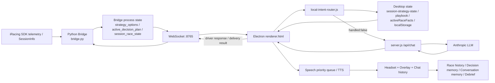

# PITWALL 第三者アーキテクチャ監査・修復プログラム

最終更新: 2026-10-08 JST（WO-013定義slice独立APPROVE / DONE）\
監査基準commit: `ff180b8` (`main` / `origin/main`)\
対象: `/Users/yuji.s/Desktop/Claude/english-voice-app`\
状態: **WO-001〜012定義slice DONE・WO-013実装中/独立REVISE、Claude次解除17:20 JST。全製品完成・release承認ではない**

## 0. この文書の権威と境界

この文書は、2026-09-23時点のPITWALLに対する第三者監査結果、依存順の修復工程、Claude Codeへ渡す作業指示を一つにまとめた正本である。

- 現行コード、テスト、設定、Git履歴を一次証拠とする。
- `HANDOFF.md`と過去のMarkdownは、現状説明と移行漏れを探すための証拠であり、コードと矛盾する場合は現行仕様として扱わない。
- この文書を作成する工程では、製品コード、設定、Build、公開物を変更しない。
- 実装担当はClaude Code、開発管理と独立確認はCodex、実走確認と製品判断はYujiが担当する。
- 作業指示書は一度に一件だけ`APPROVED FOR HANDOFF`にする。実装はさらにYujiの開始GOを必要とし、後続指示書を並行実装しない。
- 修復の完成条件はテスト件数ではなく、Driverの相談が入力から実行結果と次回記憶まで一つの経路で成立することとする。

## 1. Architecture Map

現行製品の実経路は、単一のAI会話サービスではなく、Bridge、Electron Renderer、クラウドServerに責務と状態が分散している。



実際の責務境界は次の状態である。

| 領域 | 現在の主な実装 | 実態 |
|---|---|---|
| Telemetry取得 | `irsdk-bridge/bridge.py` | Bridgeが権威だが、raw flagsやpenaltyが下流へ届かない |
| Strategy計算 | Bridge各module + Desktop `strategy-playbook.js` | 一部統合済みだが、BridgeとDesktopに判断・表示状態が分散 |
| Plan合意 | Bridge pending/active + Desktop `session-strategy-state.js` | 配送、会話合意、active化が複数状態を跨ぐ |
| Intent | `desktop/local-intent-router.js` + LLM | 正規表現の順序によりDriverの行動宣言を相談として扱う場合がある |
| Context生成 | `desktop/renderer.html` | 多数のlive/localStorage状態から都度構成。canonical lifecycleは存在しない |
| LLM | `server.js` | 会話生成。ストリーム整形が機械タグを欠落させ得る |
| 音声 | Renderer priority queue + Google/Web Speech | queue投入、再生開始、完了、中断が別概念だが状態契約が不十分 |
| Memory/Debrief | 複数Desktop module/localStorage + server decision store | race identityとPlan outcomeの結合が一貫していない |

## 2. Data Flow

### 2.1 Driver質問から回答まで

```text
PTT / text
  -> renderer.sendMsg()
  -> Local Intent Router
       -> deterministic answer -> speech queue
       -> handled:false -> renderer.callAPI()
            -> server.js /api/chat
            -> LLM stream
            -> renderer stream parser / truth gate / judge parser
            -> speech queue
  -> TTS playback
  -> Overlay / chat / memory
```

`renderer.html`は`isBusy`中の入力を受けず、PTT開始時には`ptt_abort`を送る経路を持つ（`renderer.html:2572`, `8803-8807`）。したがって「Driverが割り込んで戦略を変更する」は会話要件である一方、現在は入力破棄または処理中断として扱われる可能性がある。

### 2.2 Telemetryから戦略発話まで

```text
iRacing variables / SessionInfo
  -> bridge.py poll loop
  -> fuel / laps / gap / strategy_options / race lifecycle計算
  -> Bridge process state
  -> WebSocket event / telemetry payload
  -> renderer.lastTelemetry / activeRaceFacts / activeStrategyPlaybook
  -> local intent or proactive strategy proposal
  -> delivery precheck
  -> speech queue
  -> delivery report / Driver response
  -> Bridge active decision
  -> target lap BOX call
```

この経路の最大の欠陥は、実ピットとpenaltyがactive Planの状態遷移へ接続されず、古いPlanがtarget lapまで残る点である。現行BOX callは`active_decision_plan`、送信済みflag、race/on-track/non-pit、speech block、target lapだけを確認する（`bridge.py:7468-7492`）。

### 2.3 実ピットから採点まで

```text
OnPitRoad False -> True
  -> pit_enter_lap / fuel / position記録
OnPitRoad True -> False
  -> fuel_added / lane time / repair / exit position計算
  -> pit_event追加
  -> score_execution(strategy_options, actual facts)
  -> pit_timing broadcast / memory / summary
```

`pit_event`は現在`entry_lap`, `exit_lap`, position, `fuel_added_l`, lane/stall timeだけで、race identity、source frame、driver pit sequence、penalty evidenceを持たない（`bridge.py:5943-5952`）。さらに採点入力は合意時に凍結したPlanではなく、現在の可変`strategy_options`である（`bridge.py:5957-5960`）。

## 3. State Flow

| State | 作成 | 更新 | 参照 | 破棄・境界 | 問題 |
|---|---|---|---|---|---|
| `strategy_options` | Bridge strategy計算 | 再計算 | telemetry、Desktop、pit score | session reset | 推薦と実行結果採点の双方に使われる |
| `active_decision_plan` | BridgeのA確定またはB/C合意 | Driver合意 | BOX call、pit outcome | session reset中心 | 実ピット・penalty・Driver早期pitでterminal化されない |
| `pending_strategy_proposal` | Bridge proposal | delivery/response | Bridge/Desktop往復 | ack/失敗処理 | reconnect snapshotに十分含まれない |
| `_session_race_state.active_plan` | Bridge | calculation/decision系 | speech block、summary等 | session reset | `active_decision_plan`との責務が重複 |
| `_strategyStateBox` | Desktop | proposal合意・取消 | local intent、judge | Desktop session key変更 | Bridge正本と別のPlan状態を持つ |
| `activeStrategyPlaybook` | Desktop | telemetry/live更新 | local intent、自発提案 | session変更 | Bridge推薦と別更新周期 |
| `activeRaceFacts` | Desktop | radio/event中心 | LLM note/context | session変更 | telemetryの全更新を正本として取り込まない |
| speech tracking/outbox | Desktop | queued/spoken/interrupted/ack | retry/dedupe | terminal ack | `spoken`が再生完了を意味しない |
| conversation/race/decision memory | Desktop localStorage + server | turn/outcome/import | context/debrief | 複数の独自key | race instanceを含まないkeyがあり別レース混入の危険 |

必要な状態モデルは「計算推薦」「Driverと合意したPlan」「配送試行」「Driver応答」「実ピット事実」「判断履歴」を別オブジェクトにしつつ、Planの所有権だけはBridgeのrace-scoped lifecycleへ一元化する構造である。2026-09-22の`7 in 1`資料はこの方向を設計しているが、現行HEADでは`PlanLifecycleRecord`, `DriverPitEvent`, `AuthorityProof`, `PlanValidityContract`はMarkdownにしか存在しない。

## 4. Critical Findings

| ID | Severity | Confidence | 問題 | 主証拠 |
|---|---|---|---|---|
| F01 | Critical | Confirmed | 実ピット、早期pit、取消、penaltyがactive Planをterminal化せず、後から旧BOX callを出せる | `bridge.py:5718-5952`, `7468-7492` |
| F02 | Critical | Confirmed | LLMによる提案合意タグがserver stream終端で破棄され、自然会話による合意がBridgeへ届かない | `server.js:1289-1299`, `renderer.html:5177-5214` |
| F03 | Critical | Confirmed | black flag/penalty authorityが未実装。`SessionFlags`は`0xC000`の黄旗用途のみ | `bridge.py:5739-5740`, `5914-5915`, `6144-6158` |
| F04 | Critical | Strong Evidence | BridgeとDesktopに複数のPlan/strategy stateがあり、所有権と更新順が分裂 | `bridge.py:3205-3247`, `renderer.html:1519-1520`, `4950-4959`, `7498-7499` |
| F05 | High | Confirmed | reconnectが現在のPlan lifecycleを完全復元せず、broadcast成功も実配送ではなくenqueue成功を示す | Bridge websocket/broadcast経路、delivery outbox経路 |
| F06 | High | Confirmed | 「ピット入るぞ」がstrategy相談側へ吸収され、Driverの実行宣言としてactive Planを変えない | `local-intent-router.js` strategy routeとpit declarationの優先順位 |
| F07 | High | Confirmed | pit outcomeを可変`strategy_options`へ採点し、合意済みfrozen decisionと結果がずれ得る | `bridge.py:5957-5971` |
| F08 | High | Confirmed | LLM Contextにraw flag、penalty、Plan phase/revision、pit sequence、authority proofが無い | `renderer.html` context構築とBridge payload |
| F09 | High | Confirmed | `isBusy`中のDriver入力が捨てられ、Driver割込みによるPlan変更が成立しにくい | `renderer.html:2572`, `4092`, `8803-8807` |
| F10 | High | Strong Evidence | memory/session keyがrace instanceを常に含まず、別レースの会話・判断を混ぜ得る | `renderer.html:1092-1116`, `6346`, `7274` |
| F11 | High | Strong Evidence | 発話履歴・表示・合意状態が音声再生完了より前に確定される経路がある | `renderer.html` speech finalizer / memory checkpoint |
| F12 | Medium | Confirmed | debriefがincidents存在だけで接触質問を優先し、戦略失敗・penalty・Driver訂正を選べない | `desktop/pddp.js` selection ordering |
| F13 | Medium | Confirmed | root README等の現行architecture正本が無く、巨大な追記型HANDOFF/shared logが新旧競合を起こしている | `HANDOFF.md` 1,693行、shared log 21,847行、root標準設計文書欠落 |
| F14 | Medium | Confirmed | Desktop dev Bridge path、Bridge終了後の再起動、permission handlerに運用上の欠陥がある | `desktop/main.js` |
| F15 | High | Confirmed | raw SessionFlags、Plan遷移、source frame、queue滞留、最終発話本文のtraceが不足 | Bridge/Renderer logging |
| F16 | High | Confirmed | 個別テストは緑だが、Server streamを含む実入力→音声→Plan遷移のE2Eが無い | 2026-09-23 baseline testとF02再現 |
| F17 | Critical | Confirmed | 直近8 commitの主要PlanLifecycle修復はMarkdown設計のみで、製品コードへ未実装 | `git show ff180b8`, `rg PlanLifecycleRecord` |

## 5. Disconnected / Broken Wiring

1. `OnPitRoad`で作るpit factからactive Planの`executed/invalidated/cancelled`への遷移が無い。
2. Driverの「予定より早く入る」「今入る」「やめる」とBridge active Planの遷移が直接接続されていない。
3. `SessionFlags & 0x00010000`、raw flag、penalty state、Plan hold/invalidate、LLM context、debriefが未接続。
4. `<<PW_JUDGE ...>>`はRendererで要求・解析するが、Serverが句読点のないfinal tailを捨てるため製品streamで消える。
5. pit eventは給油量を持つが、race identity、source frame、pit sequence、penalty evidenceを持たない。
6. reconnect後にPlan record、active pointer、pending proposal、delivery attempts、proofを一貫して復元できない。
7. `broadcast()`の`DISPATCHED`はWebSocket/TTS/聴取完了の証拠ではない。
8. calculation resultの一部はBridge state、Desktop playbook、`activeRaceFacts`で別更新され、同じframeの事実として揃わない。
9. pit scoreは現在の推薦を読み、実行した合意Planへ確実に結合しない。
10. debriefはPlan失効、Driver訂正、penalty結果を入力として消費しない。

## 6. Legacy / Duplicate Architecture

初回監査の所見に対する現状（WO021終了、2026-10-19。機械/source確認と実機/出荷を区別）：

- 旧 `irsdk-bridge/bridge.js` は現行起動/package consumer0を確認してWO021で削除。CIで再追加・起動参照をREDにする。現行entryはPython Bridge。
- Bridgeのstrategy_options/active_decision_plan/pending等とDesktopの旧state名には現consumerがあり、WO005/011のLifecycle read-only compatibility projectionとして保持。名前の残存を別ownerが復活した証拠や死コードと決めつけない。
- `renderer.html` の巨大scriptは残る。WO021で全面分割はしておらず、今回の変更はBuild情報readerの共有まで。
- root package名 `english-voice-app` とpackage semver/installer versionはdeploy/Store metadata。製品Build番号とは別概念であり、今回は変更していない。URL/repositoryの同名も現consumerがあるため維持。
- HANDOFFは旧履歴をSHA付き開始archiveへ保全して現行要点へ集約、TEAM_STATEは歴史資料と注記。過去Build別reviewは歴史証拠であり現在の起動指示ではない。
- Lifecycle/音声/記憶の契約はWO001–020の製品経路と機械E2Eへ接続済み、WO021でBuild表示/CIのdriftを整備。これを実LLM意味・Windows/iRacing・出荷品質の合格とは呼ばない。

## 7. State Management Issues

### 7.1 必須の単一所有権

Bridgeは次の唯一のownerになる。

- authoritative race snapshot
- race identity / session identity / source frame
- Plan lifecycle recordとactive pointer
- Driver pit sequenceとimmutable pit event
- black flag/penalty hold
- box authority proof
- delivery attemptとDriver responseの適用結果

Desktopは次のみに限定する。

- Bridge lifecycleのread-only projection
- UI表示
- 音声配送とその結果通知
- Driver inputの構造化event化
- 会話履歴と長期memory。ただしrace truthを上書きしない

### 7.2 必須Plan phase

```text
proposed
  -> awaiting_driver
  -> active
  -> held
  -> active
  -> executed | invalidated | cancelled
  -> closed
```

`executed`, `invalidated`, `cancelled`, `closed`はterminalであり、同じrecordからBOX callを再発行しない。条件変更による新提案は新decision IDを持つ。

### 7.3 失効イベント

- actual pit entry/exit
- Driver early-pit declaration
- Driver cancel/amend
- black flag/penalty
- race/session identity change
- expected pit sequence mismatch
- B/C validity boundary failure
- target lap elapsed without valid execution
- finish/checkered/session end

## 8. LLM Context Audit

| 分類 | 現在渡るもの | 欠落・問題 |
|---|---|---|
| Race facts | fuel、lap、position、gaps、race format、fuel strategyの一部 | source frame、fact age、raw flags、black flag、penalty、pit sequence |
| Strategy | `strategy_options`, Desktop playbook、proposal note | canonical active lifecycle、phase、revision、invalidated reason、current authority proof |
| Driver agreement | Desktop pending proposal、会話history | Bridgeで適用済みか、ack済みか、古いresponseかのcanonical view |
| Pit history | last pit、fuel added、lane time等 | immutable DriverPitEvent identity、normal/early/penalty relation |
| Memory | conversation/race/decision/self memory | race-instance境界、訂正前後とoutcomeの一意な結合 |
| Output constraints | short race reply、truth instructions | 「現在のPlanを説明する唯一の構造化context」が無い |

本来LLMに渡すべき最小contextは次である。

```json
{
  "race_identity": {},
  "source_frame": {},
  "freshness": {},
  "current_facts": {},
  "penalty_state": {},
  "active_plan": {},
  "pending_proposal": {},
  "last_driver_action": {},
  "last_pit_event": {},
  "allowed_actions": [],
  "unknowns": [],
  "relevant_memory": []
}
```

LLMはこのcontextを説明と相談に使うが、fuel/lap/gap/penalty/Plan phaseを創作または更新しない。

## 9. Observability Problems

- raw `SessionFlags`とbit遷移が保存されず、実走後にblack flagの立上がりを再現できない。
- Plan transitionを`decision_id/revision/event/source_frame/race_instance`で一列に追えるtraceが無い。
- `pit_event`にidentityとpenalty evidenceが無い。
- queueに入った、再生を開始した、最後まで聞こえた、Driverが応答した、Bridgeが適用した、の時刻が一つのtrace IDで結合されない。
- fallback/defaultがunknownをfalse/normalへ見せる箇所がある。
- broad `catch`やsilent catchが多数あり、失敗が正常fallbackに見える。
- Desktop CIはBridgeを同梱するのにBridge runtime import全体を検査しない。
- Bridge CIとDesktop CIの対象範囲が実artifact構成と一致しない。
- green unit testsは個別helperを証明するが、Server stream、実queue、reconnect、pit sequenceを含む縦断経路を証明しない。

### 9.1 2026-09-23 baseline

外部有料APIを呼ばず、現行HEADで次を再実行した。

| command | result |
|---|---|
| `node tests-proposal-agreement-bridge.js` | 134/134 |
| `node tests-bridge-strategy-proposal-roundtrip.js` | 85/85 |
| `node tests-local-intent-router.js` | 54/54 |
| `python3 irsdk-bridge/tests_bridge_strategy_options_recalc_sync.py` | 62/62 |

この全緑とBuild 302実走不合格が同時に成立するため、現在の問題は単純なテスト不足ではなく、製品境界を跨ぐ受け入れテストの欠落である。

## 10. Root Cause Hypothesis

### RC1: 状態の所有権が未確定のまま機能を追加した

Bridge、Desktop、memory、speech deliveryがそれぞれPlanの一部を持つため、局所テストは通っても全体状態が一致しない。F01、F04、F05、F07の共通原因である。

### RC2: 「関数・保存先・テストの存在」を接続完了と誤認した

入力から出力までの逆向きtraceが不足し、未接続helperや擬似的なテストが完成扱いされた。F02、F06、F12、F16に現れている。

### RC3: 会話品質問題をLLM prompt側へ寄せすぎた

LLMに正しいPlan phase、penalty、pit factsが届いていないため、モデル変更やprompt追記では根本解決しない。F02、F03、F08が根拠である。

### RC4: 失敗をfail-closedにする共通契約がない

unknown、stale、disconnected、queue failure、reconnectを各moduleが別に処理し、fallbackが障害を隠す。F05、F09、F11、F15が根拠である。

### RC5: 設計レビューがコード統合より先行し続けた

直近commitは詳細なPlanLifecycle設計をshared logへ追加したが、製品moduleは存在しない。レビュー文書の精緻化が実行可能な小さな縦断sliceへ変換されていない。F17が直接証拠である。

## 11. Severity Summary

| Severity | Finding |
|---|---|
| Critical | F01, F02, F03, F04, F17 |
| High | F05, F06, F07, F08, F09, F10, F11, F15, F16 |
| Medium | F12, F13, F14 |
| Low | 現時点では単独Lowを優先登録しない。中核修復後に整理する |

## 12. Confidence Summary

| Confidence | Finding |
|---|---|
| Confirmed | F01, F02, F03, F05, F06, F07, F08, F09, F12-F17 |
| Strong Evidence | F04, F10, F11 |
| Suspected | series固有rule completeness、実機音声完了時刻の全挙動 |
| Unknown | iRacingが各series/車両で提供する全penalty/tyre/energy信号の網羅性 |

## 13. Recommended Repair Order

### 修復Gate

```text
R0 監査と赤いシナリオ固定
  -> R1 Authoritative Race Facts
  -> R2 Bridge PlanLifecycle単一owner
  -> R3 Pit / Driver command / Penalty transitions
  -> R4 Snapshot / reconnect / delivery projection
  -> R5 Intent / Context / LLM agreement
  -> R6 Speech / Memory / Debrief lifecycle
  -> R7 Full replay / observability / field candidate
  -> R8 Legacy / config / docs cleanup
```

後続Gateは前Gateの受け入れ条件を満たすまで開始しない。

### 作業指示書一覧

| WO | Gate | 内容 | 依存 |
|---|---|---|---|
| 001 | R0 | Road Atlanta赤シナリオの製品経路fixtureとtrace契約 | 監査 |
| 002 | R1 | raw SessionFlags、black flag、source frame、race identity、driver pit sequenceのauthoritative snapshot | 001 |
| 003 | R1 | immutable `DriverPitEvent`生成とnormal/early/penalty/unresolved分類 | 002 |
| 004 | R2 | pure `PlanLifecycleRecord` state machineとterminal規則 | 002-003 |
| 005 | R2 | Bridge既存strategy stateをLifecycle ownerへ移行 | 004 |
| 006 | R3 | Driver early pit/amend/cancelをLifecycle eventへ接続 | 005 |
| 007 | R3 | actual pit/penalty/session-endをLifecycleへ接続し旧BOX callを遮断 | 003,005-006 |
| 008 | R3 | fresh box-call authority、immutable `AuthorityProof`、Driver amend target constraintの権威consumer | 005-007 |
| 009 | R4 | Bridge telemetryをcanonical lifecycle snapshotへ統合 | 005-008 |
| 010 | R4 | reconnect snapshot、attempt replay、ack/timeout/idempotency | 009 |
| 011 | R4 | Desktop strategy stateをread-only projection化 | 009-010 |
| 012 | R5 | Intent優先順位と実走表現（早期pit、window、penalty） | 006,011 |
| 013 | R5 | LLM judgeをstream本文tailから構造化transportへ移行 | 010-011 |
| 014 | R5 | canonical LLM race context builder | 009,011-013 |
| 015 | R6 | speech queued/started/audible/completed/interrupted契約 | 010,013 |
| 016 | R6 | PTT interruptionとDriver緊急入力の非破棄化 | 015 |
| 017 | R6 | race-instanceを使うconversation/decision memory境界 | 009,014 |
| 018 | R6 | Plan outcome、penalty、訂正をdebriefへ接続 | 007-008,017 |
| 019 | R7 | Road Atlanta fixtureを全てgreenにする製品E2E replay | 001-018 |
| 020 | R7 | trace、queue metrics、CI/artifact coverage | 019 |
| 021 | R8 | legacy route、設定差、Build番号、stale docs整理 | 019-020 |

最初の実用縦断sliceはWO-001〜010とWO-012〜015のうち必要最小限で構成し、Road Atlantaシナリオを成立させる。全21件を先に一括実装しない。

## 14. Acceptance Scenario: Road Atlanta Red Thread

```text
1. Plan A: lap 21 pitを作成・active化
2. Driver: 「ピットウィンド湧いてる？」
3. Driver: 「ピット入るぞ。前の25が遅いから先に入る」
4. Bridge: Driver行動をearly pit changeとして受理し、旧Plan Aを取消/失効
5. Actual pit: lap 15、fuel delta 16.79Lを一意なDriverPitEventとして確定
6. Penalty pit: lap 16、fuel delta 0L、black flag evidenceでpenalty分類
7. Old Plan A: terminalのためlap 21でBOX callを出さない
8. Fresh calculation: 現燃料、残周回、必要燃料、trafficから再計算
9. Luna: 旧指示が失効した理由、現在の余裕、次の行動を短く説明
10. Reconnectしても同じPlan terminal状態を保持
11. Debriefにearly pit、penalty、旧Plan失効、再計算結果を残す
```

必須不変条件:

- 同じrace instance内で全eventを同じidentityへ結合できる。
- actual pitまたはpenalty後、旧PlanからBOX callは0件。
- black flag unknownを`false`として扱わない。
- LLMへ渡す数字は同じsource frameまたは明示された鮮度を持つ。
- 音声で聞こえなかった提案をDriver合意可能状態にしない。
- reconnect、重複event、遅延ackでterminal Planを復活させない。
- replayの最後にPlan、speech、memory、debriefを同じdecision/pit identityで逆追跡できる。

---

# WO-001 — Road Atlanta Red-Thread Fixture / Trace Contract

状態: **DONE — Claude Code実装、Codexの3回の独立差戻しと最終再確認を通過。製品欠陥は意図的acceptance赤として固定**\
想定担当: Claude Code\
独立確認: Codex\
対象Gate: R0\
実装前確認: 2026-09-23、開発Codex task `01a0cbcb-3aa3-7443-b6e1-834117fbe8bc`、初回`REVISE`後のRevision 1を`APPROVE`
実装後確認: 2026-09-23、`REVISE 3`の最終3件修正後、characterization JS 25/25・Python 25/25、意図的acceptance赤、既存134/85/54/62/19、構文、`git diff --check`をCodexが独立再現。製品runtime差分0で`DONE`

## 1. 目的

Build 302で発生した一本の失敗を、現在の製品関数・routing・stream・stateを通して繰り返し再生できるfixtureにする。現在の欠陥をcharacterization modeで再現し、最終受け入れ条件をacceptance modeで赤として固定する。このWOでは製品挙動を修正しない。

## 2. 現在の不具合

- 個別テスト134/85/54/62件は緑だが、実走では旧Plan Aが早期pit後も残りlap 21で誤BOX callした。
- proposal agreementテストは完成済みタグを直接parserへ渡し、`server.js`のstream truncationを通らない。
- pit/recalculationテストはactual pit、black flag、Plan terminal、reconnect、speech、debriefを一本で通さない。
- 元実走ログ`OMORAY-bridge-debug-20260922-0934.log`はリポジトリ内にないため、原本再生と合成再構築を混同してはならない。

## 3. 根本原因

テストがmodule単位に分かれ、入力からPlan状態、音声、Driver応答、実ピット、再計算、debriefまでを同じidentityで検査していない。さらにテスト自身が本番関数を迂回した過去があり、「helperがある」「件数が緑」を完成証拠にできない。

## 4. In Scope

1. Road Atlanta失敗を表す一つのfixtureを作る。
2. fixtureの出所をevent単位ではなくpayload field単位で明示する。
   - リポジトリに存在する一次証拠で確認済みの値
   - HANDOFFにだけ残る値
   - 再現のために合成した値
3. 最低限、次の順序を含める。
   - Plan A: target lap 21
   - Driver「ピットウィンド湧いてる？」
   - Driver「ピット入るぞ」「前#25が遅いから先に」
   - lap 15 pit、fuel delta 16.79L
   - lap 16 penalty pit、fuel delta 0L、black flag evidence
   - lap 21 fuel 18.14L、required 9.98L、margin 8.16L
   - 旧BOX callが0件であるべき最終条件
4. characterization modeで現在の実挙動を再現し、既知欠陥IDを出力する。
5. acceptance modeで目標挙動をassertし、現在はF01/F03/F06等の理由で赤になることを確認する。
6. Server streamの`PW_JUDGE`欠落を、現行stream整形とrenderer parserを通す形でfixtureへ含める。
7. 入口から出口まで同じtrace identityを要求するschemaを定義する。ただしfixtureが付けるharness相関IDと、製品が実際に出力するidentityを別fieldにする。
8. 本番関数を呼ばずに期待結果を再実装するfake helperを禁止する。
9. Bridgeはinput reader、monotonic clock、外部I/Oだけをtest doubleへ置換し、`poll_iracing()`の本番経路を進める。pit生成やBOX条件をtest側へ複製しない。
10. Plan Aは本番のPlan生成・active化経路で成立させる。fixtureやadapterから`active_decision_plan`を直接注入しない。
11. WO-001で実行する縦断範囲は、router、Server stream整形、Renderer judge parser、Bridge pollによるpit処理、BOX `broadcast`捕捉までとする。reconnect、実TTS、memory、debriefは同じtrace contract上の後続eventと期待値だけを固定し、このWOで動作済みとは判定しない。

## 5. Out of Scope

- 製品ロジックの修正
- `PlanLifecycleRecord`、black flag authority、`DriverPitEvent`の実装
- active Planの失効やBOX call条件の変更
- Intent、LLM transport、speech、memory、debriefの修正
- Build、公開、外部有料API呼出
- F1/WEC/INDY等のseries固有rule pack

## 6. 変更候補

- 新しいfixture data 1件
- replay/acceptance test 1系統
- input reader、時計、SDK/LLM応答、WebSocket/broadcast等の外部境界だけを置換するtest-only adapter
- test commandの説明

test-only adapterは製品判断、pit event生成、Plan active化、BOX eligibilityを再実装してはならない。Bridgeの巨大poll loopがテスト不能ならWO-001を無理に通すためのコピーを作らず、`BLOCK`として監査Codexへ返す。

`bridge.py`、Desktop runtime、`server.js`、設定、Build番号、公開ページは変更しない。意図的に赤いacceptance modeを通常`preflight.sh`へ登録してmainを常時赤にしない。登録方法は後続WO-019で最終化する。

## 7. Data Contract

```json
{
  "scenario_id": "road_atlanta_build302_red_thread_v1",
  "event_id": "stable-id",
  "harness_correlation_id": "fixture-race-a/event-001",
  "product_identity": {
    "race_instance_id": null,
    "decision_id": null,
    "pit_event_id": null
  },
  "session_num": 0,
  "source_frame_id": 1,
  "at": 0.0,
  "type": "telemetry|driver_utterance|pit_entry|pit_exit|flag|delivery|speech|debrief",
  "payload": {},
  "provenance": {
    "payload.field_name": {
      "source_class": "repository_evidence|handoff_only|synthetic_reconstruction",
      "reference": "file:line or document section",
      "note": "why this classification applies"
    }
  }
}
```

契約:

- 全eventはstable `scenario_id/event_id`を持つ。
- リポジトリに元実走ログが無いため、本fixture全体を「原本ログreplay」または`verified_log_fact`と呼ばない。
- lap、fuel delta等のHANDOFF記録値は`handoff_only`、追加するraw black flag値・時刻・frame IDは`synthetic_reconstruction`とfieldごとに記録する。
- event順序は固定するが、製品が作る内部stateをfixture側で直接書き換えない。
- acceptance traceは`source -> authority -> state -> decision -> output -> outcome -> reset`を記録する。
- unknownはunknownとして保持し、false/0へ偽装しない。
- harness相関IDを製品identityとして後付けしない。製品出力にidentityが無ければ`product_identity`はnullのままにし、欠落をassertする。

二つのmodeは同じ入力と同じ観測結果を使う。

- `characterization`: 現行HEADで確認した既知挙動との一致を判定する。既知欠陥を正しく再現すればcommandは成功する。
- `acceptance`: 同じ観測結果を最終不変条件に照らし、findingごとに独立して赤/緑を出す。
- fixture読込失敗、製品経路未到達、例外、timeout、必要なinstrumentation欠落はfinding再現ではなく`HARNESS_ERROR`とし、characterizationも失敗させる。

## 8. 必須テスト

1. 現行`ピット入るぞ`が`strategy_recommendation`へ誤分類されることを、実routerへ実strategy API/playbook依存を渡してcharacterization modeで再現。router結果やstrategy応答をstubで作らない。
2. 現行`ピットウィンド湧いてる？`が期待routeへ入らないことを再現。
3. fake SDK reader、fake clock、捕捉I/Oで本番`poll_iracing()`を進め、本番経路がPlan Aを作成・active化したことを確認する。
4. 同じpoll経路へlap 15/16 pit inputsを渡し、pit eventが作られてもactive decisionがterminal化されないことを再現する。
5. lap 21まで進め、同じdecision IDから発生した実`broadcast`のBOX call件数を検査する。「条件が成立可能」だけでは合格にしない。
6. SDK/LLM応答だけをmockし、Serverの実stream整形出力をRenderer judge parserへ渡す。完成文後の末尾に区切り文字のない`PW_JUDGE`欠落を再現し、末尾改行ありとchunk分割ありを対照ケースにする。
7. black flag既知trueを製品が権威化できないことと、black flag unknownをfalseにしてはならないことを別assertにする。
8. acceptance modeではF01/F02/F03/F06を独立判定し、複数findingを一つの総合booleanへ潰さない。
9. fixture loaderのevent order、identity重複、型、field-level provenanceを検査。
10. router、Server stream、Renderer parser、Bridge poll input、pit event、BOX broadcastの各重要接続について、接続を一つ外すmutationまたは専用reachability probeでcharacterizationを成功から失敗へ変える。もともと赤いacceptanceが赤のままでもmutation合格にしない。
11. 未到達、例外、timeoutが`HARNESS_ERROR`となりfinding再現に数えられないことを検査。
12. 既存134/85/54/62件の回帰。
13. `git diff --check`。

## 9. 必須ログ

replay出力には最低限次を持たせる。

```text
SCENARIO_TRACE scenario_id=<id> event_id=<id> type=<type>
source=<repository_evidence|handoff_only|synthetic_reconstruction>
harness_correlation_id=<id>
product_race_id=<id|null> product_decision_id=<id|null> product_pit_event_id=<id|null>
reachability=<reached|not_reached> harness_status=<ok|HARNESS_ERROR>
finding=<F01|F02|F03|F06|none>
expected=<target behavior> actual=<current behavior>
```

## 10. Acceptance Criteria

- characterization modeが既知の現行挙動を安定して再現し、commandとして成功する。
- acceptance modeが、現在未修復の正確な条件だけで赤になる。
- characterizationとacceptanceが同じ観測結果を評価し、`HARNESS_ERROR`をfindingへ誤分類しない。
- replayが現行のrouter、Server stream整形、Renderer parser、Bridge `poll_iracing()`、pit event、BOX `broadcast`を実際に通る。
- fixture内のリポジトリ証拠・HANDOFF由来・合成値がpayload fieldごとに区別される。
- harness相関IDと製品identityが分離され、製品identity欠落をadapterが補完しない。
- Plan Aは本番経路で生成・active化され、testからactive stateを直接注入しない。
- 旧Plan抑止、black flag authority、Driver command、judge transportの最終期待値が一つのscenarioに固定される。
- reconnect、実TTS、memory、debriefは未実行範囲と表示され、契約定義を動作確認済みと報告しない。
- 製品runtime挙動を変更していない。
- 外部有料API呼出0。
- ソース差分、テスト結果、未検証事項をshared working logへ回覧する。
- Codexがコード差分とmutationを独立再確認するまでWO-001を`DONE`にしない。

## 11. Claude Codeへの実行指示

このWOが`APPROVED FOR HANDOFF`となり、さらにYujiが実装開始GOを出すまで実装を開始しない。開始後はこのWOだけを実装し、WO-002以降へ進まない。fixture内で製品判断ロジックを再実装して緑にせず、test-only adapterは外部入力・時計・外部I/Oの置換に限定する。本番poll経路を安全に進められない場合は製品コードを直さず`BLOCK`として返す。完了時は次を報告する。

```text
- commit/SHAまたは未commit状態
- 変更ファイルと関数
- fixture provenanceとtrace contract
- characterization/acceptance双方の結果
- 実行した全テストと結果
- mutationで赤になることを確認した箇所
- 未実行・実機のみの項目
- 不安点と次の独立確認者
```

実装完了報告を`review/PITWALL_SHARED_WORKING_LOG.md`へ追加した場合、チャット報告に必ず次を含める。

`次のMDに指示書あり`

## 12. Codex独立確認チェックリスト

- [ ] fixture provenanceがpayload fieldごとにリポジトリ証拠/HANDOFF/合成を区別する
- [ ] harness相関IDと製品identityを分離し、欠落を後付けで隠さない
- [ ] router実関数へ実strategy API/playbook依存を渡してfield phraseを再現する
- [ ] Server stream実装とRenderer parserを同じprobeで通し、末尾条件の対照ケースを持つ
- [ ] Bridgeのinput/clock/I/Oだけを置換して本番poll経路を進める
- [ ] Plan Aを本番経路で生成し、active stateを直接注入しない
- [ ] actual pitから同じdecision IDのBOX broadcast件数までを観測する
- [ ] current behaviorを目標挙動として固定していない
- [ ] acceptance failureがF01/F02/F03/F06へ対応する
- [ ] `HARNESS_ERROR`とfinding再現を分離する
- [ ] mutation/reachability確認が各重要製品接続の切断を検出する
- [ ] reconnect/TTS/memory/debriefの未実行範囲を明示する
- [ ] runtime product codeに変更がない
- [ ] paid API call 0
- [ ] diffに無関係変更がない

---

# WO-002 — Authoritative Race Facts Snapshot

状態: **DONE — Claude Code実装、Codex `REVISE 1`の2件修正後に独立再確認合格。F03のみ修復し、F01/F02/F06は意図どおり赤**\
想定担当: Claude Code\
独立確認: Codex\
対象Gate: R1\
依存: WO-001 `DONE`

## 1. 目的

iRacingの同一telemetry frameから、race identity、session identity、raw `SessionFlags`、black-flagの三値状態、source frame、Driverのpit visit順序を一つの読取専用snapshotとしてBridge内で権威化する。このWOは「生の事実が同じ観測時点とidentityを持って届く」ところまでとし、Plan lifecycle、pit分類、Driver command、LLM context、speechはまだ変更しない。

## 2. 現行コードで確定した破損

1. `bridge.py`のpit退出経路は`_flags = reader.read_int('SessionFlags') or 0`とし、SDK変数未取得`None`と実値`0`を同じ緑旗へ潰す。
2. その値から作るのは`caution_state`だけで、black flag bit `0x00010000`を権威化する製品経路がない。
3. `_pit_sample`にraw flags、観測`SessionTime`、source frame、race identity、pit sequenceが無い。`pit_timing`broadcastから元frameへ逆引きできない。
4. `resolve_race_instance_id()`はあるがpit factに渡されない。`pit_events`はidentityの無いmutable listである。
5. `SessionFlags`はyellow/style/pit-loss/pit-exitで個別に読まれ、同一frameの共通snapshotではない。consumerごとにunknown変換と時点が分岐する。
6. WO-001 acceptanceはF03をknown true、unavailable/unknown、later known falseの3反証として固定済みで、現行は3件とも赤である。

## 3. Tunnel Completion Matrix

| 段 | WO-002で接続する内容 | このWOでまだ行わない内容 |
|---|---|---|
| source / capture | `poll_iracing()`が毎frame読む`SessionNum`, `SessionTime`, `SessionFlags`、SessionInfo由来race identity、`OnPitRoad` transition | Desktop/LLM入力 |
| authority / validation | `SessionFlags=None`をunknownのまま保持。black flagはraw bit以外から推測しない | penalty種別の推測 |
| state | Bridge poll ownerが最新snapshotとpit sequence counterを所有 | Desktop側正本、DB永続化 |
| retrieval / identity | `race_instance_id + session_num + source_frame_sequence + driver_pit_sequence` | `DriverPitEvent` ID（WO-003） |
| decision / consumer | pit exitでsnapshotをcopyし`pit_timing.sample.black_flag_evidence`へ投影 | Strategy/Planの状態遷移 |
| output | 既存`pit_timing`broadcastとtrace logへ根拠を搭載 | 無線発話、UI、LLM context |
| outcome / scoring | WO-001 F03 3反証をgreen化 | F01/F02/F06の修復 |
| correction / reset | reconnect、race/session change、out-of-order/duplicate frameの扱いを明示 | lifecycle terminal化 |
| proof | pure contract test + 実`poll_iracing()` replay + WO-001 acceptance/regression | Windows/iRacing実走 |

## 4. 権威snapshot契約

Bridge内に単一のbuilder/update contractを置き、最低限次を保持する。実装上のmodule名は`authoritative_race_facts.py`を第一候補とするが、既存のより適切な単一ownerがあれば変更可。ただし`bridge.py`内の複数辞書へ同じ真実を二重保管しない。

```json
{
  "race_instance_id": "sub:<id>|sid:<id>|fallback:<id>",
  "session_num": 0,
  "source_frame": {"sequence": 123, "session_time_s": 456.7},
  "session_flags": {"authority": "iRacing SessionFlags", "available": true, "raw_value": 65536},
  "black_flag": {
    "state": "true|false|unknown",
    "authority": "iRacing SessionFlags",
    "raw_value": 65536,
    "observed_session_time": 456.7,
    "source_frame_sequence": 123,
    "freshness": "fresh|unavailable"
  },
  "driver_pit_sequence": 2
}
```

契約:

- `SessionFlags` readは1poll iterationに1回だけ行い、snapshotから必要なconsumerへ渡す。全consumer置換が大きすぎる場合でも、少なくともWO-002で触るpit exit/F03経路はこの単一read以外を使わない。残存readは一覧化し、snapshotと競合しない根拠を回覧する。
- black flag bitは`0x00010000`。raw値が整数ならbit set=`true`、bit clear=`false`、raw値が`None`または無効なら`unknown`。fuel delta、stall時間、repair、cautionから補完しない。
- `raw_value=0`はknown false。`raw_value=null`はunknown。両者をtruthinessで分類しない。
- `observed_session_time`はraw readと同じpoll iterationの`SessionTime`。別frameの最新値を後付けしない。
- `source_frame.sequence`はBridge内で正常受理したpoll frameの単調増加連番。同じframeを使う投影は同じ連番を持つ。連番が逆行する更新で最新snapshotを上書きしない。
- `race_instance_id`は既存`resolve_race_instance_id(info, race_instance_fallback_id)`の戻り値を使い、同じsnapshot内で再計算しない。
- `driver_pit_sequence`は確定した`OnPitRoad true -> false` pit exitごとに1回だけincrementし、その退出frameのsnapshot/投影に新しい値を載せる。同一frameの重複処理で二重incrementしない。
- pit sequenceは`race_instance_id`または`session_num`が変わったら0へresetする。P/Q/R各sessionのpitを混ぜない。race identityは別fieldとして維持し、SessionNumをrace identityの代用にしない。
- reconnect時は前connectionのsource frame/freshnessを現在として再利用しない。新connectionの最初のreadまでflagsはunknown/unavailable。同じBridge process内でrace/session identityが不変なら`source_frame.sequence`と`driver_pit_sequence`は単調性を保ち、reconnectだけで0に戻さない。process restart後のpit sequence復元はWO-009/010の範囲であり、WO-002では永続済みと表示しない。
- snapshotは作成後にconsumerが変更しない。broadcastやpit sampleへはcopy/射影し、後書きで過去eventが変化しないようにする。

## 5. `pit_timing` への必須投影

pit exitで作る`_pit_sample`に少なくとも次を追加する。WO-001の確定済みacceptance contractと名前を合わせる。

```json
{
  "race_instance_id": "sub:...",
  "source_frame_sequence": 123,
  "driver_pit_sequence": 2,
  "black_flag_evidence": {
    "state": "true|false|unknown",
    "source_visit_fuel_added_l": 0.0,
    "freshness": "fresh|unavailable",
    "authority": "iRacing SessionFlags",
    "raw_value": 65536,
    "observed_session_time": 456.7,
    "source_frame_sequence": 123
  }
}
```

`source_visit_fuel_added_l`は同じpit sampleの`fuel_added_l`をcopyした相関fieldであり、black flag判定根拠にしない。`caution_state`は既存互換投影として残してよいが、unknown flagsを`green`と断定する新しい権威として使わない。

## 6. In Scope

1. authoritative snapshotの単一builder/update ownerとpure unit tests。
2. `poll_iracing()`の同一frame read、identity取得、source-frame sequence、pit-sequence updateへの本番配線。
3. session change、race identity change、reconnectのreset/invalidation。
4. pit exitの`pit_timing.sample`へのsource-bound evidence投影。
5. 権威snapshot更新とpit projectionの構造化log。
6. WO-001 F03 acceptance 3件のgreen化。F01/F02/F06は赤のままであることを個別確認。
7. 既存Bridge/strategy/router回帰、構文、`git diff --check`。

## 7. Out of Scope

- immutable `DriverPitEvent`とnormal/early/penalty/unresolved分類（WO-003）
- Plan terminal化、旧BOX call抑止（WO-004以降）
- Driverの「ピット入るぞ」IntentとPlan変更（WO-006/012）
- telemetry全体のcanonical lifecycle snapshot統合、reconnect復元（WO-009/010）
- LLM context、judge transport、speech、memory、debrief
- Build、公開、commit、push、有料API、Windows/iRacing実走

## 8. 必須反証テスト

1. raw `0x00010000` -> `black_flag.state=true`、同じraw value/SessionTime/frame sequence。
2. raw `0` -> `state=false`。
3. raw `None` -> `state=unknown`, `raw_value=None`, `freshness=unavailable`。
4. known trueの後のknown falseがtrueをcarry-overしない。
5. unknownの後に実readが復帰すれば新frameでknown stateに戻る。
6. pit exit 2回でsequence 1,2。重複処理で二重incrementしない。
7. SessionNum変更でpit sequence=0、flags=unknown/unavailableへreset。
8. race identity変更で前identityのsnapshot/pit sequenceを再利用しない。
9. reconnectの最初のread前に前flagsをfreshとして出さず、同一process/race/sessionのframe/pit sequenceを逆行・重複させない。
10. 過去のpit sampleが後続snapshot更新で書き換わらない。
11. 実`replay_harness.py -> poll_iracing()`でknown true/unknown/later falseが`pit_timing`broadcastまで届く。
12. mutationでsnapshot builderまたはpit projectionの配線を1本外すとgreen testが必ず赤になる。

## 9. Acceptance Criteria

- WO-001 Python acceptanceのF03 3テストがgreen。F01は依然赤で、F02/F06のJS acceptanceも依然赤。総合commandのexit 1だけを見てF03未完了を見逃さない。
- pit sampleのblack flag evidenceはrace/session/source-frame/pit-sequenceと逆引きできる。
- unknownはfalse/0/greenに縮退しない。
- 後続frame、別pit、別session、別raceの値が既存sampleへ混入しない。
- `SessionFlags`の残存直接readを列挙し、snapshotと競合する判定が残っていないか独立確認できる。
- 製品経路はbuilderを実際に呼び、test-only写経でgreenにしていない。
- 対象外のPlan/Intent/LLM/speech/memoryに修正がない。
- 外部有料API呼出0、Build/公開/commit/pushなし。
- Claude Codeの完了申告だけでは`DONE`にせず、Codexがdiff、本番配線、赤/緑の内訳を独立再現する。

## 10. Claude Codeへの実行指示

開発Codexの実装前レビューが`APPROVE`になるまで製品コードを変更しない。handoff後はWO-002だけを実装し、WO-003以降へ進まない。既存dirty working treeのWO-001成果を保存し、無関係差分を巻き込まない。

完了回覧には次を記録する。

```text
- 未commit状態と対象SHA
- 変更ファイル、関数/行範囲、配線内容
- authoritative snapshot schemaとowner
- SessionFlagsの全直接read一覧（変更/残存理由）
- reset/reconnect/duplicate/out-of-orderの実測結果
- WO-001 acceptanceのF01/F02/F03/F06個別結果
- 既存回帰、構文、diff check
- mutation/reachabilityで外れた配線を検出した結果
- 未実行と実機のみの項目
- 不安点とCodexに反証してほしい点
```

共有MDへ回覧したチャット報告には必ず次を含める。

`次のMDに指示書あり`

## 11. Codex独立確認チェックリスト

- [ ] snapshot ownerが一つで、本番`poll_iracing()`から到達する
- [ ] raw 0 / raw None / black bit setを三値で区別する
- [ ] raw flags、SessionTime、source frameが同じpoll iterationに由来する
- [ ] race identityが既存権威経路由来で、SessionNumと混同しない
- [ ] pit sequenceは退出ごと1回だけincrementし、race/session changeでresetする
- [ ] reconnect前のfresh stateを再利用しない
- [ ] pit sampleはcopyで固定され、後続更新で変化しない
- [ ] WO-001 F03 3件だけが目標どおりgreenになる
- [ ] F01/F02/F06を偶然greenにした対象外変更がない
- [ ] mutation/reachabilityがtest-only写経ではなく製品配線切断を検出する
- [ ] 既存回帰、構文、`git diff --check`が合格する
- [ ] 無関係変更、Build、公開、commit、push、有料API呼出がない

# WO-003 — Immutable DriverPitEvent / Execution Classification

状態: **DONE — Claude Code実装、Codex `REVISE 1` 3件・`REVISE 2` 1件の修正後、独立再確認合格。WO-004以降は未着手**\
依存: `WO-001 DONE`, `WO-002 DONE`\
目的: 一つの実ピット訪問を一度だけ確定される不変の`DriverPitEvent`に変換し、凍結Planと権威penalty証拠だけで`normal / early / penalty / unresolved`を分類する。

## 1. 現行証拠と欠陥

1. `bridge.py`は`OnPitRoad False -> True`で進入値を取り、`True -> False`で`_pit_event`を作るが、現行eventは`entry_lap / exit_lap / position / fuel_added_l / lane_total_s / stall_s`だけである。race identity、source frame、pit sequence、penalty evidence、凍結Plan参照、実行関係がない。
2. `pit_events`はmutable dictのprocess-local listで、session summaryとDesktop historyにcopyされる。同一訪問の重複生成やID衝突を検出するstoreがない。
3. WO-002でpit exitに`race_instance_id / session_num / source_frame_sequence / driver_pit_sequence / black_flag_evidence`が届くようになったが、それは退出frameの証拠である。ペナルティ消化後にblack flag bitが落ちた場合、退出の一点だけでは訪問全体のpenalty証拠を失う。
4. `active_decision_plan`は`build_strategy_decision()`で凍結された`decision_id / selected_plan / target_lap / session_num / evidence_snapshot_id / options_snapshot`を持つ。しかしpit exitでは、eventがどの凍結Planと照合されたかを不変記録していない。
5. 現行`_classification` (`calibration / repair / drive_through / ...`)はpit-loss学習用であり、Plan実行関係ではない。これを`execution_relation`の代用にしない。

## 2. 唯一の権威モデル

pure moduleを新設し、少なくとも次の不変値オブジェクトとpure functionを所有させる。ファイル名は`irsdk-bridge/driver_pit_event.py`を原則とし、別名を選ぶなら完了回覧で理由を明記する。

```python
@dataclass(frozen=True)
class DriverPitEvent:
    schema_version: int
    pit_event_id: str
    race_instance_id: str
    session_num: int
    driver_pit_sequence: int
    entry: PitBoundaryFact
    exit: PitBoundaryFact
    service: PitServiceFact
    penalty_evidence: PenaltyEvidence
    plan_reference: Optional[FrozenPlanReference]
    execution_relation: str
    classification_reason: str
```

ネスト値も`frozen=True`とし、mutable dict/listを不変object内に保持しない。JSONや既存`pit_events`に渡す際は、唯一のserializerから新しいdeep valueを生成する。consumerが過去eventの正本を変更できてはならない。

### 2.1 `pit_event_id`

- 一意性の正本は`race_instance_id + session_num + driver_pit_sequence`。
- IDはこのcanonical tupleから決定的に生成し、broadcast/retryごとのUUIDにしない。
- 同じtupleと同じ内容の再保存は冪等no-op。同じIDで内容が異なればinvariant violationとして失敗させ、上書きしない。
- 同一訪問のsummary、`pit_timing`、structured logは同じ`pit_event_id`を持つ。

## 3. Pit visit trackerとsource-bound evidence

Bridgeはピット進入時に一つのvisit trackerを開始し、退出確定で一度だけeventへfinalizeする。

### 3.1 進入時に凍結するもの

- `race_instance_id`, `session_num`
- entryの`lap / SessionTime / source_frame_sequence / class_position / LapDistPct / fuel_l`
- その時点の`active_decision_plan`から、`decision_id / selected_plan / target_lap / session_num / evidence_snapshot_id`だけをdeep copyした`FrozenPlanReference`
- 凍結Planが無い、またはPlanのrace/session identityを証明できない場合は`plan_reference=None`。退出時の最新Planで後付けしない。
- 進入frameの`black_flag_evidence`

### 3.2 訪問中のpenalty証拠

WO-002のauthoritative snapshotを毎frame観測し、その訪問と同じrace/sessionかつ進入〜退出範囲のものだけをtrackerに蓄積する。

- 一度でも権威の`black_flag.state=true`があればvisitのpenalty evidenceは`true`。最初のtrue source frame/SessionTime/raw valueを保存する。
- `false`は必要な境界観測がknownで、訪問中にtrueが一度も無い場合だけ。
- 進入、退出、または中間の必要証拠が`unknown/unavailable`なら、trueが観測されない限りvisitの最終値は`unknown`。unknownをfalseへ縮退しない。
- `fuel_added_l == 0`、drive-through、stall/repair時間、caution、発話文字列からpenaltyを推測しない。Driver申告の権威化はWO-006/012の範囲。
- reconnectが訪問中に起き境界連続性を証明できない場合、true証拠が無ければ`unknown`にする。

### 3.3 退出時

- WO-002の退出snapshotがincrementした`driver_pit_sequence`をそのまま使う。新たな連番ownerを作らない。
- exitの`lap / SessionTime / source_frame_sequence / class_position / LapDistPct / fuel_l`と既存のlane/stall/fuel/repair/tire-service観測を固定する。
- entryとexitのrace/session identityが異なる、trackerが無い、sequenceが不正、または訪問境界を証明できない場合は、別訪問を合成せずstructured errorを残す。作れる実測factが十分な場合だけ`unresolved`でeventをfinalizeする。

## 4. `execution_relation`分類契約

分類はfinalize時に一度だけ行い、event保存後に書き換えない。優先順は次の通り。

1. `penalty`: visit-wide `penalty_evidence.state == true`。Plan有無、給油量、target lapより常に優先。
2. `unresolved`: penalty evidenceが`unknown`。black flagではないと証明できないため、normal/earlyに進まない。
3. `unresolved`: `plan_reference`/`target_lap`/`entry_lap`が無い、planとeventのrace/session identityを結合できない、または値型が不正。
4. `early`: penaltyがknown falseで、同一race/sessionの凍結Planがあり、`entry_lap < target_lap`。
5. `normal`: penaltyがknown falseで、同一race/sessionの凍結Planがあり、`entry_lap == target_lap`。将来、Planに明示的なentry windowが凍結された場合のみその範囲内もnormalにできるが、現行Planに存在しないwindowを暗黙に作らない。
6. `unresolved`: `entry_lap > target_lap`。現行enumに`late`がないためnormalと偽らない。

`driver_pit_sequence`が将来Planの`expected_pit_sequence`に明示的に凍結されるまで、sequence一致だけでnormalにしない。`classification_reason`は安定enumとし、例として`authoritative_black_flag / penalty_evidence_unknown / no_frozen_plan / plan_identity_mismatch / before_target_lap / at_target_lap / after_target_lap`を使う。

## 5. Store / projection / reset契約

- canonical storeは`pit_event_id -> DriverPitEvent`のみ。`pit_events`、`pit_timing`、summary、logのそれぞれで別eventを作らない。
- 既存consumer互換の`pit_events`listはcanonical eventのserialized viewにし、既存fieldも保つ。`pit_timing`にも`driver_pit_event`を投影する。
- append/store/broadcast/logは同一finalize結果から行う。同一IDの再処理でappend/broadcastを増やさない。
- canonical event storeはrace/session identityでscopeする。同一process・同一race/sessionのreconnectで確定eventを消さない。実際のrace identityまたはSessionNumが変わった時だけfinalize/resetする。
- 現行のSessionInfo signature resetは`pit_events=[]`を行い、reconnectでも通り得る。WO-003ではimmutable event ledgerをこの汎用signature resetの所有にせず、実identity境界でのみresetする。summary互換viewもledgerから再構成できるようにし、reconnectで消えた旧listを正本にしない。
- process restart後の復元、disk永続化、異なるBridge process間のexact-onceはWO-009/010の範囲。ここで保証したと表示しない。

## 6. In Scope

1. immutable `DriverPitEvent`、ネストfact、serializer、classifier、idempotent storeのpure implementation。
2. `poll_iracing()`のentry / visit observation / exit finalizeへの本番配線。
3. WO-002 authoritative snapshotとpit sequenceの再利用。
4. 進入時の凍結Plan reference、visit-wide penalty evidence、exitでの一度だけの分類。
5. canonical store、既存`pit_events`/summary互換view、`pit_timing.driver_pit_event`、structured logへの同一ID投影。
6. duplicate、collision、reconnect、session/race reset、過去event不変性の反証test。
7. Road Atlanta fixtureの二つのpitが、lap 15=`early`、lap 16=`penalty`と異なるevent ID/sequenceで実製品経路から得られること。

## 7. Out of Scope

- eventを受けたPlanの`executed / invalidated / closed`遷移、`active_decision_plan`の消去、旧BOX callの抑止（WO-004/005/007）
- Driverの「ピット入るぞ」発話のIntent化、発話理由のpenalty権威化（WO-006/012）
- Desktop context、LLM、speech、memory、debriefの変更
- process restart後のreplay/restore、完全なcanonical lifecycle snapshot（WO-009/010）
- Build、公開、commit、push、有料API、Windows/iRacing実走

## 8. 必須反証テスト

1. 同一canonical tupleから常に同じ`pit_event_id`。race/session/sequenceのいずれかが異なれば別ID。
2. frozen eventとnested factを直接変更できず、serializerの返値を変えてもstore内eventが変わらない。
3. same ID + same contentはno-op。same ID + different contentは衝突として失敗し、上書き・二重append・二重broadcastなし。
4. penalty true + fuel>0でも`penalty`。penalty true + fuel=0でも`penalty`。
5. penalty unknown + target前/一致のどちらも`unresolved`。unknownをearly/normalにしない。
6. penalty false + target前=`early`、target一致=`normal`、target後=`unresolved`。
7. plan無し、target無し、entry lap無し、race/session mismatchはすべて`unresolved`。
8. entryでfalse、visit中true、exitでfalseでも最終penalty evidence=true。exit一点だけを見るmutationは必ず赤になる。
9. entry/exitのどちらかがunknownでtrueなしなら最終unknown。
10. pit entry後に`active_decision_plan`が変わってもeventはentry時のPlan referenceを持つ。exit時Planを読むmutationは赤。
11. 同一process・同一identityのreconnect前後で、確定eventが消えず、新pitは次sequence/IDになる。
12. race identityまたはSessionNumが変わればstore/trackerが新scopeになり、前event/Plan/evidenceが混入しない。
13. Road Atlanta replayの実`poll_iracing()`経路でlap 15とlap 16が異なる`pit_event_id`、sequence 1/2、relation `early`/`penalty`になる。test-only classifierの写経で緑にしない。
14. 同じserialized eventが`pit_events`、`pit_timing.driver_pit_event`、structured logに同じID/relation/reasonで届く。
15. eventを作っても現行Planはterminal化されず、WO-001 F01はまだ赤。F03は緑のまま、F02/F06も赤のまま。

## 9. Acceptance Criteria

- eventの一意identity、不変性、冪等store、visit-wide penalty evidence、entry時Plan reference、fail-closed分類がpure testsと本番wiring testsの両方で実証される。
- Road Atlantaの実Bridge replayがlap 15 earlyとlap 16 penaltyを別eventとして出力する。`fuel_added_l=0`はpenaltyの判定根拠になっていない。
- 同一pitがsummary/broadcast/logで別IDまたは別relationにならない。
- reconnectで同一identityの確定eventを消さず、session/race境界では混入させない。
- WO-001 acceptanceはF03の3件のみ緑を維持し、F01/F02/F06は予定通り赤。WO-003だけでF01を緑にしない。
- 既存Bridge/strategy/router回帰、Python/JS/JSON構文、`git diff --check`が合格。
- 無関係変更、Build/version変更、公開、commit、push、有料API呼出なし。
- Claude Codeの完了申告だけで`DONE`にせず、Codexがdiff、本番配線、テスト内訳を独立再現する。

## 10. Claude Codeへの実行指示

WO-003だけを実装する。既存dirty working treeのWO-001/002成果を保存し、差分のロールバックや無関係整形を行わない。実装中にPlan terminal化が必要に見えてもWO-004の前倒しはせず、eventと未接続境界を記録して止める。

完了回覧には次を記録する。

```text
- 未commit状態と対象SHA
- 変更ファイル、関数/クラス/行範囲、配線元と配線先
- DriverPitEvent/nested fact/ID/reason enumの実schema
- entry/visit/exitで取得するsource-bound evidenceと凍結Plan参照
- storeのduplicate/collision/reset/reconnect動作
- Road Atlanta lap 15/lap 16の実出力（ID, sequence, relation, reason, evidence source）
- pit_events / pit_timing / log / summary間の同一ID実測
- pure/wiring/mutation/replayテスト結果
- WO-001 F01/F02/F03/F06の個別結果
- 既存回帰、構文、diff check
- 未実行と実機のみの項目、不安点、Codexに反証してほしい点
```

共有MDへ回覧したチャット報告には必ず次を含める。

`次のMDに指示書あり`

## 11. Codex独立確認チェックリスト

- [ ] event IDがcanonical race/session/pit sequenceから決定的に生成される
- [ ] frozen nested valueとserializer copyで過去eventを変更できない
- [ ] same ID same contentはno-op、different contentは上書きせず検出する
- [ ] entry時Plan referenceが凍結され、exit時latest Planで後付けされない
- [ ] visit-wide trueをexit falseが消さず、unknownをfalseにしない
- [ ] fuel/stall/repair/cautionをpenalty根拠にしない
- [ ] `penalty > unresolved unknown > early/normal`の優先順とtarget後unresolvedが実装と一致する
- [ ] 本番entry/visit/exit経路から一度だけfinalize/store/broadcastされる
- [ ] `pit_events`, `pit_timing`, log, summaryが同じevent ID/relationを持つ
- [ ] reconnectと実identity resetを区別する
- [ ] Road Atlantaがlap 15 early / lap 16 penaltyをsequence 1/2で実出力する
- [ ] F03は緑維持、F01/F02/F06は意図的に赤のまま
- [ ] WO-004以降のPlan/BOX/Intent/LLM/speech/memoryを変更していない
- [ ] 既存回帰、構文、`git diff --check`が合格する
- [ ] Build、公開、commit、push、有料API呼出がない

---

# WO-006 — Driver Early-Pit / Amend / Cancel to Lifecycle Event

状態: **Revision 2 + REVISE 1 — 条件付きAPPROVE（安全なcommand slice完了、amend実適用はWO-008へ）**\
想定担当: 独立Codex実装担当\
独立確認: 監査Codex\
対象Gate: R3\
依存: WO-005 DONE\
明示GO: 2026-10-01 Yuji `WO-006 >>> GO!`

## 1. 目的

Driverの明示的なPlan実行・変更・取消発話を、Desktop内の返事だけで終わらせず、
`Desktop -> WebSocket command -> Bridge -> RaceStrategyState -> ACK -> Driver-facing output`
まで同じidentityで接続する。

本WOの中心は「言葉を分類できたこと」ではなく、Bridgeが所有するcanonical active Planへ
実際に一度だけ適用され、適用結果を受け取るまでDesktopが成功を断言しないことである。

## 2. 現行証拠と根本欠陥

1. `desktop/local-intent-router.js:strategyCallKind()`は「ピット入るぞ」を
   `recommendation`へ分類し、`strategy_consultation`として返す。
2. `desktop/renderer.html:sendMsg()`はlocal routeが`handled`なら発話して終了する。
   現在Bridgeへ返すPlan関連commandは、既存提案へのyes/noである
   `sendStrategyDecisionResponse()`だけである。
3. `irsdk-bridge/bridge.py`のWebSocket handlerにはDriver early-pit/amend/cancel commandが無い。
4. canonical Plan ownerは`poll_iracing()`内の`_race_strategy_state`であり、Desktop routerは
   これを直接変更できない。
5. WO-001 F06 acceptanceはrouter単体結果に
   `action.activePlanChange.applied===true`を要求する。これは別processのBridge ACKを通さず
   適用済みを名乗らせる誤った同期契約であり、そのまま緑にしてはならない。
6. `telemetry_live`にはactive decision ID/revision/activation frameはあるが、Driver commandを
   race scopeと一意照合する完全なcommand envelope、ACK、outboxが無い。

## 3. Authority / Tunnel Contract

```text
final STT text
  -> deterministic narrow intent classification
  -> Desktop command envelope + outbox
  -> Bridge websocket receiver + input validation
  -> poll_iracing single consumer
  -> canonical RaceStrategyState transition
  -> read-only legacy projections rebuilt from Lifecycle
  -> structured ACK carrying actual transition outcome
  -> Desktop outbox removal only on matching ACK
  -> truthful acknowledgement speech / trace
```

分類は適用権限ではない。routerは`recognized/requested`までを返し、`applied`を返さない。
`applied=true`相当の事実は、BridgeがLifecycle遷移を完了したmatching ACKだけが所有する。

## 4. Command Contract

最低限、DesktopからBridgeへ次を送る。

```json
{
  "cmd": "driver_plan_command",
  "command_id": "desktop-generated-stable-id",
  "intent": "early_pit|amend|cancel",
  "text": "original final STT text",
  "reason_text": null,
  "race_instance_id": "authoritative current scope id",
  "session_num": 0,
  "expected_decision_id": "canonical active decision id",
  "expected_revision": 0,
  "expected_activation_source_frame_sequence": 100,
  "source_frame_sequence": 123,
  "driver_pit_sequence": 0,
  "requested_target_lap": null
}
```

契約:

- `command_id`は再送でも同じ。Bridgeは同ID・同contentをidempotent retry、同ID・異contentをcollisionとする。
- race/session/decision/revision/source frameが欠落・不一致・staleならPlanを変更しない。
- active Plan不在時に、存在しないPlanを作ったり過去Planを推測して変更しない。
- target canonical decision IDは全operationで必須。amendは検証済み整数の
  `requested_target_lap`も必須とし、欠落・現在周以前・race authority外はrejectする。
- 生のSTT文字列だけをBridgeへ送り、Bridge側で別の自然言語分類を再実装しない。
- `reason_text`は証拠・traceであり、telemetry authorityやpenalty evidenceへ昇格させない。
- outboxはmatching ACKまで保持し、same-identity reconnectで再送可能にする。
- identity変更時は旧commandを新raceへ適用しない。遅延ACKも現行commandを消さない。

Bridge ACKは最低限次を持つ。

```json
{
  "type": "driver_plan_command_ack",
  "command_id": "same-id",
  "intent": "early_pit|amend|cancel",
  "race_instance_id": "same-scope",
  "session_num": 0,
  "decision_id": "target canonical plan",
  "expected_revision": 0,
  "result_revision": 1,
  "outcome": "applied|retry_no_op|stale|collision|scope_mismatch|no_active_plan|rejected",
  "lifecycle_phase": "cancelled|null",
  "reason": "driver_early_pit|driver_amend|driver_cancel|diagnostic-code"
}
```

## 5. Lifecycle Semantics

### 5.1 early pit

Driverの「今周入る／ピット入るぞ」はactual pitの観測ではない。現在のactive Planを
`invalidated(reason='driver_early_pit_declared')`へ移し、同scopeに合意待ちのawaiting Planがあれば
`cancelled(reason='superseded_by_driver_intent')`へ同じtransactionで移して、
旧Plan由来の後続BOX eligibilityと遅延proposal ACKによる復活経路を同時に失わせる。
同時に再計算要求を一度だけqueueする。実ピットの発生・`DriverPitEvent`適用はWO-007であり、
本WOは`executed`を捏造しない。

既存`cancel_plan()`の逐次呼出しではactiveだけ取消済み・awaitingだけ生存という部分成功を公開し得る。
そのため`plan_lifecycle.py`に、immutable `DriverPlanIntent`相当の入力を受け、同一scopeの対象
non-terminal recordsを一つのcopy-on-write transitionで上記terminal phaseへ移し、active pointer/history/
outcomeをまとめて返すpure APIを追加する。same command retry、
stale revision、対象集合不一致は全体no-op/diagnosticとし、部分適用しない。

### 5.2 cancel

明示的な「このプランを取り消す」は同scopeのactive/awaiting Planを前節のatomic APIで
`cancelled(reason='driver_cancel')`へ接続する。曖昧な否定や一般会話をcancelにしない。

### 5.3 amend

明示的なPlan変更要求は旧active Planを`invalidated(reason='driver_plan_amended')`でterminal化し、
同scopeのawaiting proposalもatomicにterminal化してから再計算をqueueする。Driver発話だけから給油量・
タイヤ・target lapを補完した新active Planを作らない。
新しいPlanの計算・提案・合意は既存WO-005経路を通る。直接置換できる完全な新Plan contentが
権威計算から得られない限り、router文字列だけで`register_active_replacing_plan()`を呼ばない。

### 5.4 reason follow-up

「前の25が遅いから先に入る」のような直後の理由は、同じ`command_id`と対象decision IDへ
関連付ける。理由到着の前後がACKと競合しても別Planへ付け替えない。理由はPlan変更の成功条件ではなく、
変更済みcommandの説明証拠である。別session・期限切れ・対象不一致はlinkしない。Desktopが保持する
follow-up候補は「同じrace/session内の直前の未完了またはACK済みearly-pit command」1件だけとし、
次のfinal Driver turn以外へ持ち越さない。時間上限も定数で持ち、別話題が来た時点で失効させる。
先行commandが無い時の「先に入る」単独分類と広い口語対応はWO-012へ残す。本WOではe03直後かつ
same race/session/decisionのe04だけをreason follow-upとして扱う。

## 6. In Scope

1. narrow deterministic intent: early pit / explicit amend / explicit cancel / immediate reason follow-up。
2. `strategyCallKind()`より先に実行commandを判定し、相談routeへの誤流入を止める。
3. telemetry projectionへcommand照合に必要なcanonical race/plan identityと、当該
   `telemetry_live`を生成した現在source frame sequenceを追加。active Planの
   `activated_source_frame_sequence`を現在frameとして代用しない。
4. Rendererのcommand outbox、再送、matching ACK処理、成功前の発話制約。
5. Bridgeのqueue/consume、validation、Lifecycle cancel、projection再構築、recalculation queue、ACK。
6. immutable `DriverPlanIntent`/reason eventとcopy-on-write ledger、structured log。eventは最低限
   command/intent ID、operation、race/session、target decision、expected revision/activation frame、
   utterance ID、received source frame/driver pit sequence、amend targetを保持する。
7. WO-001 Road Atlanta e03/e04を、router単体の偽`applied`ではなくproduction transport結果で評価するよう改訂。
8. source -> state -> ACK -> speech/traceのproduction replay。
9. Driver commandは`_race_facts_snapshot`生成直後、fuel authority・decision・BOX等のPlan consumerより
   前で消費する。同じframe内でcanonical transition後のprojectionを再構築し、legacy
   `active_decision_id/plan`、session race active view、pending proposal/delivery effect、decision/BOX lockを
   整合してclearする。`session_race_state`に正本からactive projectionを明示的に外すAPIが無ければ、
   本WOの最小APIとして追加し、dictの場当たり的直接変更を増やさない。後段BOX判定まで旧projectionを残さない。

## 7. Out of Scope

- actual pit / penalty / session-endからLifecycleへ`apply_pit_event()`する配線（WO-007）
- fresh fuel calculation、`AuthorityProof`、新しいBOX call配送（WO-008）
- 広範な口語、方言、シリーズ固有表現、LLM Intent優先順位（WO-012）
- reason発話をblack flag / penalty authorityへ昇格すること
- Driver発話だけから新しい給油量、タイヤ、target lapを創作すること
- LLM context、memory、debrief、Server API、Build、公開、commit、push、有料API

## 8. 必須反証テスト

1. 「ピット入るぞ」は相談でなく`early_pit` requestになるが、router単体では`applied`を名乗らない。
2. e03 commandがRenderer outboxから実WebSocket shapeでBridge queueへ入り、実`poll_iracing()`で
   対象active Planだけを一度cancelし、matching ACKを返す。
3. ACK前は「変更した／取消した」と発話しない。matching applied ACK後だけ短い受領確認を出す。
   rejected/stale/no-activeのACKでは成功文を出さず、適用できなかったことを短く明示する。
4. socket切断・send throwではoutboxを残し、same-identity reconnect後の再送で一度だけ適用。
5. duplicate same-content commandはrevision/history/recalculationを増やさず`retry_no_op`。
6. same command ID different contentはcollision。Plan/history/pointer/outboxの別entryを壊さない。
7. wrong race/session/decision/revision/source frame、active無し、terminal対象は全てfail-closed。
8. identity変更後の旧commandと遅延ACKは新race、新outbox entry、新active Planへ影響0。
9. e04理由はe03と同じcommand/decisionへだけ結合。別Plan、期限切れ、reason先着、ACK先着を反証。
10. reason textに「penalty」「黒旗」が含まれてもauthoritative black flag/penalty stateを変更しない。
11. early/amend/cancel後、legacy `active_decision_id`/`active_decision_plan`はLifecycle projectionで
    `None`、旧Plan由来BOX callは0。actual pitを`executed`とは記録しない。
    active A + awaiting B併存時も両方を一つのtransactionでterminal化し、旧Bの遅延accepted ACKで
    active Planが復活しない。
12. recalculation requestはapplied transitionにつき一度。retry/stale/rejectedではqueueしない。
13. strategy相談、pit window質問、既存B/C proposal yes/no、damage reportを誤分類・破壊しない。
14. F06 acceptanceは同一command/decisionのproduction ACKを検査し、routerの合成結果でgreenにしない。
15. disconnect/reconnectとACK競合を含むproduction replayを用い、helper直接合成だけで完了にしない。
16. WO-001〜005回帰、Python/JS構文、`git diff --check`。

## 9. Acceptance Criteria

- Road Atlanta e03/e04が同じcanonical decisionとcommand IDへ結合される。
- e03のPlan変更はBridge Lifecycle ACKで証明され、Desktopの推測fieldで証明しない。
- 旧Planはterminalで復活せず、旧Plan由来のBOX callは0。
- actual pit未観測のため`executed`を作らず、WO-007の責務を前倒ししない。
- failure/reconnect/duplicate/stale/collisionで二重transition、誤ACK、成功発話がない。
- telemetry、command、Lifecycle history、ACK、speech traceを同じrace/decision/commandで逆追跡できる。
- 既存proposal agreement/delivery lifecycleを壊さない。
- WO-006完了で緑にするF06範囲はe03/e04のDriver Plan command sliceだけ。e02のpit-window表現は
  WO-012のIntent優先順位・実走表現に残し、WO-006がF06全体を修復したとは報告しない。
- Driver command起点の旧Plan BOX抑止は本WOでgreenにするが、actual pit event起点のF01全体は
  WO-007まで意図的にredのまま残す。この二つを同じ「BOX 0件」という表示だけで混同しない。
- Build、公開、commit、push、有料API呼出0。
- 独立実装担当の自己申告では完了にせず、監査Codexが実transport replayとnegative casesを再確認する。

## 10. 実装担当への指示

実装前独立監査が`APPROVE`になるまで製品コードへ着手しない。承認後はWO-006だけを実装し、
WO-007/008/012へ広げない。既存dirty worktreeを保存し、Bridge安全基準コピーとの無関係差分を作らない。
source文字列検査だけ、router単体だけ、testからLifecycle helperを直結しただけでは完成扱いしない。

完了回覧には次を記録する。

```text
- 未commit状態、変更ファイル、関数、狭い行範囲
- command/ACK schema、identity、idempotency、collision、outbox規則
- intentごとのLifecycle transitionとrecalculation副作用
- production Desktop->Bridge->poll->Lifecycle->ACK->output replay
- negative cases、mutation/reachability、既存回帰
- WO-007/008/012を前倒ししていない証拠
- 未実行項目、不安点、独立確認してほしい点
```

共有MDへ回覧した報告には必ず次を含める。

`次のMDに指示書あり`

## 11. 監査Codex独立確認チェックリスト

- [ ] router結果とBridge適用結果を区別し、ACK前に成功を名乗らない
- [ ] commandがrace/session/decision/revision/source frameへ結合される
- [ ] outbox/ACKがsame-identity reconnect、duplicate、late ACKで安全
- [ ] canonical LifecycleだけがPlan phaseを変更する
- [ ] early/amend/cancelはactual pitやpenaltyを捏造しない
- [ ] reason follow-upが同じcommand/decisionだけへ結合される
- [ ] retry/collision/stale/mismatchでstate/revision/recalculation/speechが増えない
- [ ] terminal後の旧BOX callが0
- [ ]実WebSocket shapeと実`poll_iracing()`を通るproduction replayがある
- [ ] F06がrouter-only fake appliedを受け付けない
- [ ] WO-001〜005回帰、構文、diff checkが合格
- [ ] Build、公開、commit、push、有料API呼出0

---

# WO-005 — Bridge Strategy State Migration to Lifecycle Owner

状態: **REVISION 7 — 開発Codex APPROVE。Yuji GO有効、Claude Code実装中**\
作成: 2026-09-27 JST\
対象Gate: R2\
依存: WO-004 DONE\
実装担当: Claude Code（開発Codex APPROVE後）\
独立確認: 監査Codex

## 1. 目的

`bridge.py.poll_iracing()`に分散している「現在のPlan」「Driver合意待ちPlan」の所有権を、
WO-004の`plan_lifecycle.RaceStrategyState`へ移す。Plan Aの即時確定、Plan B/Cの提案登録、
Driver合意によるactive化、拒否・再計算による提案失効を、すべて同じcanonical recordと
`active_plan_id`で表現する。

本WOはPlanの**登録・提案・合意・置換**までを製品Bridgeへ接続する。actual pit / penaltyによる
terminal化はWO-007、Driverのearly pit / amend / cancel発話はWO-006、fresh BOX authorityと
BOX配送はWO-008であり、本WOで前倒ししない。

## 2. 現行証拠と根本欠陥

現行`bridge.py`は同じPlan truthを少なくとも次へ別々に書く。

- `active_decision_id` / `active_decision_plan`
- `pending_strategy_proposal`
- `strategy_options_decision_sent` / `strategy_options_proposal_sent`
- `strategy_proposal_delivery_state` / `strategy_options_box_call_sent`
- `_session_race_state.active_plan` / `active_plan_snapshot`
- `_session_race_state.recommended_plan` / `recommended_plan_snapshot`

実際の書込みは`bridge.py`のPlan A commit（現行約7458行）、B/C accepted（約7584行）、
初期playbook登録（約7340行）に分散する。`sync_desktop_strategy_options()`は再計算時に
legacy booleanとpending dictだけを解除し、同一のPlan recordをterminal化しない。

このため局所的には正しい値でも、次の矛盾が構造上可能である。

1. `_session_race_state.active_plan`と`active_decision_plan`が別Planを指す。
2. pending dictを消しても、その提案が何故・いつ失効したか残らない。
3. active Aを保持したままB/Cを提案できるが、合意時は旧Aを履歴無しで上書きする。
4. reset経路が複数あり、同一race reconnectと実identity変更を区別せずlegacy Planを消し得る。
5. immutable lifecycle modelが存在しても`bridge.py`からimportも呼出しもされず、product ownerが旧変数のまま。

根本原因はbooleanの不足ではなく、Plan phaseを変更できる唯一のownerとtransactionが本番経路に無いこと。

## 3. Canonical ownership contract

### 3.1 唯一のPlan owner

`poll_iracing()`はrace/session scopeごとに`RaceStrategyState`を1つだけ保持する。

- scope identityはWO-002の`_race_facts_snapshot.race_instance_id/session_num`を使う。
- `active_plan_view(_race_strategy_state)`だけを現在の実行Planとする。
- awaiting proposalは`plan_records`内の`phase == 'awaiting_driver'` recordからdecision IDで読む。
- `active_decision_id`、`active_decision_plan`、`pending_strategy_proposal`を独立に書き換えない。
- 既存consumerへdictが必要ならserializerから毎回作るread-only compatibility projectionとする。
- `_session_race_state.active_plan*`は別のPlan ownerにしない。Lifecycle active recordから更新する
  compatibility projectionに限定する。`recommended_plan*`は計算推薦でありPlan lifecycle truthではないため残してよい。
- Lifecycle activeが存在するframeでは、`plan_fuel_authority.evaluate()`のP0 suppression根拠と
  driver-facing pit timing authorityへ渡すoptionsは、active recordの凍結options projectionを
  第一かつ唯一の**実行Plan**とする。live `strategy_options` / `recommended_plan*`は比較・再提案材料であり、
  active fuel/timing authorityの代用にしない。
- activeが存在しない初期だけ、`authority:*`候補を§4.2のprovisional規則で評価できる。

### 3.2 transport/effect stateとの境界

次はPlan phaseそのものではないため、本WOで無理に`PlanLifecycleRecord`へ格納しない。

- proposalの`dispatch_id`、inflight/audible、再送占有状態
- decision radioがWSへdispatchされたか
- BOX callがdispatchされたか
- declined actionable signatureのbounded記憶

ただし全て現在の`decision_id`へkeyedされた付随状態にし、Plan存在・active判定の代用にしない。
bare booleanが別Planへ持ち越されないよう、少なくとも`decision_id + status`の構造へまとめるか、
canonical lifecycleから導く明示的compatibility adapterを設ける。`strategy_options_box_call_sent`の
実配送置換はWO-008まで残してよいが、Lifecycle active record以外をBOX対象にしてはならない。

## 4. 必須実装

### 4.1 Scope初期化・reset

1. `plan_lifecycle`をBridgeへimportする。
2. 最初のvalid `_race_facts_snapshot`で`new_race_strategy_state(race_instance_id, session_num)`を生成する。
3. reconnect / signature refreshだけでは同じobjectを失わない。WO-002と同じ実identity比較、すなわち
   `_race_identity_changed_this_frame`だけをscope変更の根拠とする。
4. identity変更では旧scopeを`close_scope(reason='race_identity_changed')`して監査可能なarchive/viewを残した後、
   新scopeを空で開始する。Session endの実接続はWO-007なので、ここで推測終了を追加しない。
5. identity不明、scope不一致、state生成失敗を空PlanやPlan Aへdefaultしない。structured logを出しPlan mutationを止める。

### 4.2 Plan record adapterと初期Plan A

`build_strategy_decision()`が返す凍結dictから`register_plan()`引数を作るproduction adapterを1つに集約する。

- `decision_id`, selected Plan, target/add/set fuel, conditions, evidence/options snapshotを欠落なく渡す。
- `reason`等の判断根拠は`plan_basis`へ、Plan有効性条件は`validity_contract`へ明示投影する。
- race/sessionはrecord dictの任意値を信用せず、同frameのcanonical scopeを渡す。
- `current_driver_pit_sequence`と`created_source_frame_sequence`は同frameのWO-002 snapshotから渡す。
- mutable dictをLifecycleへ保存後に書換えてもrecordへ波及しない既存WO-004契約を維持する。
- adapter失敗時にlegacy変数だけ更新するfallbackは禁止。発話・合意対象化も止め、診断する。

ただし現行Bridgeではdecision-lockより前に、初期playbookのPlan Aがfuel authorityを支える実行中Planである。
一方、初期playbookより前のpoll位置では`authority:*`暫定候補が作られる。この2つを混同しない。

- `authority:*`候補は、そのframeのP0 fuel evaluationに使う**未確定の計算材料 / recommendation**であり、
  Lifecycle active、decision ID、active compatibility projectionの代用にしない。
- 初期Plan生成前のauthority評価は候補だけを読み、active Planが存在すると偽らない。Lifecycle登録、
  decision/proposal/BOX effect、`_session_race_state.active_plan*`を一切更新しない。
- 未登録`authority:*`候補だけを根拠に、active Planが安全だとしてP0 suppressionをcommitしない。
  初期候補が返すsuppression/top-up verdictは同frameのcanonical初期登録成功までprovisionalとし、
  登録できない場合は既存P0判定をsafe-sideへ戻す。active無し・initial無しなのに警告だけ消える状態を禁止する。
- 初期playbook生成を早期authority位置へ無条件に前倒ししない。前倒しする場合は、従来のinitial生成と
  同一入力・同一snapshot根拠になることをproduction replayで証明しなければならない。

- 初期playbookを実行中Plan Aとして確定する場合、initial broadcastより前に、
  そのframeのcanonical race/session、pit sequence、source frameと凍結optionsから決定的decision IDを作り、
  Lifecycleへ`phase='active'`で登録する。
- 登録失敗時は`_session_race_state.active_plan*`を作らず、initial発話とactive Plan依存consumerを
  fail-closedにする。旧`register_active_plan()`だけ成功させるfallbackは禁止。
- 後のdecision-lockが同じcontentのPlan Aを扱う時は、このactive recordを再利用し、decision radioの
  delivery effectだけを更新する。material contentが変わった新Plan Aだけが、§4.5の未登録successor
  transactionで新decision IDへ置換できる。不要な二重Plan・二重decisionを作らない。
- 初期activeが存在する次frame以降、active依存のfuel authority fallbackはLifecycleからのprojectionだけを読む。
  初期生成前authority候補、初期登録frame、次frame active fallbackのsnapshot/Plan IDをtraceで区別する。

### 4.3 Plan A commit

`build_strategy_decision().mode == 'commit'`では、radio dispatchより前に`phase='active'`で登録する。

- lifecycle registrationが`registered`または正当な`retry_no_op`の時だけdecision radioへ進む。
- `retry_no_op`を正当と扱えるのは、そのrecordが**現在activeでactive pointerも一致**する時だけ。
  terminal / awaiting recordの同ID再試行ではdecision radio、accepted扱い、active projectionを一切出さず、
  新しい判断が必要なら新decision IDを作る。
- collision / scope mismatch / active owner conflict等ではlegacy Planを開かず、発話もしない。
- `active_decision_*`と`_session_race_state.active_plan*`は成功後のcanonical active viewから投影する。
- lifecycle登録成功・radio dispatch失敗はPlan truthを巻き戻さない。配送状態だけを未達として残す。

### 4.4 Plan B/C proposal and response

提案前に`phase='awaiting_driver'`で登録する。登録成功後だけ`strategy_plan_proposal`をbroadcastする。

- audible失敗による再送解放では同recordをcancelしない。同content retryは既存recordを再利用する。
- proposal登録の`retry_no_op`を正当と扱えるのは、recordが**現在awaiting_driver**で、同contentかつ
  現在のdecision/dispatch相関と矛盾しない時だけ。terminal / active recordからproposalを再broadcastしない。
- 再計算でactionable signatureが変わり、旧pendingが陳腐化した時は旧awaiting recordを
  `cancel_plan(reason='proposal_superseded_by_recalculation')`でterminal化する。
- pending proposalのactionable signatureは、再計算だけでなくauthority top-upを含む**全material更新後**に、
  現在の同Plan recommendationと再照合する。target、add/set fuel、conditions、evidenceのいずれかが変われば、
  そのdispatchへのacceptedを成功ACKにしない。active predecessorは維持する。cancel reasonは更新sourceで一意にする。
  - recalculation起因: `proposal_superseded_by_recalculation`
  - authority top-upその他の非recalculation material更新: `proposal_superseded_by_material_update`
- material更新後に再提案する場合は新decision IDと新dispatch IDを必須とし、旧recordを同IDで再利用しない。
- Driver declineは`cancel_plan(reason='driver_declined')`でterminal化し、declined signature記憶は
  transport/policy補助として別保持する。
- stale/no-match responseはLifecycleを変更しない。
- active predecessorが無いacceptedは`activate_plan()`を唯一のawaiting→active入口とし、record revision、
  現在のpit sequence、source frameを実値で渡す。active predecessorがあるacceptedは§4.5の既存awaiting
  successor transactionだけを使う。成功時だけack outcomeをacceptedとして扱い、active projectionを更新する。
- 合意待ち中にpit sequenceが進んだ時はWO-004契約どおり`pit_before_plan_activation`となり、
  legacy active化や成功ackへfallbackしない。

### 4.5 Active Plan replacement transaction

現行挙動はactive Aを残したままB/Cを提案し、accepted時にAを無履歴で上書きする。
WO-004は別active ownerがある状態で`activate_plan()`を拒否するため、本WOで明示的置換contractを追加する。

- awaiting successorと現active predecessorの共存は許可する。
- pure transactionは次の2入口を分離する。
  1. **既存awaiting successorのactivate+replace**: B/C accepted用。
  2. **未登録successorのregister-active+replace**: material contentが変わった新Plan A commit用。
- 両入口はexpected predecessor decision ID/revision、scope、現在pit sequence/source frameを必須とする。
  既存successor入口はexpected successor revisionも必須とする。現在active ownerのID/revisionが期待値と
  異なる遅延ACKは、別のcurrent Planを取消さずdiagnosticのみ。
- 全通常検査を通った時だけ、純粋API一回でpredecessorを
  `cancelled / superseded_by:<successor decision_id>`、successorを`active`へ移し、pointerを移す。
- awaiting successor登録後にpit sequenceが進んだ場合だけは通常のvalidation failureと分ける。
  replacementは行わず、successorだけを`invalidated / pit_before_plan_activation`へterminal化し、
  predecessor activeとpointerは維持する。これは失われた前提を記録する明示的transitionである。
- scope mismatch、stale predecessor/successor revision、owner競合、source frame不正、content collision等の
  通常失敗は両record・history・pointerを不変にしdiagnosticだけを追加する。
- Bridgeで`cancel_plan(); activate_plan()`または`cancel_plan(); register_plan()`を逐次公開して
  中間stateや部分成功を許す実装は禁止。
- 同じ置換retryをno-opとできるのは、同一successorが現在active、pointer一致、predecessorの
  `superseded_by` historyが一致する場合だけ。terminal predecessorだけを見て成功扱いしない。

必要なら`plan_lifecycle.py`へ`activate_replacing_plan(...)`相当のpure APIを追加してよい。
active predecessorが無い通常のB/C acceptedは既存`activate_plan()`を使う。

### 4.6 Compatibility projection

既存consumerを一度に壊さないため、canonical stateから次を作るpure adapterを設ける。

- active record → legacy decision dict（`decision_id`, selected Plan, fuel, target, conditions,
  evidence/options snapshot, session等）
- lifecycle active record → `_session_race_state.active_plan*`
- current awaiting record → proposal broadcast/response照合用dict

projectionは新しいdictを返し、変更してもcanonical recordに波及しない。consumerはprojectionを読めるが、
projectionを書いてLifecycleを更新してはならない。既存`register_active_plan()`をPlan決定箇所から直接呼ぶ経路、
`active_decision_plan = ...`、`pending_strategy_proposal = ...`によるowner更新は撤去する。

現行`apply_recommended_plan_fuel()`は`strategy_options`、authority候補、
`_session_race_state.active_plan_snapshot`のnested fuel値をin-place変更する。Lifecycle移行後は次を必須とする。

- Lifecycle active projection、legacy active decision dict、既にbroadcast対象となった凍結Planを
  `apply_recommended_plan_fuel()`の書込み先へ渡さない。
- active登録**前**の未確定candidate / recommendationへのtop-upは許可する。その補正済みsnapshotから
  初期recordを作るなら、canonical recordと全projectionは最初から同じfuel値になる。
- active登録**後**に新しいtop-upが必要になっても、本WOではactive Planを暗黙変更しない。
  補正はrecommended snapshotへだけ保持し、active record / projection / decision payload / 既存BOX payloadは
  凍結値で一致させる。recommendedとactiveはPlan ID/phaseとともに明示的に区別する。
- top-up要求が「凍結active fuelではfinish safetyを満たさない」ことを示す場合、recommended補正だけを根拠に
  P0を抑止しない。既存warning経路を黙らせず、凍結した不足fuel値の旧PlanからBOX callも出さない。
  active recordは履歴上activeのまま保持し、`authority_requires_new_decision`相当の構造化診断/effectで
  「新しいPlan authority待ち」を明示する。新給油量の決定・発話・配送はWO-008まで行わない。
- この不足警告はBridge broadcast成功で完了としない。Bridgeはcanonical active decision ID、record revision、
  source frame、`authority_requires_new_decision`診断に結合した構造化safety overrideをwarningへ付ける。
  Rendererはこの同一warningに付いた検証済みoverrideに限り、前フレーム
  `pit_timing_authority=hold|pit_later` guardとDesktop playbook再評価によるsuppressionを適用しない。
  ID/revision/frame不一致、欠落override、無関係warningは従来guardのまま扱う。
- `multi_stop`、pit window、fuel margin等のrace factを偽ってguardを迂回しない。overrideは安全不足を
  黙らせない配送許可であり、新給油量、BOX instruction、active Plan変更を含まない。
- active fuel値を変える必要があるなら、それは新しいdecision IDとDriver合意またはfresh authorityを要する
  material Plan変更である。WO-008より前にprojection mutationで代用しない。本WOではこの新規BOX authorityを実装しない。
- active projectionだけ補正され次frameの再投影で消える、canonicalとBOX payloadが異なる、という状態を禁止する。
- top-upをrecommendedへ反映した直後、awaiting proposalがあれば§4.4のmaterial signature照合を同frameで行う。
  古いfuel値をDriverへ提示済みのrecordを、そのままaccepted可能状態へ残さない。
- decision/BOX radio payload内の`strategy_options`も、当該Lifecycle active recordの凍結
  `options_snapshot`から作るcompatibility projectionとする。live recommended snapshotを同じPlan名で混入させない。
  recommended値を別途送る必要がある時は、active payloadとは意味が異なる明示的別fieldにする。
- BOX payloadの`selected_plan`、`decision_id`、`decision_plan`、`strategy_options.plan_X`、`message`は
  Plan ID、target lap、add/set fuelの同じ凍結値を表す。現行rendererが`strategy_options.plan_X.set_fuel_l`
  を読むことを前提に、Bridge messageと実音声が別量にならない形で投影する。Desktop製品変更は不要。

same-identity reconnect / sig refreshで`_session_race_state`が汎用resetされる場合は、そのframeの最初の
active Plan consumerより前にLifecycle active recordからactive fieldsを再投影する。

### 4.7 Same-identity reconnectのeffect相関

- 同じrace/session identityのsig refreshではLifecycleだけでなく、現在decision IDに紐付くproposal
  `dispatch_id`、delivery state、decision/BOX delivery effect、dispatch sequence、declined signatureを維持する。
  これらを破棄してLifecycle recordだけ残す実装は禁止。
- 代替として再同期を行う場合は、旧dispatchへの遅延delivery/response、未達proposal再送、重複ACKを
  decision ID + dispatch IDで安全に処理できることを同じproduction replayで証明する。
- identity変更時だけ旧scope keyed effectを破棄し、新scopeを空で始める。
- reconnect後もDesktop応答を照合できずawaitingが永久残留する、または旧dispatchを新提案へ適用する状態を許さない。

## 5. In Scope

1. `plan_lifecycle`のBridge import、scope生成、same-identity reconnect維持、identity-change reset。
2. Plan A register-active、B/C register-awaiting、accepted activate、decline/recalc-supersede cancel。
3. active predecessorからsuccessorへのatomic replacement pure APIと反証テスト。
4. Lifecycleからlegacy consumer / `_session_race_state`へのread-only projection。
5. production `poll_iracing()`経路を直接通すwiring/replay test。
6. lifecycle transitionの構造化log（race/session/decision/revision/from/to/reason/source frame/pit sequence）。
7. canonical active燃料不足warningをRenderer二段guardから実発話へ通す、decision/revision/frame keyedの
   最小safety override配線と反証test。

## 6. Out of Scope

- `DriverPitEvent`をLifecycleへapplyすること、actual pit / penalty / session end terminal化（WO-007）
- Driver early-pit / amend / cancel intent（WO-006）
- BOX call authority proof、fresh fuel calculation、BOX delivery state machine（WO-008）
- Desktop stateの全面read-only化、reconnect snapshot protocol、LLM context、memory、debrief。
  ただし§4.6のcanonical safety overrideを既存`fuel_strategy_warning`二段guardから実発話へ通す
  最小Renderer配線だけはIn Scope。
- `strategy_options` / recommended plan計算ロジックの再設計
- Road Atlanta F01をgreenにすること。actual pit未接続なので本WO終了時もF01 redが正しい。
- Build、公開、commit、push、有料API、Windows/iRacing実走

## 7. 必須反証テスト

1. valid identityでscopeを一度だけ生成し、same-identity reconnect / sig refreshでrecords/history/pointerを保持する。
2. race/session変更だけが旧scope close＋新空scopeを作り、旧Planを新scopeへmergeしない。
3. Plan A commitがproduction decision-lock経路でactive recordを1件作り、legacy viewsが同じdecisionを指す。
4. Plan B/C proposalがawaiting recordを作るがactive pointerを奪わず、未合意Planをactive projectionへ出さない。
5. audible failure→同content再送で同decision record/history/revisionを重複生成しない。
6. B/C acceptedがexpected revision/pit sequence/source frame一致時だけactive化する。
7. awaiting中pit sequence進行後のacceptedはinvalidatedとなり、active/acceptedに見せない。
8. declineはawaitingをcancelledにし、次frameで同signatureを再提案しない。
9. actionable signature変更は旧awaitingをcancelledにし、新decisionを別recordで登録する。
10. stale response、wrong session、wrong dispatch、unknown decisionでcanonical stateを変更しない。
11. active A + awaiting Bの合意をatomicにA cancelled / B activeへ置換し、中間・複数activeが存在しない。
12. replacement validation失敗はA active / B awaiting / pointer/history/revisionを不変にする。
13. new Plan Aが既存activeを置換する場合も同じtransactionを通り、無履歴上書きしない。
14. register collision / scope mismatch時はradio broadcastとlegacy owner更新が0件。
15. projection dict、元decision/options dict、`_session_race_state`側dictを変更してもcanonical recordは不変。
16. `_session_race_state.active_plan*`へのPlan決定箇所からの独立書込みが無く、canonical viewと一致する。
17. `active_decision_id/plan`またはpending dictを直接代入してLifecycleを迂回する本番owner経路が無い。
18. proposal/decision/BOXのtransport状態がdecision IDへ紐付き、別Planへbare booleanを持ち越さない。
19. WO-004の67 tests、WO-002/003、proposal roundtrip、recalculation、poll replay、driver handoff回帰が無劣化。
20. Road Atlanta acceptanceはF01だけ意図的red、F03 greenを維持する。F01をtest fixtureの注入で偽装しない。

追加必須反証:

21. initial playbook作成frameからdecision-lock前までLifecycle active Aとfuel authority用projectionが存在し、
    初期登録失敗時はinitial/active依存broadcast 0件。
22. decision-lockの同content Aは初期recordを再利用し、新Plan/historyを重複生成しない。materially different Aだけ
    register+replace transactionを通る。
23. active A + awaiting Bの間にactive Cへinterleaveした後の古いB ACKはCを取消さない。
24. active A + awaiting Bでpit sequence進行後のACKはBだけをinvalidatedにし、A active/pointerを維持する。
25. terminal recordへのPlan A decision retry / B/C proposal retryはdecision/proposal/BOX broadcast 0件。
26. same-identity reconnect前後で同じdispatch response、未達再送、重複ACKを正しく照合し、identity変更だけが
    keyed effectを破棄する。
27. `replay_harness.replay()`等で実`bridge.poll_iracing()`へ保存frameと本物のdelivery/response queueを投入し、
    外界境界だけをfakeにする。test-only observerまたは構造化traceで各frameのcanonical state/history/
    diagnosticsを観測し、broadcast/ACK/projectionと同じdecision ID、revision、frame、pit sequenceで照合する。
    initial→lock、A+B→B、pit進行、same-identity reconnect、identity変更、失敗時broadcast 0を独立scenarioにする。
    helperの手連結、source文字列存在、ログ文言存在だけで合格にしてはならない。
28. 初期Plan生成前の`authority:*`候補評価、初期登録frame、次frameのactive fallbackを別々に観測し、
    暫定候補がLifecycle activeを捏造せず、初期broadcast時だけcanonical Planが成立し、その後のauthorityが
    同じPlan ID/snapshot projectionを読むことを示す。
29. active登録後にauthority top-up条件を発生させ、同frameと次frameのcanonical record、active projection、
    decision payloadの凍結fuel値が一致して不変であること、補正値はrecommended側にだけ明示されることを示す。
    projectionへのin-place mutationや次frameでの補正消失を許さない。この補正がactive fuel不足を示すcaseでは
    BOX payloadは存在してはならず、§31の0件を検査する。
30. 初期candidateがP0 suppression/top-upを返した後にLifecycle初期登録を失敗させ、active/initial broadcastが
    0でも必要なP0 warningが消えないことを実pollで示す。
31. active Plan登録後の不足top-up要求から次frame・target lapまでを再生し、凍結fuelが安全条件を満たさない間、
    warningを黙らせず旧fuelのBOX broadcastが0件であること、active recordは勝手に書き換わらず診断が残ることを示す。
    存在しないBOX payloadのfield比較を要求しない。
    前フレーム`pit_timing_authority=hold`かつDesktop active playbook有りの状態から、Bridge warning→
    Renderer二段guard→TTS開始/実発話まで同一fixtureで追跡し、検証済みsafety overrideが警告を通し、
    旧BOX 0件、矛盾したpit timing回答0件であることを確認する。Bridge broadcast件数だけで合格にしない。
32. **不足top-upとは別scenario**として、初期登録前に補正を取り込んだ安全なPlan、または補正不要のactive Planを
    target lapまで再生する。その正常な凍結BOX payloadで`selected_plan`、`decision_plan`、
    `strategy_options.plan_X`、`message`のPlan/target/fuelを比較し、現行rendererの
    `strategy_plan_box_call`実発話も同じfuel値になることを検査する。live recommended値をactive BOX payloadへ
    混入して合格させない。
33. active A + awaiting B/Cでwindow/fuelが異なるframeを実pollへ流し、P0 verdict、
    `telemetry_live.pit_timing_authority`、decision/BOX identityがAを示すこと、accepted replacement後の
    次frameからだけB/Cへ切り替わることを検査する。
34. B awaiting後、production再計算等の**実際に到達可能なmaterial更新**でBのfuel/target/conditions/evidenceを
    変更し、旧dispatch acceptedを再生する。recalculationなら旧Bが`proposal_superseded_by_recalculation`、
    非recalculation material更新なら`proposal_superseded_by_material_update`でcancelled、
    active A維持、accepted成功ACKと旧B BOXが0件、再提案が必要なら別decision/dispatch IDとなることを検査する。
    top-up固有の失効は、authorityが実際にpendingと同じPlanのsignatureを変更できる到達可能fixtureがある場合だけ
    production replayにし、無い場合はmaterial-update adapterのpure transition testへ分ける。
35. §29〜34で`plan_fuel_authority.evaluate()`戻り値、内部helper、canonical stateをtestから差し替えて
    production wiringを偽装しない。保存frameと正規queue/inputで到達させ、外界境界だけをfakeにする。

## 8. Acceptance Criteria

- production BridgeのPlan登録・合意経路で`RaceStrategyState`が唯一のPlan phase ownerである。
- Plan A / B / Cのrecord identity、phase、revision、source frame、pit sequenceを入力からlog/projectionまで逆追跡できる。
- pending/active/superseded/declinedがdict削除やboolean反転ではなくcanonical historyへ残る。
- `_session_race_state.active_plan*`とlegacy decision viewはLifecycle projectionであり、別ownerではない。
- transport failureはPlan truthを巻き戻さず、Plan validation failureは発話・accepted ackへ進まない。
- same-race reconnectでstateを失わず、identity変更で混ぜない。
- actual pitはまだLifecycleへ未接続でF01 red。WO-006/007/008の責務を前倒ししない。
- Desktop差分は§4.6のcanonical safety override受信・guard通過・反証testに限定。
  Server / config / Build差分0。commit、push、Build、公開、有料API呼出0。
- Claude Code自己申告で完了にせず、監査Codexがsource wiring、mutation、replay、回帰を独立確認する。

## 9. Claude Codeへの実行指示

開発Codexが本指示を`APPROVE`し、YujiのWO-005 GOが有効であることを確認してからWO-005だけを
実装する。dirty working treeのWO-001〜004成果を保存し、rollback、全体整形、無関係変更をしない。

完了回覧には最低限、変更ファイル、公開API、旧→新owner対応表、全transition、scope/reset、
replacement atomicity、production wiring箇所、追加テスト、全コマンド結果、F01/F03、差分境界、
未実行項目、不安点、Codexに反証してほしい点を記録する。

共有MDへ回覧したチャット報告には必ず次を含める。

`次のMDに指示書あり`

## 10. 開発Codex実装前レビュー観点

- Plan truthとtransport/effect stateの境界が明確か。
- initial playbookの`_session_race_state.active_plan`がLifecycleより先にactiveを捏造しないか。
- active predecessor + awaiting successorの合意を部分成功無しで置換できるか。
- lifecycle validation失敗後にlegacy fallbackやbroadcastが進まないか。
- reconnectとidentity変更を混同していないか。
- WO-006/007/008を前倒しせず、それでもWO-005単独のowner移行を証明できるか。
- source文字列assertだけでなく実`poll_iracing()`経路のstate/outputを観測するtestになっているか。
- `retry_no_op`のrecord phase/pointer/dispatch相関を再検査し、terminal recordを再発話していないか。
- initial Plan Aからdecision-lock前までactive authorityが空白にならないか。
- reconnectでPlan stateだけ残しproposal配送相関を失っていないか。
- early `authority:*` candidateをactive Planに昇格・投影していないか。
- `apply_recommended_plan_fuel()`がcanonical active projectionを再びmutable ownerにしていないか。
- provisional recommendationだけでP0 warningを抑止し、不足した旧PlanのBOXを許可していないか。
- canonical不足warningがRenderer二段guardを越えて実発話へ届き、無関係warningは従来guardを維持するか。
- BOX payloadの全fieldとrenderer実発話がLifecycle activeの同じ凍結fuel値を示すか。
- active Aがある間、未合意B/C recommendationをfuel/timing authorityへ使っていないか。
- top-upを含む全material更新が古いawaiting proposalを同frameで失効させるか。
- 既存`session_race_state`のactive fieldsを消すかprojection化するかが一意で、二重ownerを残さないか。

## 11. Codex独立確認チェックリスト

- [ ] lifecycle scope生成/resetがWO-002 identityと一致
- [ ] Plan A register、B/C await、accept/decline/supersedeがcanonical stateへ到達
- [ ] active replacementがatomicで複数active・中間none・履歴欠落なし
- [ ] legacy active/pendingと`session_race_state.active_plan*`が独立ownerでない
- [ ] delivery failure、stale ack、collision、scope mismatchがfail-closed
- [ ] projection/input mutationがcanonical recordへ波及しない
- [ ] structured traceでdecision/revision/frame/pit sequenceを逆追跡可能
- [ ] actual pit・Driver intent・BOX authorityを前倒ししていない
- [ ] F01 red / F03 greenと既存回帰を維持
- [ ] Desktop差分はcanonical safety overrideの最小配線/testのみ。Server、config、Build、commit、push、公開、有料API差分0

---

# WO-004 — Pure PlanLifecycleRecord State Machine / Terminal Rules

状態: **DONE — 開発Codexの実装前`REVISE` 5件をRevision 2へ反映し`APPROVE`。Claude Code実装後、監査Codex `REVISE 1` 4件・`REVISE 2` 1件の修正と独立再確認に合格**\
想定担当: Claude Code\
開発設計レビュー: 開発Codex\
独立確認: 監査Codex\
対象Gate: R2\
依存: WO-002 / WO-003 DONE

## 1. 目的

Bridgeに分散する`active_decision_plan` / `active_decision_id` / 複数booleanを置換する前に、
Planの生存期間とterminal規則を1つの純粋な状態機械として固定する。WO-003が確定した
immutable `DriverPitEvent`を「実行事実」として受け取り、normal / early / penalty / unresolvedを
別の場所で再分類せず、Planを必ず一意なterminal状態へ移す。

このWOの成果は「未接続だが単体で完結した新しい権威model」である。Bridgeの旧stateを移行する
WO-005と、actual pit / penaltyを本番poll loopから接続し旧BOX callを遮断するWO-007の前提にする。

## 2. 現行証拠と根本欠陥

- `bridge.py` `poll_iracing()`内のPlanは`active_decision_plan`、`active_decision_id`、
  `strategy_options_decision_sent`、`strategy_options_box_call_sent`等の別変数に分散している。
- WO-003の本番経路は`DriverPitEvent`をcanonical storeへ確定するが、Planへの状態遷移は意図的に
  未接続である。`tests_driver_pit_event_wiring.py`も現在はPlanがterminalにならないことを
  WO-003のscope境界として固定している。
- その結果、Road Atlantaでlap 15 early pitとlap 16 penalty pitが不変eventとして取得できても、
  旧Plan Aはactiveのまま残りlap 21で誤BOX callする。
- 根本原因はpit判定の不足ではなく、Planの現在状態、terminal record、active owner、適用済みeventが
  1つの機械として定義されていないことである。

## 3. 唯一の権威model

`irsdk-bridge/plan_lifecycle.py`を新設し、少なくとも次を定義する。入力object / nested valueを
直接変更せず、遷移関数は新しいstateと構造化outcomeを返す。

### 3.1 `PlanLifecycleRecord`

必須field:

- `decision_id`
- `race_instance_id`
- `session_num`
- `revision`
- `selected_plan`
- `plan_basis`
- `target_lap`, `add_fuel_l`, `set_fuel_l`
- `conditions`, `validity_contract`, `evidence_snapshot_id`, `options_snapshot`
- `phase`
- `expected_pit_sequence`, `resolved_pit_sequence`
- `invalidated_reason`, `execution_relation`
- `terminal_pit_event_id`
- `created_source_frame_sequence`
- `registered_driver_pit_sequence`
- `activated_source_frame_sequence`, `activation_record_revision`

`phase`は`awaiting_driver | active | executed | invalidated | cancelled`とする。
`executed / invalidated / cancelled`はterminalであり、後続eventで`active`へ復帰しない。

### 3.2 `RaceStrategyState`

- `race_instance_id`, `session_num`。state自身を1つのrace/session scopeに固定する。
- `plan_records: decision_id -> PlanLifecycleRecord`。terminal recordも上書き・削除せず保持する。
- `active_plan_id: Optional[str]`。現在操作可能なPlanだけを指す。terminal遷移と同じatomic操作で
  `None`にする。
- `applied_pit_events: pit_event_id -> DriverPitEvent`。ID集合ではなくWO-003の不変event本体を保持する。
  same ID + same contentだけをretry no-opとし、same ID + different contentはcollision診断として拒否する。
- `history`。コピーしたPlan本文ではなく、decision / event / transition / reason / revisionを指す不変の
  監査entryとする。
- `diagnostics`。active Planがない、identity不一致、未知event等を無言で握り潰さない。

`active_plan_view(state)`は`active_plan_id`のrecordが`phase == 'active'`の時だけ返す。
`executed`をactive viewに含めない。

## 4. 純粋遷移契約

### 4.1 Plan登録

- `new_race_strategy_state(race_instance_id, session_num)`だけがscopeを作る。空文字 / 型不正identityを拒否する。
- `register_plan(..., phase='awaiting_driver'|'active')`だけが新recordを作る。recordのrace/sessionは
  state scopeと必ず一致させる。
- `decision_id / race_instance_id / session_num / selected_plan`の欠落・型不正は拒否する。
- 同ID・同内容のretryはno-op、同ID・異なる内容はcollisionとして上書きしない。
- non-terminal active ownerがある間に別Planをactiveとして作らない。supersedeはWO-005/006が
  明示eventとして接続するまで暗黙実行しない。
- `phase='active'`で直接登録するPlan Aは`current_driver_pit_sequence`、
  `activation_source_frame_sequence`を必須とし、登録と同時に
  `expected_pit_sequence = current_driver_pit_sequence + 1`を凍結する。
- `awaiting_driver`を含む全Planは登録時に`created_source_frame_sequence`と
  `registered_driver_pit_sequence=current_driver_pit_sequence`を凍結する。合意待ち中のpitを後から
  無かったことにしない。

### 4.1.1 `awaiting_driver -> active`

`activate_plan(state, *, decision_id, expected_record_revision, current_driver_pit_sequence,
activation_source_frame_sequence)`相当の純粋APIを唯一の昇格入口とする。

- state / recordのrace/session一致、対象が`awaiting_driver`、他のnon-terminal ownerなし、
  `expected_record_revision == record.revision`、activation frameがcreation frame以上を全て必須とする。
- `current_driver_pit_sequence == registered_driver_pit_sequence`も必須とする。不一致なら、
  合意待ち中にactual pitが起きPlanの前提が失効したため、遅延ACKを単にdiagnosticで無視せず
  `invalidated / pit_before_plan_activation`へ一度だけterminal遷移させる。revision +1、history 1件、
  active pointer解除をatomicに行う。その後の同/別ACKはterminal-late diagnosticのみとする。
- 成功時だけ`phase='active'`、`expected_pit_sequence=current_driver_pit_sequence+1`、
  activation frame/revision凍結、revision +1、history 1件追加をatomicに行う。
- 同じdecision / expected revision / pit sequence / activation frameのack retryはno-op。内容の異なる
  retry、遅延revision、terminal、別decisionはstructured diagnosticだけを残し、record/history/revisionを変更しない。
- DeliveryAttempt、Driver発話解釈、WebSocket配線は作らない。WO-005/006がこのAPIを呼ぶ。

### 4.2 `DriverPitEvent`適用

WO-003の`DriverPitEvent.execution_relation`を唯一の分類入力とし、fuel量、entry lap、black flagから
このmodule内で再推定しない。

| 現phase | relation | 新phase | reason / 必須副作用 |
|---|---|---|---|
| `active` | `normal` | `executed` | `execution_relation='normal'`, `resolved_pit_sequence`, `terminal_pit_event_id`を記録し`active_plan_id=None` |
| `active` / `awaiting_driver` | `early` | `invalidated` | `invalidated_reason='driver_early_pit'`、event identityを記録し`active_plan_id=None` |
| `active` / `awaiting_driver` | `penalty` | `invalidated` | `invalidated_reason='penalty_pit'`、fuel量に関わらず優先、`active_plan_id=None` |
| `active` / `awaiting_driver` | `unresolved` | `invalidated` | `invalidated_reason='pit_relation_unresolved'`。actual pit後に旧Planを生存させないfail-closed |
| `awaiting_driver` | `normal` | `invalidated` | Driver合意前のactual pitであり、実行済みと偽らず`pit_before_plan_activation` |
| terminal | any | 不変 | 復活・reason上書き・revision加算なし |

適用前に次の全てを検査する。

1. eventの`race_instance_id` / `session_num`とrecordが一致する。
2. eventの`plan_reference.decision_id`がrecordと一致する場合は表どおり適用する。
3. `plan_reference`が無い、または別Planを参照する場合は、以下のphase別契約でのみ
   現Planと結合する。WO-003の`execution_relation`自体は再分類しない。
   - `active`: entry frameがactivation frameより後で、event sequenceがexpected以上なら
     `invalidated / pit_relation_unbound`。`executed`にはしない。
   - `awaiting_driver`: entry frameがcreation frameより後で、event sequenceが
     `registered_driver_pit_sequence + 1`以上なら`invalidated / pit_before_plan_activation`。
   - entry frameがcreation/activation frameと同じでframe内順序証拠が無い場合は、古いeventと新Planの
     どちらかを安全に証明できない。BOX call可能なPlanを生かす側に倒さず、
     `invalidated / pit_order_ambiguous`とする。将来、同frame内の単調event ordinalを権威化した場合だけ
     その順序証拠で判定できる。
   - source frame欠落、entryがcreation/activation前、sequenceが各threshold未満の古いeventは
     diagnosticのみとし、後から作られた新Planを壊さない。
4. `normal`は`driver_pit_sequence == expected_pit_sequence`を必須とする。不一致は
   `normal`と偽らずfail-closedで`invalidated / pit_sequence_mismatch`とする。
5. new eventだけを`applied_pit_events`へ本体とともに記録する。identity不一致で拒否したeventを
   「適用済み」と偽らない。same ID / different contentはcollision diagnosticだけを追加し、
   Plan / pointer / history / revision / 先に保持したeventを不変とする。

各遷移はPlan record更新、`active_plan_id`解除、event ID記録、history追加を一度の純粋操作で返す。
中間状態をconsumerに見せない。

### 4.3 Cancel / close boundary

- 明示`cancel_plan`だけが`awaiting_driver | active -> cancelled`へ遷移できる。reasonは必須。
- `close_scope(state, reason='session_end'|'race_identity_changed')`は、state scopeと同じnon-terminal Planだけを
  `cancelled`にしterminal record/historyを保持する。既にterminalのrecordは不変。
- identity変更後は`new_race_strategy_state(new_race_instance_id, new_session_num)`で別stateを開始する。
  旧state/archiveを新scopeにmergeしない。その配線と持続はWO-005/009の責務とする。
- terminal recordの物理削除はしない。

## 5. In Scope

1. `plan_lifecycle.py`の純粋model、validation、serializer / read-only view。
2. register / activate / cancel / session-end / pit-event terminal transition。
3. input immutability、record archive、active pointer、revision、history、diagnostics、idempotency / collision。
4. WO-003の実`DriverPitEvent`を入力する単体テスト。test用の類似event再実装は禁止。
5. Road AtlantaのPlan A -> lap 15 early -> terminal -> lap 16 penalty retry/next eventで旧record不変、
   という状態機械単体の赤糸。

## 6. Out of Scope

- `bridge.py`の旧7状態変数への配線、削除、read-only projection化（WO-005）
- Driver発話のearly/amend/cancel Intent配線（WO-006）
- `poll_iracing()`のactual pit / penaltyからこのstate machineを呼ぶ配線、旧BOX call遮断（WO-007）
- fresh fuel authority / `AuthorityProof` / BOX call配送（WO-008）
- Desktop、Server、LLM context、speech、memory、debrief、reconnect persistence
- Road Atlanta acceptance F01を緑にすること。本WO完了時もF01は本番配線が無いため赤のままで正しい。
- Build、公開、commit、push、有料API、Windows/iRacing実走

## 7. 必須反証テスト

1. register active -> normal pitで`executed`、resolved sequence / event ID保持、active viewは`None`。
2. active -> early / penalty / unresolvedが別reasonの`invalidated`となりactive pointerが外れる。
3. awaiting_driver -> normalを`executed`にせず`pit_before_plan_activation`でinvalidated。
4. penaltyはfuel>0 / fuel=0のどちらでも同じ遷移。lifecycleがfuelを読まないmutation証拠を持つ。
5. unknown evidenceから作られた`unresolved`はactiveを維持せずfail-closed。
6. terminal recordへの同event retryと別eventはphase / reason / revision / historyを変更しない。
7. 同pit eventを2回適用してもhistoryとrevisionは1回分だけ。
8. race / session / decision mismatchはactive Planを変更せずstructured diagnosticを残す。
9. `normal`でsequence不一致ならexecutedにせずfail-closed invalidated。
10. Planなしのpit eventはクラッシュせずdiagnosticのみ。後の新Planに過去eventを適用しない。
11. same decision ID same contentはno-op、different contentはcollisionでarchiveを上書きしない。
12. cancel / session_end後のPlanが復活しない。terminal archiveはserializerから追跡可能。
13. input state / Plan dict / options snapshot / `DriverPitEvent`のいずれも呼出後に変更されない。
14. Road Atlanta単体赤糸でlap 15 earlyが旧Plan Aを一度だけinvalidated、lap 16 penaltyはその
    terminal reasonを上書きせず、active viewは終始`None`。
15. phaseとactive pointerの不正組み合わせをconstructor / validatorが拒否する。
16. awaiting Planを`activate_plan()`で同一recordのままactive化し、expected sequenceとactivation frameを1回だけ凍結する。
    same ack retryはno-op、stale revision / different retry / terminal後ackはdiagnosticのみ。
17. `plan_reference=None`および別Plan参照でも、activation後かつexpected sequence以上のactual pitは
    `pit_relation_unbound`でinvalidated。activation前の遅延eventと過去sequenceは新Planを壊さない。
18. same pit event ID / same contentはno-op、same ID / different contentはcollision diagnosticで、
    Plan / pointer / history / revision / ledgerは不変。
19. state / record / eventのrace-session三者一致をregister / activate / apply / closeの全APIで検査する。
    旧scope closeはnon-terminalだけをcancelled化し、新scopeは独立の空stateとして開始する。
20. awaiting Planの登録後にpit sequenceが進んだ状態で遅延ACKを適用すると、
    `pit_before_plan_activation`でinvalidatedとなりactive化しない。
21. awaiting Plan登録後の参照無しactual pitは`pit_before_plan_activation`、登録前entryの遅延eventは
    diagnosticのみでPlan維持。同frameで順序不明のentryは`pit_order_ambiguous`でfail-closed invalidation。

## 8. Acceptance Criteria

- 実`DriverPitEvent`からPlan terminalへの純粋トンネルが全relationで単体証明される。
- terminal遷移とactive pointer解除がatomicで、terminal後の復活・reason上書き・重複historyがない。
- state machineはWO-003の分類を信頼し、fuel / flag / lapを使って再分類しない。
- product wiringは0であり、WO-001 acceptanceのF01/F02/F06は意図的に赤、F03は緑のまま。
- WO-001〜003と既存Bridge/Desktop回帰、構文、`git diff --check`が合格。
- Desktop / Server / config / Build差分0。commit、push、Build、公開、有料API呼出0。
- Claude Codeの自己申告で完了とせず、CodexがAPI、diff、mutation反証、回帰を独立確認する。

## 9. Claude Codeへの実行指示

開発Codexが本指示を`APPROVE`し、YujiのWO-004 GOが有効であることを確認してからWO-004だけを
実装する。既存dirty working treeのWO-001〜003成果を保存し、ロールバック・整形・無関係変更を
行わない。`bridge.py`、Desktop、Server、configに新state machineを配線しない。F01を緑にしない。

完了回覧には次を記録する。

```text
- 未commit状態と対象SHA
- 変更ファイル、公開API、schema、phase / reason enum
- 全遷移表と不正eventの取扱い
- input immutability / state copy / archive / active pointer / revision / idempotency / collisionの実測
- 実DriverPitEventを使ったpure / mutation / Road Atlanta単体テスト
- WO-001 acceptance F01/F02/F03/F06の個別結果、既存回帰、構文、diff check
- product wiring差分0、未実行項目、不安点、Codexに反証してほしい点
```

共有MDへ回覧したチャット報告には必ず次を含める。

`次のMDに指示書あり`

## 10. 開発Codex実装前レビュー観点

- WO-004が純粋modelに限定され、WO-005/006/007/008の配線を前倒ししていないか。
- WO-003の不変event / classification / identityを再実装していないか。
- normal / early / penalty / unresolved / identity mismatch / sequence mismatchの全てで危険側の復活が無いか。
- terminal archiveとactive pointerが矛盾せず、normal実行後に次stintのPlanを作れるか。
- retry / collision / terminal後の遅延eventが、current Planを上書きしないか。
- pure APIの入出力がWO-005/007で実際に接続できる粒度か。
- 旧booleanを新module内に再生産していないか。
- acceptanceとout-of-scopeが矛盾していないか。

## 11. Codex独立確認チェックリスト

- [ ] schemaとphase / terminal invariantが1か所で定義される
- [ ] inputと過去recordを直接mutationしない
- [ ] `active_plan_view()`はactiveだけを返す
- [ ] 全pit relationで一意なterminal遷移とreasonになる
- [ ] penalty / unresolved / mismatchがfail-closedで旧Planを生存させない
- [ ] terminal transitionとactive pointer解除がatomic
- [ ] duplicate / collision / stale / terminal-late eventで復活や上書きがない
- [ ] real WO-003 `DriverPitEvent`を使い、類似fake classifierで通していない
- [ ] Road Atlanta単体赤糸が旧Planの一度だけ失効を示す
- [ ] product wiring、F01修復、BOX authority、Driver intentを前倒ししていない
- [ ] 既存回帰、構文、`git diff --check`が合格する
- [ ] Build、公開、commit、push、有料API呼出がない

---

# WO-007 — Actual Pit / Penalty / Session-End Lifecycle Wiring

状態: **Revision 2 — APPROVE / DONE（2026-10-04実装後独立監査。定義slice限定）**\
起草: 2026-10-04 監査Codex\
依存: WO-003、WO-005、WO-006条件付きAPPROVE。amend実適用はWO-008に残す。\
実装担当: Claude Code。監査担当: Codex。今回の再開指示は実装GOと解釈しない。

## 1. 現コードの根拠と目的

- `bridge.py.poll_iracing()`はWO-003 eventを退出frameでfinalize/store/serializeするが、
  `plan_lifecycle.apply_pit_event()`を呼ばない。actual pit後も旧activeが残る。
- `close_scope()`のproduction呼出は`race_identity_changed`だけ。session-endは未接続。
- 後段BOX consumerはlegacy active projectionと送信flagを読む。Lifecycle active無しの場合の
  `strategy_options` fallbackもあるため、terminal後のprojection・配送効果の保全を併せて検証する。
- 2026-10-03独立実行でRoad Atlanta acceptance F01は旧decision BOX 1件でFAIL、F03 3件PASS。
  この再現を実装前baselineにする。共有ログの完了申告をbaselineの代用にしない。

目的は、観測されたpitと確認された終了をcanonical Lifecycleへ接続し、terminal Planから
旧BOXを出さないこと。新Planの正しさやfresh BOX authorityの完成を本WOの成果に含めない。

## 2. 入口→出口契約案

| 段 | 契約・監査証拠 |
|---|---|
| source | raw OnPitRoad entry/dwell/exit → WO-003 canonical immutable DriverPitEvent。black flagはWO-002 snapshotだけ |
| authority | WO-003のvisit-wide penalty証拠とrelationを消費。fuel=0、Driver理由、stall時間からpenaltyを推測しない |
| state | 成功したcanonical storeの同一eventをWO-004 apply_pit_eventへ渡す。非canonical collision eventを適用しない |
| identity | race/session/pit_event_id/sequence/entry・exit frame/凍結decision referenceを同じtraceに保持 |
| consumer | exit frameで後段のproposal ACK・再計算・BOXより先にtransitionし、canonical stateから再投影 |
| output | terminal decision IDのBOX broadcast 0。実行済みとinvalidatedを区別したLifecycle traceを保存 |
| outcome | normal activeはexecuted、early/penalty/unresolvedとawaitingはWO-004既存規則。採点入力の別scope修正を混ぜない |
| retry/reset | duplicate no-op、collision拒否、terminal不変。same-identity reconnectでterminalを復活させない |
| proof | 実poll replayの同一時系列でevent→transition→projection→遅延ACK→旧BOX件数を照合 |

## 3. 接続・失効条件案

1. store成功後、serialize/broadcast前または同じblock内でcanonical eventをapplyする。
   retryでもapply ledgerとの一致を確認する。store失敗を正常適用として扱わない。
2. terminal化されたactiveとawaitingだけに対応するlegacy active、session compatibility active、
   pending proposal、delivery state、decision/BOX sent effectを同frameで退役させる。
   無関係な新decisionをclearしない。dispatch counterを巻き戻して古いACKと衝突させない。
3. exit frame以後のACKは旧terminal recordをactivateしない。recalcが後段で走っても旧IDの
   再登録・再投影・BOXを禁止する。新decisionの計算値の権威検証はWO-008。
4. session-endは既存RaceLifecycleの本人完走証拠に結合する。CHECKER_OUT/SessionState=5だけ、
   garageだけ、telemetry断だけ、summary配送成功だけを終了証拠にしない。
5. 本人完走でclose_scope(reason='session_end')し、active/awaitingをcancelledにする。
   同identity終了済みlatchを保持し、reconnect resetや後段registrationによる新Plan再生成も遮断する。
   close_scope自体にはclosed latchが無いため、一度呼んだだけでscope封鎖を証明したとしない。
6. 実identity変更は既存race_identity_changed契約を維持し、旧archiveを新scopeへ混入させない。

## 4. 承認前に解決する境界

- **pit進入〜退出の間とblack flag検出時の扱い**：退出event適用だけでは、black flag trueから
  pit entry前の旧BOXを遮断した証明にならない。activeをhold/invalidateする時点、unknown/falseへ
  変化した際の復帰条件、normal実行判定を失わないentry reference保存順序を明文化すること。
  black flagだけでexecutedやpenalty消化済みを作らない。ここは未確定であり草案を承認しない。
- **同frame競合**：Driver command、proposal acceptance、pit entry/exit、本人完走が同frameにある
  場合の順序表が必要。terminal優先で危険なBOXを出さず、normal実行事実を捏造・消失させない。
- **終了種類**：本人完走以外の終了（DNF等）に採用可能な現コードの権威証拠を調査する。
  未証明の終了を推測してscope closeしない。race以外のPlan適用範囲も明記する。

## 5. 必須production反証

- Road Atlanta actual early pit→旧Plan invalidated→次のpenalty visit→target lapまで旧BOX 0。
- normal active→executed、penalty trueでfuel有/無、unknown→unresolved、awaitingのみ、active A＋awaiting B。
- event retry/collision、別identity、古いevent、reference無し、terminal後遅延delivery/accept。
- pit exitと旧target到達が同frame、pitとDriver command/acceptが競合するframe。
- leader checkerのみ・garage・短時間断では誤close無し。本人完走後の同identity reconnect・長時間断・
  raw SessionState巻戻りで旧/新Plan登録とBOXが復活しない。実identity変更後は新scope開始可能。
- canonical event/terminal revision/active pointer/proposal効果/BOX broadcastを同じtraceで検査。
  source文字列assertやpure helper直結だけを完成証拠にしない。
- calibrator seedはtempコピーへ隔離する。fixture実行でrepository seedを変更しない。

## 6. 禁止・完了境界

WO-008のDriver target consumer、新しいAuthorityProof/BOX配送、WO-009以後のsnapshot全面統合、
Memory/debrief改修を混ぜない。Build・公開・commit・push・有料API呼出は禁止。
本草案の未確定境界を解消して実装前監査でAPPROVED FOR HANDOFFとした後、Yujiの実装GOを必要とする。
実装後は独立監査で実poll replayと関連回帰を再実行するまでDONEにしない。

## 7. Revision 2 確定契約（Revision 1の未確定案より優先）

2026-10-04 Yujiの「GO!」を、WO-007仕様完成と承認後の開発委任のGOとして受領。
独立Codex仕様監査の指摘を以下へ反映した。監査担当は製品コードを変更しない。

### 7.1 観測gate

WO-002同frameのblack_flag=true/unknownはread-only execution holdとする。
flagだけでcanonical Planをterminal化しない。known falseはflag holdだけ解除する。
visit-open/onPit、terminal旧decision、scope-closedの遮断は解除しない。
visit中true→falseでもWO-003 visit-wide penaltyを維持してexit eventでinvalidatedにする。
pit未発生のtrue→falseで既存activeの内容・revision不変のまま再利用できるが、
fresh fuel authorityを検証済みとは呼ばない。cancel/early commandは観測holdだけを理由に拒否しない。

gate対象はinitial registration、decision-lock A registration/replacement、B/C awaiting registration、
proposal dispatch/retry、proposal activation、旧BOX radio、live strategy_plan.action='box'の公開。
black hold時にP0燃料不足の事実警告まで消さない。既存fuel safety overrideを新BOX指示へ昇格しない。
scope-closedでは新Plan生成・accept・BOXを新旧decision IDに関わらず禁止する。
hold中acceptはqueueから消費し、held/rejectedの診断を残してactivation無し。
解除後に自動適用せず、現在のidentity/revision/dispatchを満たす明示accept再入力を必要とする。
delivery reportはmatching bookkeepingのみ許し、hold中の再送・activationを起こさない。

### 7.2 同frame順序

1. scope identity確定・canonical state再投影・WO-002 snapshot。
2. genuine entry edgeならframe開始activeからentry fact/referenceを凍結。Driver command/closeより先。
   同frame cancel/earlyでactiveがterminalになってもentry referenceを後から差し替えない。
3. genuine exitならcanonical store成功→WO-004 apply。normal実行を先に確定しterminal不変を維持。
   collision eventをapplyしない。collisionは同race/sessionのinvariant-broken execution latchを
   立て、翌frame・known false・same-identity reconnectでもholdを維持する。
   登録・accept・旧BOX・live boxを全て止め、正常eventで代用しない。
   本WOの回復は実identity変更による新scope開始のみ。canonical reconciliationは別途仕様・監査を要する。
4. 本人finish検出時にはscope-closed latchを即setし、中間のPlan出力も遮断。
   canonical closeは同frame exit apply後に実施。normal executedはcloseでcancelledへ変更しない。
5. Driver commandsを適用し、matching ACK。exit/finishでterminalになったrecordを変更しない。
6. delivery/accept→既存recalc→Plan consumer。ただしexecution gateとclosed latchを全入口で照合。

現在の位置を単純移動するだけでは途中のconsumerが旧Planを読むため不可。
イベント処理を先行分離するか、commandを元位置でdrain/stageしpending event/commandのgateを
中間consumerへ適用する。適用前の成功ACKは禁止。実装方式と全consumer一覧を回覧に明記する。
exitとcommandが同frameならpit事実優先。early/cancelがno-active/staleとなっても偽appliedを返さない。
entryとcommandが同frameなら凍結referenceは開始時Plan、commandはその後適用。

### 7.3 終了scope

本WOのsession-end対象はrace sessionの既存RaceLifecycle PLAYER_FINISHED証拠と、その後のDEBRIEF。
CHECKER_OUT、garage、telemetry断、summary配送だけではcloseしない。
DNF等の未証明終了とnon-race session完了は本WOで推測実装せず未対応を開示する。
実identity change時の既存close契約は維持する。
closed latchはrace_instance_id/session_numに結合し、同identity reconnect・generic reset・
raw SessionState巻戻りで消さない。実identity変更のみ新scopeを開始する。
terminal record/archive、pit ledgerの保持を壊さない。新ID registrationやrecalc経由の再生成も遮断。

### 7.4 追加受入条件

実poll replayでtrue→unknown→false、visit中true→false、entry＋cancel/early、exit＋accept、
exit＋finish、exit＋Driver command、closed後新decision登録、same-identity reconnectを反証する。
各traceでframe、race/session、pit_event_id、decision/revision、transition reason、gate reason、
ACK outcome、BOX radio件数とlive strategy_plan.actionを照合する。
実装完了回覧には変更関数・schema・順序・検査結果・未検証境界・最新SHAを表で記載する。
関連回帰はWO-002/003、Lifecycle/adapter、WO-005 B/C wiring、WO-006 transport、fuel safety、
session/race lifecycle、recalculation/poll、Road Atlanta acceptanceを含める。
characterizationの旧F01期待を残したままgreen件数を成果にしない。修復後の挙動へ更新し、
同一fixtureのacceptance F01 greenと旧BOX生成mutationによるredを証明する。


---

# WO-008 — Fixed Driver Target Consumer / Fresh BOX Authority and Delivery

状態: **Revision 2 + REVISE 1 — APPROVE / DONE（2026-10-04実装後の親・別Codex独立監査。定義slice限定）**\
起草: 2026-10-04 監査Codex。Yuji `WO-008 GO!`受領。\
依存: WO-005/006/007。実装担当は独立開発Codex、監査は親Codex＋別Codex。

## 1. 完成sliceと現在の欠陥

Driverの明示amend targetを権威計算が消費し、凍結successor登録とmatching ACKへ接続する。
そのactive Planから同frame証拠でimmutable AuthorityProofを発行し、BOX専用attempt→Renderer
再生直前検証→実再生開始/中断/未配達→Bridge台帳まで閉じる。通常LLMに数値や権威を創作させない。

現`reevaluate_plans()`はtarget引数無し・A/B/C再選択・失敗時旧options fallbackでありamend consumerに
そのまま使えない。capacity未知を許すinitial計算も新authorityには採用しない。
旧BOXは`lap>=target`とDISPATCHEDだけでsentflagを立て、Renderer通常radioには専用precheckが無い。
この三つを修復対象とする。WO-009/010/015の全snapshot/全transport/全speech全面改革は対象外。

## 2. 指定targetの権威consumer

### 2.1 支持するauthority

既知lap race・単一指定stopで完走可能・観測済みclean燃費（既存minimum3）・既知positive capacity・
同framefuel/lap/crossings/source identityを最低条件とする。timed provisional、unknown finish/capacity、
multi-stopのtarget再計画は明示unsupported/reject。これらを支持済みとは呼ばない。
必要データのbool/NaN/infinity/欠損/負値を数値として採用しない。race formatとcrossings authority種別を
consumerへ渡し、provisional fallbackをverified finishと混同しない。

### 2.2 同frame周回基準とcoupled entry境界

現在走行周L（1-based）、現在raw LapDistPct q∈[0,1]、総周回N、指定entry周T、
同frame残S/F crossings C=N-L+1、観測燃費μ、残燃料F、reserve r、容量K、integer addition設定上限M。
既存legacy_laps_remaining=N-Lは「現在周より後」で最終周0のためCへそのまま採用しない。
Cは最終周でも1で、同frameのLap/N/qが一致することをfixtureで証明する。Lap0/pre-raceは支持しない。

amendはd=T-L、0<d<Cを要求。future entry位置pは未知でもp∈[0,1]として、予測消費を
entryまでμ(d+p-q)、entry後μ(C-d-p)と結合して扱う。両者の合計はμ(C-q)であり、
互いに同時達成できない上限を相加して一律に余計な一周を要求しない。

- 到達下限E_min=F-μ(d+1-q)、E_min>=r。
- entry後必要量の上限Q_max=μ(C-d)+r、Q_max<=K。
- 現在から完走までの予測必要量W=μ(C-q)+r、必要追加量A=max(0,W-F)、S=ceil(A)。
- 0<=S<=M、F+S>=Wを要求する。これとQ_max<=Kにより、同じpに対して
  min(K,E(p)+S)>=Q(p)が成立することを数式と境界fixtureで確認する。
- Mは同frame実効capacityから作るfloor(K)を上限とし、別のservice上限があれば小さい方。
  上限を超えるSを切り詰めて成功にしない。負Eを0へclampして到達成功にしない。
- add_fuel_l=Aは必要追加量、set_fuel_l=Sは給油追加設定。onboard target fuelと混同しない。
- min(K,...)はSDKが実容量で給油を止める既存service前提に依存する。追加量のSDK解釈・上限は
  実Windows/iRacing未検証として残す。将来μ一定の物理保証ではなく、実観測を使う決定論予測。
- q欠損/非有限/範囲外は明示reject。過去calibratorのentry位置をfresh権威に昇格しない。
- constraintはcommand/race/session/前decision/revision/activation/sourceframe/pitseqとtargetをdeep immutableに保持。
  通常A/B/Cを再選択してtargetを捨てる処理、旧options fallbackは不可。

### 2.3 原子的適用とACK

commandの既存identity/retry/collision契約を保ち、WO-007 pit/finish後のcanonical activeとcurrent
pitseqを照合する。closed/collision/visit/black true/unknownのframeではamendを適用しない。
同framefresh inputを組み立ててconsumer検査を通過してから一つのcopy-on-write transactionで、
前active=invalidated/driver_plan_amended、同scope awaiting=cancelled/superseded_by_driver_intent、
新decisionのsuccessor=activeへ移す。登録失敗を含む全failureで旧state/pointer/ledgerの成功状態は不変。
command単体は明示target変更の合意であり、これを追加のLLM承認へ依存させない。

新decision IDはcommand identityへ結合し、successor target==requested target、凍結計算内容と証拠snapshotを
検証してからACK applied。前terminal ID/phase/result revisionに加え、successor ID/revision/activation
frame/target/add/set/constraint ID/authority snapshotを返す。ACK自体のcanonical transaction証拠をcommand envelopeと照合する（後着telemetryの旧activeと
新successorを比較して正常ACKを誤rejectしない）。Rendererは全identityとsuccessor契約を検証し、
実採用targetを述べた成功文を出す。未成立は理由を返し成功発話無し。同content retryは元ACKのretry_no_op、
計算・登録・発話二重適用無し。異content同commandはcollision。

fresh inputが後段でしか確定しない場合はamendをstageし、その間command_pending execution holdを維持。
古いfuel snapshotを同framefreshとして採用しない。ACKは実適用後だけ。early/cancelの既存安全経路を壊さない。

### 2.4 指定targetの継続

successorのconstraintは同record生存中の全recalc・decision-lock・initial replacementに優先する。
通常A/B/Cが別targetへ無断上書きしない。initial、decision-lock A置換、B/C activation、
P0 material top-up、recalc後syncを含む全経路を列挙してconstraintを保護する。recalcは固定target consumerへ戻し、凍結内容をmutationしない。
material fuel変更・到達不能ならexecution hold/authority_requires_new_decisionとし、別量の新Planを
無断activateしない。追加変更/取消/actual pit/終了による明示失効でのみconstraintを退役。
実証は成功した別周amend→同target successor→ACK→そのtargetのBOX→actual pit executedまで。
全target rejectのままDONEにしない。

fresh input builderは通常telemetryの3秒cadenceに依存させない。amend pending・BOX候補・既存attempt
再検証には現在のraw fuel/lap/WO-002 frameと実観測燃費ledgerから同frame入力を組み立てる。
cached `_fuel_strategy_live`へ新frame番号だけ付けてfreshと偽らない。laprace crossingsは同frameraw SessionLapsTotal/Lapから上記Cを作り、既存legacy after-current値を
残S/F crossingsへすり替えない。計算基準をLap/finish fixtureで検証する。

## 3. Immutable AuthorityProof

pure/deep immutable record。serializeはfresh copy。最低schema_version/proof_id/race/session/
decision_id/plan_revision/activation_frame/issued_source_frame/issued_session_time/current pitseq/expected
pitseq/selected_plan/target/current lap/add/set/constraint identity/fuel inputs+source/finish authority/
capacity/reserve/validation結果/validity contractを保持する。race factsの単一snapshotを再読込しない。

canonical activeの凍結内容だけを対象としlive推薦fallbackを禁止。BOX実行窓は**current_lap==target**。
過ぎたtargetはhold/requires_new_decision、無期限lap>=target許可を廃止する。
同frame current燃料とraw q/Cからcurrent target窓（d=0）のentryをp∈[q,1]として評価する。
E_min=F-μ(1-q)>=r、Q_max=W=μ(C-q)+r<=K、F+凍結S>=W、0<=S<=Mを要求。
q以降同周で入れる可能性の保守モデルであり、実entry位置を過ぎた事実が観測できればその窓を閉じる。
entry位置unknownはその事実を創作しない。actual OnPitRoad entryを観測したらWO-007 gateで遮断。
既存A/B/Cもknown single-stop/known finish/known capacityを要求し、凍結setが安全条件を満たす場合のみ
proofを作る。不足ならactive setをmutationせずhold＋diagnostic。P0燃料事実警告は維持する。

WO-007 gate、current pitseq==active.expected-1、race/onTrack/notPit、active phase、identity/revisionが必須。
unknownをfalse扱いしない。支持外multi-stop/timed未知はBOX authority unavailableを明示し、fake proofを作らない。
予測を物理的保証やfield検証と呼ばない。

proof発行frame bindingと後続frame validityを区別する。同frame完全一致だけを再生条件にせず、
後続frameでも同identity/decision/revision/activation/pitseq/target窓/gate/fuel安全が成立した同proofを
Bridgeが許可する。material evidence変化はproof失効、古いproofの内容を書き換えない。

materialはμ/reserve/capacity/finish authority種別・総周回/constraint/Plan凍結内容の変更、
または最新安全条件不成立とする。source frameの進行、同周qとfuelの通常進行だけはmaterialにせず、
最新F/q/Cで同凍結Sの安全条件を再検証できる限り同proofの許可snapshotを更新する。
この許可更新でproof発行時刻・内容・5秒期限を延長しない。

## 4. 専用BOX projectionと配送

### 4.1 coherent authorityを先行送信

BridgeはBOX候補より先に専用`box_authority_snapshot`を送る。全telemetry統合ではなく、race/session/
source frame/session time/active ID+phase+revision+activation/pitseq/current lap/execution gate/closed/
collision/allowed proof ID+attempt ID/validity期限の最小projection。
同frameのtransitionとfresh評価完了後に送信。禁止への変化はcandidateが無くてもrevoke snapshotを送る。
同identity正常frameでもfreshness heartbeatを更新し、送信順をproduction replayで証明する。

Desktopはこれをlocal monotonic受信時刻と共に保持し、受信/queue dequeue/cloud fetch後play直前/
fallback直前で同じpure verifierへ通す。snapshot/proof/attemptのbinding、source巻戻り、現在窓、gate、
活性phaseを照合。proof/frame/identity欠落はfail-closed。socket disconnect中は再生不可。
TTLはnamed constant（初期proof/snapshot上限5秒、設定根拠はlocal telemetry cadenceとqueue待ち。
境界fixture必須）、Bridge SessionTimeとDesktop wallclockを直接比較しない。
proofのDesktop期限はattempt/proofを最初に受理したmonotonic時刻から数え、heartbeatや同ID再受信で
延長しない。snapshot heartbeatはsnapshot自身のageだけ更新する。Bridge側もissued SessionTimeから
5秒の上限を保持し、後続frameの同proof許可で期限を延長しない。
最初のreceiptから5秒以内でも古いproofを新snapshotが許可していなければ無効。
同scope古いsnapshotやlate eventで新stateを巻き戻さない。

### 4.2 attempt ledgerと実再生報告

Plan phaseと別にimmutableなattempt identityと履歴を持つ。
attempt_id/proof_id/race/session/decision/revision/activation/pitseq/dispatch_sequenceに結合。
created→dispatched→audible_started、failureはdropped_before_audible/suppressed_by_user/
audible_interrupted/expired/revokedを区別。DISPATCHEDはaudibleでない。
既存spoken callbackは再生開始であり完聴/合意/actual executedへ昇格しない。
audible_started→audible_interruptedを許し、report event identityでretry/collisionを検出。
interrupted先着は開始事実を内包するconfirmed-startedとして履歴へ保存し、その後のstartedは順不同no-op。
expired/revoked/delivery_unknown後のmatching started/interruptedも遅延実結果としてarchiveへ保存する。
旧attemptを実行可能へ復活させず、新attempt/Planを変更しない。confirmed-startedは同decisionの自動retry停止。
started ACKだけlostでもoutbox再送と重複reportは冪等、二度開始したとは数えない。

専用WS `box_delivery_report`/matching `box_delivery_ack`を用いproposal transportへ混入しない。
report outboxはsocket closed/send throwで残し、全binding一致ACKだけで退役。同identity reconnectでも
attemptを消さない。旧ACKは新attemptを完了させず、terminal Planを復活させない。
metadata allow-listへの専用ACK追加は可、全非active radio解禁は不可。

matching attemptの開始前dropが確認された場合だけ現在fresh authorityから新proof＋新attemptでbounded retry。
DISPATCHED後のreport欠落・disconnect・report/ACK timeoutは未開始証拠ではなくdelivery_unknownへholdし、
自動retryしない。旧attemptのrevoke ACKで未開始が証明できる場合だけretryを許せるが、単なるexpireは禁止。
最大自動再試行2回（初回含む3attempts）、attempt間1秒以上、旧attempt revoke/expire、同target窓のみ。
audible開始後は自動再読無し、中断も記録のみ（再読は新明示requestの別scope）。
queue overflow/dedupe/voice off/precheck失敗はhandlerが未配達確定し、sentflagで永久抑止しない。
旧strategy_options_box_call_sentはcanonical audible台帳のcompat projectionとし、独立ownerにしない。

### 4.3 Renderer実出口

strategy_plan_box_callを専用handlerへ分岐し、proof検証後にlocale本文を凍結setから作る。
通常injectRadioでproof無しBOXを発話しない。precheck/onDelivery/onSpokenを同じqueue itemへ付ける。
同decisionのattempt dedupeを発話開始と混同せず、新attemptだけ再配送可能にする。
actual entry/black true・unknown/terminal/close/collision/identity changeはqueued itemをrevoke。
開始済み当該BOX audioも既存interrupt手段で止めaudible_interruptedをreportする（他の発話は止めない）。

## 5. 実装前・実装後の受入

- 実sendMsg/router→WS command→実poll→固定targetconsumer→atomic successor→matching ACK→success発話。
  別targetへ変更して実採用targetが変わること、通常recalc後にも保持すること、同targetBOX→actual executed。
- 到達不能、too-early容量不足、整数設定上限不足、unknown capacity/format/finish、bool/NaN、
  timed provisional/multi-stop、stale frame/seq/revision、hold/closed/collisionでstate不変・成功発話無し。
- same-content retry、異content collision、二つのcommand、active+awaitingのatomic失効、登録失敗rollback。
- actual pit後のfresh PlanのみBOX、旧decision BOX0、overdue窓BOX0、unsafe frozen setting BOX0。
- rawframe→proof→先行snapshot→radio→実injectRadio/専用handler→実drainQueue/play callbacks→report
  →実poll ledger/ACKを同traceで接続。pure helper直結やsource assertだけを完成証拠にしない。
- voice off、queue overflow/dedupe、fetch待機中のpit/black/session/revision変更、期限境界、stale snapshot、
  send throw/offline outbox/reconnect、retry cap、audible→interrupt、順不同/duplicate/wrong binding/late ACK。
- proof無し/偽proof/false numeric/不一致/深いmutationをrejectし、全localeで凍結設定以外を読まない。
- Desktop実開始→report遅延/offline→Bridge timeout→reconnectで開始1回・自動retry0。
  interrupt先着、expired/revoked後started後着、started ACK lostも履歴保持・復活無し・冪等。
- geometry境界：現在周開始直後/SF直前、entry周早い/遅い位置、最後の支持可能entry周。
  同じentry位置pでentry前/後の消費を結合し、coupled安全条件と独立上限の違いを検証する。
- dispatch数/audible開始数/interruption数/actual pit数を分けてtrace。旧sentflagだけを完成証拠にしない。
- WO-002〜007、B/C proposal、fuel safety、Renderer transport、race/session lifecycle、recalc/poll/sync、
  Road Atlanta両modeを回帰。支持外を隠さず機械検証/field検証を区別。
- 全replay calibrator seedをtempコピーへ隔離。実装前に全変更予定ファイルの安全コピーとhashを保存し、
  既存dirtyとの差分境界を回覧。seed byte不変も確認。Build/公開/commit/push/有料API禁止。

仕様承認後に本GOでWO-008のみ実装へ委任。実装担当は変更関数/schema/consumer/全出力/gate位置/
計算境界/production trace/回帰/懸念/未対応/最新SHAを共有ログ末尾へ表で回覧して停止する。
監査の独立再実行と差分判定までDONEにしない。

# WO-009 — Canonical Lifecycle Snapshot Producer and Minimal Consumer Fence

状態: **Revision 1 — APPROVE / DONE（2026-10-04親監査＋別Codex最終独立確認、定義slice限定。WO010復元・Build・実走は未完）**\
起草: 2026-10-04 親監査Codex。Yuji `WO-009 GO!`受領。\
依存: WO-005〜008。開発担当は独立開発Codex、監査担当は親Codex＋別Codex。

## 1. 完成slice・既存の問題

Bridgeの最終canonical stateを一つのdeep immutable snapshotへ統合し、その同じsnapshotから
telemetryのLifecycle互換欄・BOX専用authority projectionを出す。最小のDesktop consumerを実接続し、
legacy telemetry更新・逆順・欠損・別process epochから現在のactive/BOX権威を作り直させない。
全車データ保存層、LLM context全面改修、Desktop全state所有権、完全な復元transportは本WOで前倒ししない。

開始Bridge SHA `206aad371e0fec67b9dd83979a1645d09874819132ca16dd4cd96e5c6564252a`、
Renderer SHA `7f89c2242ad439818d10cf6b2d05816a3fec9aedea0b8b82c6d492d23128dbae`。
現在telemetryは`strategy_plan/strategy_options`とLifecycle active ID/revisionを別ownerから読んで混在し、
active無しでもlive optionsへfallbackする。cached燃料計算へ現在fuel/lapのtiming authorityを追記する。
3秒telemetryの後に100ms BOX snapshotが出るため、Desktopは別時点のPlan参照を保持する。
process restart時はframe/pitseq/store/Lifecycleが初期化されるがepochのwire fenceが無い。

## 2. 単一snapshotの生成と意味

### 2.1 transaction順序

raw取得→identity/scope→pit/finish→Driver commands→proposal delivery/accept→recalc→
WO008 BOX ledger評価の後、一回だけsnapshotを生成する。telemetry cadence内に閉じ込めない。
同frame snapshot→telemetry互換projection（cadence時）→BOX専用projection→BOX candidateの順。
immutableなsnapshot発行後にstateを後追いmergeしない。candidate DISPATCHED結果は次snapshotへ
反映可能だが、生成時createdをaudibleへ昇格しない。

Plan実行に関わる同frameイベントは、参照snapshotが受信側へ先行到着するよう順序を確保する。
transition ACKは履歴事実であり最新activeの宣言と混同しない。イベントの発行元decision/revisionが
最終stateでterminal/別activeとなった場合、古い実行指示を新snapshotへ付け替えて正当化しない。
前段consumerを丸ごと複製せず、延期する場合は既存DISPATCHED/HELD/DROPPED・band/proposalの
状態消費を実dispatch結果へ接続する。内部queue投入だけでDISPATCHEDと偽装してはならない。

### 2.2 required envelope / canonical domains

`type=canonical_lifecycle_snapshot`, `schema_version=1`, `bridge_process_epoch`（process起動UUID）、
`snapshot_sequence`（process内publicationの単調増加）、`snapshot_id`（epoch+sequence）、
`race_instance_id/session_num`, `source_frame.sequence/session_time_s/available`、
`telemetry_available`, `freshness/unknowns/diagnostics`を持つ。
publication順序とSDK SessionTimeを混同しない。raw rollbackでもterminal latchを消さない。

| 領域 | 正本・契約 |
|---|---|
| `race_facts/current_facts` | WO002 raw flags/black三値/pitseqと同frame raw fuel/Lap/LapDistPct/OnPitRoad/onTrack。boolをinteger/floatへcoerceしない。NaN/inf/欠損はnull+available/reason。SDK未読をfalseにしない |
| `finish` | lap raceの`remaining_after_current=N-L`と`remaining_sf_crossings=N-L+1`を別field・別意味で公開。final lap C=1。timed forecastはprovisional/verified/unavailableの既存種別・計算sourceを明示、WO008でunsupportedなformatを支持済みへ変えない |
| `lifecycle` | RaceStrategyStateのactive pointer、active record、awaiting record(s)、terminal record summaries/reason/event refs。active無しはnullでlive recommendationから復元しない。decision/revision/activation/expected&resolvedpitseq/constraint/evidence refsを保持 |
| `pit_ledger` | WO003 immutable storeのcurrent-scope event(s)/last event、event ID/sequence/penalty/execution relation。actual exit countとrecorded event countを別名にしcollision/gapを隠さない。Lifecycle applied event/terminal refとの整合を検査 |
| `execution` | WO007 closed/collision/visit/black/command holdとWO008 fresh verdict。raw pit state不明も実行禁止。allowed BOXはWO008 ledgerのallowed proof/attemptから投影し、新しいPlan判断ownerを作らない。early/cancelの安全な申告とBOX実行を混同しない |
| `box_delivery` | current allowed proof/attempt、identity/immutable issued evidence・deadline、audible/unknown/terminal summary。Plan phaseへdelivery結果を昇格しない。全旧履歴を現在権威として再発行しない |
| `last_driver_action` | current-scope Driver command ledger/ACKまたはLifecycle historyの実factだけ。適用/拒否、predecessor/successor refsを保持、ACKと現在activeを区別 |
| `recommendations` | live strategy_options/fuel_strategy等は非実行の推薦・計算領域。計算元sourceframe/time/available/reasonを生成時に記録。cached計算を現在frameで作ったかのようにrelabelしない |
| `continuity` | process-local観測、restored=false、prior history unavailable、pitseqのorigin=`process_observed`、state-origin epoch。完全復元やrace全pit回数を保証したと表示しない |

canonical側はJSONで有限数のみ、deep freeze後serializeは毎回fresh copy。
record/event参照はepoch/race/session/ID/revisionでqualifiedにし、restart前の同名IDと混同しない。
active/optionsやarchiveのheavy payloadは重複送信せずcompact projection可。ただし参照先とterminal理由を
落としたり、bounded summaryを全history保存済みと表示しない。原store/historyは変更しない。

### 2.3 inconsistent / unavailable

scope/active pointer/phase/record refs/BOX refsの不整合は診断しexecutionを禁止する。
一部の不整合を広いcatchで正常legacy fallbackへ隠さない。独立して有効なfuel/flags factは保持。
SDK inactive/socket disconnectedでは最新snapshotが現在rawfreshを持つと表示しない。
first inactive検出時からunavailable metadataを出し、raw再読まで旧fresh active/proofを再利用しない。
same-process/same-identityのLifecycle/store/latchは保持しread-only状態説明へ利用できるがexecutionはoff。
利用可能になった最初のraw frameから新publicationを作る。15秒切断通知まで実行可能扱いを待たない。

## 3. compatibilityと最小実consumer

`telemetry_live`には同じsnapshotまたはその`canonical_lifecycle`blockと共通refを載せる。
critical legacy欄 active ID/revision/activation/pitseq/実行Planはcanonical projectionだけから作る。
`strategy_options`は推薦として明示し、合意済みPlanの代用にしない。`strategy_plan.action/set_fuel_l`は
canonical実行許可が無ければhold/null。telemetry→BOX専用projectionの重要参照値は全一致させる。
WO008専用snapshot/proofのfirst-issued binding/TTLを最新canonical heartbeatで更新してはならない。

Desktopにdeep readonlyのcanonical受信cache/validatorを置き、実WebSocket handlerへ接続する。
`currentDriverPlanAuthority()`はfresh canonical snapshotのactiveだけを読む。古いlastTelemetryへfallbackしない。
最低限、Driver command envelope/ACKとBOX snapshot/candidateをepoch/refでbindingし、現socketの
accepted canonical snapshot以外からactive/実行権威を作らない。既存UI/lastTelemetryのcritical欄へ
互換投影する場合もread-only projectionであり、Desktop playbookの上書きをcanonical cacheへ戻さない。
全Desktop stateの移行・LLM context全体はWO011/014へ残す。

受信時はstrict integer/string/finite/schema/required domains/refsを検査する。seq逆順と同ID異contentはreject、
同content retransmitはno-opでfirst receipt ageを延長しない。object key順序だけをcontent差にしない。
consumer local monotonicの5秒freshnessを使用、disconnect時は即execution off。canonical heartbeatは
snapshot freshnessだけを更新し、既存proof firstreceipt/issuedSessionTimeの5秒期限を延長しない。
欠損/不成立snapshotで旧active/proofを持ち越すfallbackを禁じる。readonly archive説明と実行可否は別。

## 4. epoch/bootstrap・WO010との境界

既存WS `connected` helloへprocess epoch/schemaを追加し、socket generationにepochをpinする。
hello前のcanonical/command/BOXは実行不可。新socket callbackを旧socket closureで上書きさせない。
同socket中の別epoch、retired epoch、旧publicationをrejectする。新socket+新epochは旧executionを
revokeし、新raw snapshotまでauthority無し。same-epoch reconnectはseq floorを保持する。
新epochではsourceframeが小さくてもepoch fence後に採用可能。旧epochの遅延telemetry/BOX/ACK/commandが
新epochを完了/実行させないことを実consumerで反証する。
旧attempt/report/outboxはarchive/orphanとして区別して保持し、新epochへの再送を禁止する。
old queued/current BOXだけrevoke、他の発話は既存の明示scope規則に従う。

本WOはdisk checkpointの完全restore/replayを実装しない。`resume_old_plan_allowed=false`を明示する。
新epochのfresh raw・支持authorityからそのprocess内で作ったNEW decisionは実行可能であり、
旧Plan・pit historyを復元したことにはしない。past sequenceのabsolute continuityはunavailable。
WO010へ渡すcheckpoint候補単位はPlan records/active pointer、pit store+sequence、closed/collision latch、
constraint、command/delivery identitiesを同一scope/version/epochで結合したもの。部分restore禁止、
atomic保存/破損検知/同scope再照合/old proof freshness再利用禁止を後続scopeとして残す。
WO009で保存済み・restart exactly-once・完全再接続を主張しない。

## 5. 実装前・実装後の受入と担当

- pure schema/深いmutation/strict types/未知値/参照collisionとsnapshot派生telemetry・BOX一致。
- real pollで通常active、proposal→accept、amend＋recalc、cancel/early、actual pit executed/penalty/
  unresolved、exit＋accept、finish/black true・unknown/collision/realidentity changeが最終snapshotへ反映。
- cached recommendationの元frameはcadence間で古いまま、current raw factsは進む。final C=1とN-L=0を別に証明。
- rawinactive→unavailable→sameidentity再読、telemetry低cadence中のterminal/gate変更が100ms snapshotで届く。
- actual WS hello/handler→canonical consumer→Driver command→Bridge apply→snapshot/ACK→成功発話の縦断。
- real poll snapshot→telemetry/BOX projection→実Renderer queue/mock audio→report/ACK、同refとTTL保持。
- reorder/同ID異content/malformed/missingdomains/disconnect/oldsocket、sameepoch reconnect、新process epoch＋
  frame巻戻り＋旧epoch message流入。旧BOX0/旧command適用0/旧ACKによる新outbox退役0を確認。
- old live recommendation/lastTelemetryだけでactive復活するmutation、publication先行を外すmutation、
  epoch fenceを外すmutationが同じ実経路assertをREDにすること。
- WO002〜008、driver/P0fuel/Plan/recalc/queue/proof関連回帰、Road Python acceptance14・JS characterization。
  JS Road acceptance F02既知2FAILは独立に明記し、本WOで勝手に修復しない。

実装前に変更予定fileの安全copy/hashと現workingtree保存、追加fileはbaseline不存在を記録。
replayはtemp seed隔離、外部有料APIなし。最終回覧へ全変更file/関数/schema/consumer/gates/未検証/
SHA/実行した検査を一表で記録し、編集停止後に親・別Codexが独立確認するまでDONEにしない。
本GOは仕様承認後のWO009開発委任まで有効。監査者は製品編集しない。
Build/公開/commit/push/有料API、WO010以後の製品実装へ進まない。

次のMDに指示書あり


# WO-010 — Durable Recovery Bundle / Reconnect and Historical Settlement

状態: **Revision 1 — 定義slice APPROVE / DONE（2026-10-07親・別Codex最終独立監査）**
起草: 2026-10-04 親監査Codex。開発leadと別仕様監査のread-only調査を反映。
依存: WO009 DONE。親は監査・文書だけ、開発Codexが製品実装、別Codexが独立仕様/完成確認。

## 1. 完成sliceと支持範囲

same-process reconnectでは保持済みLifecycleをfresh canonicalで再同期し、未ACKのcommand/reportを
同内容で再送して一度だけ適用する。Bridge restartでは一体checkpointをraw scope照合後に復元し、
terminal/pit store/sequence/closed/collision/constraint/処理済み記録を失わず履歴精算できる。
Desktop reloadでもcritical outboxとattempt tombstoneを失わず、旧BOXをもう一度再生しない。

restart中にSDKを観測していない以上、同scopeと現在fuelだけで途中pit無しを保証できない。
**復元した旧active/awaitingはrestart_continuity_unverifiedでinvalidatedにする**。旧terminalは不変。
旧Plan再開不可、新processのfresh rawと支持計算から作るNEW decisionは許可する。
復元Driver target constraintは明示期限/terminal理由を保ち、継承するならfresh WO008計算で実消費し、
黙って別targetへ変えない。支持不能は理由を公開し推薦/activeへ偽装しない。

resume不可を全復元失敗扱いにはしない。history/latch/receipt/observed pit countの復元とNEWdecision
出口を実証する。音声開始とdisk保存は原子化できないためaudible exactly-onceは保証しない。
command適用/pit event記録/report精算のidempotencyと、曖昧音声の再読防止を別々に証明する。

開始Bridge SHA a12441bedf343eb21c8c691e7602aa41d114d10a49df1db0ce22db885c519011。
WO009最終25対象全SHA一致、既存dirty/untrackedを保持。前WO全変更を本WO変更としない。

## 2. 一体checkpoint・実接続

schema/version、checkpoint ID/単調revision、stable scope、生成process epoch、last observed source
frame/sessiontime/raw pit境界、origin refs、有限JSON content digestを持つbundleを保存する。
保存先は既存Bridge config dirの専用file、replayは必ずtemp dirへ注入。製品seedを触らない。

一体domain：Lifecycle全records/history/active pointer/applied pit events、immutable pit store＋observed
sequence、closed/collision latch、Driver constraint、command/ACK/reason ledger、BOX attempt/report
ledger＋dispatch sequence、open pit visitの凍結entry/Plan reference/penalty evidence/last known境界。
互換legacy表示はここから導出する。awaiting proposalはhistoryとして保存しrestart時invalidated。
WO011の全Desktop strategy state移行やusage/conversationの永続化は本WOへ混ぜない。

stable scopeはSubSessionIDなど再起動を跨いでSDKで確認できるrace identity＋SessionNum＋本人の
安定driver identityを含む。fallback UUID/名前/trackだけでrestore一致としない。fresh raw確認前は
restore_pending/executionoff。identity不明はunsupported、別scopeはarchiveとして隔離する。
別scopeで新しいfresh状態を開始できるが、破損checkpointを無言で不存在へ変換しない。
同scopeで既知破損/未対応version/欠損domain/型不正/参照不整合はrestore_failed+executionoff。

strict decode（boolをintにしない、NaN/inf拒否）、digest、scope、全domain schema、active pointer、
terminal event/store、pit sequence、command outcome、BOX bindingsを検査後に全体swapする。
部分restore、new field既定値でmissing latchをfalseへ補完、広いcatchでlegacy復活は禁止。
未読/保存失敗/不整合をcanonical continuity/diagnosticsとログへ公開する。

保存は同dir temp write→flush/fsync→atomic replace（必要なdirectory durabilityも確認）で旧valid
bundleを途中書込で壊さない。snapshot reader/WS threadへmutable half-stateを共有しない。
同一bundle revisionの異contentはcollision。複数writerを防ぎsingle ownerでserializeする。

## 3. transaction、durable commit、crash契約

Plan transition＋command receipt、pit sequence＋event＋Lifecycle適用、report＋attempt結果＋receiptは
それぞれ同じdurable bundleへcommitする。成功ACK・実行candidateはcommit成功後だけ外へ出す。
保存失敗時はapplied ACK無し、BOX無し、executionoff。未commit candidate stateをcanonical成功へ
公開しない（atomic rollback又は明示uncommitted readonly診断）。自動rollbackで既知terminalを
復活させず、write故障のfail-closedを保持する。

BOX作成＋immutable proof＋original dispatch refを保存してから送信、配送結果も保存する。
送信と結果保存の間のcrashは送信済みか不明：createdであっても復元時delivery_unknown/revoked
として扱い旧candidateを自動再読しない。期限切れは未開始証拠ではない。first-issued/first-receipt
期限をreconnect/retransmitで更新しない。fresh新proofはfresh NEWdecision又は同processの既存
matching confirmed-not-started bounded retry規則からだけ作る。

raw SessionTime rollback、未観測gapを新frame freshnessで上書きしない。pit sequenceは保存済み
observed countを継ぐがabsolute全racepitcountとは呼ばずgapを明示。openvisit復元は凍結entryを
保ちgap unknown penaltyを畳み込み、unknown rawでexitを捏造しない。次の確定exitは一度だけ
記録しclassificationをunresolvedとする。normal実行を偽造しない。
closed/collision latchはsameidentity restart/reconnectで保持、genuine identity changeだけ解除。

## 4. reconnect bootstrap・歴史精算

WS helloで新process epochをpin。現在のcommitted canonical snapshotをhello後にreadonly同期
（freshness/availability/現在raw確認を偽らない）。snapshot→BOX projectionの参照順序を維持。
Bootstrapは旧radioの再発行をしない。sameepoch outboxはoriginalrefs/contentで再送、registry
128件eviction後も保存済みreceiptを使い原ACKを再取得できる。timeoutはunknown/pendingであり
applied成功やconfirmed未開始を捏造しない。再送はbounded/backoffで暴走・費用増加を防ぐ。

新epoch旧command/reportは通常current routeへ通さない。復元bundleに存在するorigin epoch＋
完全originalbindingの専用historical settlement契約だけ許可する。
旧commandは保存済みreceipt照合→original outcome ACK履歴返却だけ（再apply0）。未知commandは
reject、同ID異contentはcollision。旧BOX開始/中断/drop reportは該当復元attemptの履歴へ保存し
durable ACKを返せるが新attemptのretry/active/実行には影響0。matching true開始を隠さない。
ACKにはhistorical-only/receiver epoch/originalrefを明示。通常ACK受信経路と混同しない。
未復元scope/未知origin/未知attempt/改ざんbindingはreject。旧ACKで新outboxをretireさせない。

## 5. Desktop durable journal・音声境界

Electron userDataの専用atomic journalと限定IPC（任意pathやgeneric fs公開無し）を実接続する。
Rendererreload前後に同一critical command/report envelope、origin epoch、attempt tombstone、
処理済みoutcome、ACK retirementを保持する。永続化失敗を無言ignoreしない。
localStorageだけでdiskdurability保証としない。main/preload/storeは実経路検査対象。

persist-before-send、persist-before-ACK retirement。BOXのqueue/再生可能性を記録してから
Audio.play等へ進む。crashの境界でpotentially-startedならunknown、復元時音声再queue無し。
actual started/interrupted callbackだけaudible factにする。persist失敗時critical送信/BOX停止。
同epochreloadは保存済み同reportの再送とtombstoneで同attempt再生0、新epochは旧outboxを
historical精算へだけ送る。新currentへepoch付替え禁止。保存receiptが無ければ不明と説明する。
有限サイズ/型/refs/schema検査と容量上限時の明示fail-closed。live unACK記録を黙って削除しない。

## 6. 受入・反証・回覧

正常：sameepoch WSdisconnect→hello→fresh canonical→同command再送→原ACK→出口1回。
Bridge freshprocessで実checkpoint読取→SDKscope一致→全domain復元→terminal/latch保持→
旧nonterminal invalidated→NEWdecision freshcalc/proof→実Renderer mockplay/report→durable ACK。
Driver指定targetの継承が支持されるならそのtarget実消費も確認。

失敗/crash：transition前、commit後ACK前、ACK後、pit entry/exit、attempt作成後send前、send後
mark前、Audio.play前/開始後report前、report保存後ACK前、Desktopreload、atomic replace前後。
破損/truncate/digest/schema/domain/ref/driver/scope/version不一致、保存失敗、SDKinactive、rawunknown、
rollback、旧epoch/旧socket/旧ACK/同ID異content、registryeviction、outbox timeoutを反証する。
全ケースでterminal復活0、二重command0、二重pit0、旧BOX再読0、新outbox誤retire0を確認。

pure codecだけで合格にしない。実poll＋実WS handler/実Renderer入口→journal/queue/mock
fetch/Audio/report/ACKを接続。restore読取/commit-before-send/idempotency/tombstoneを除去する
mutationが同じ製品経路assertをREDにする。replayは全temp seed/checkpoint/journal隔離。
WO002〜009/command/BOX/fuel/recalc/speech関連回帰、RoadPythonacceptance/JScharacterization。
既知JSF02 2FAILは残りWO013、本WOで無断修復せず全体greenとしない。

予定file安全copy/hash＋baseline不存在を記録。開発回覧に全変更/全SHA/未検証/不安点/検査を
一表で記載しfreeze。親と別Codexが独立確認するまでDONE不可。次WOへ自動進行しない。
Google TTSは未契約。Yujiは八木さんへ10/17まで使用不可と連絡済み（開通予定とは断定しない）。
実STT/TTS/有料API0、Build/公開/commit/push禁止。Windows filesystem/iRacingは未検証で残す。
期待cost効果は重複送信・未再生TTSの抑止、mockでは実費削減効果未測定。

次のMDに指示書あり


## 7. WO010最終独立判定（2026-10-07）

親は製品/テストを手編集せず、working tree・実diff・同SHA実経路検査を根拠に定義sliceをAPPROVE/DONE。
WO01022、関連Python23suite、Desktop journal35/canonical81/BOX122/command30/fuel110/fuelplan24/
speech15/TTS51/async18、RoadPython25/14・JScharacterization25が親独立PASS。別監査は13選択検査と
最終26source SHAを独立確認してAPPROVE。actual restart NEWproof→実Renderer mock Audio/report→
Bridge durableACK、およびcommit-before-send除去・crash境界・tombstone等の同assert REDを確認。

開発担当の最終チャットは利用上限で終了したが、遅れて完了した文書更新により開発最終回覧23sourceと/tmp/wo010-development-final-hashes.jsonが存在する。WO011開始時に実在と全23source SHA一致を確認した。先の「回覧未提出」は訂正する。親の26source独立照合・検査とAPPROVE判定は維持する。
Oct4 before/tmp消失の制約、Oct7takeover比較26source/14変更、全SHA、生成artifact別扱い、検査粒度と
未検証は共有ログ末尾に記録。開発自己申告や消失beforeへの照合で合格にしたものではない。

支持範囲は本文通り。Windows/実Electron/iRacing/実STT/TTS/音声遅延/物理給油・強制電源断は未検証。
Google TTS未契約・10/17まで使用不可前提、Build/公開/commit/push/有料API0。既知JS F02 2FAILは
未修復でWO013へ残す。次WO011の自動開始はしない。全構造改革後に戦略データ層/継続学習へ進む。

次のMDに指示書あり

# WO-011 Revision 1 — Desktop strategy state read-only projection（2026-10-07 GO）

## 1. 完成単位と担当

R4/WO009–010依存。親Codexは独立監査・正本更新のみ。開発Codexは仕様の別監査APPROVE後に
製品/テストを実装し、freeze回覧後は差戻し以外の編集停止。親と別監査が同SHAで独立確認するまでDONE不可。
現在の合意Plan・実行結果・燃料根拠をDesktopが独自に生成/復活させず、Bridge canonicalを読む。
会話、説明、候補提示、Driver訂正・合意の既存入口は維持して出口まで接続する。

現コードの反例：実ensureStrategyState/observePitStateにcanonical0でlocal lap12合意→raw pit
null→trueを与えるだけでlap10 pit_executedが作られ、answerPitDecisionが「ピット済み、このまま
走り切る」と答える。before probeは/tmp/wo011-before-local-pit-probe.json。同条件afterでこの
誤authorityを断つ。pure/local testsのPASSは本scope完成の証拠にしない。

## 2. source/authority/state契約

実WS hello→canonical snapshot→canonical-lifecycle-cache→単一immutable strategy projection。
cache.current()のscope/epoch/generation/order/freshness/availability/durable/closed/collision検査を
消費の都度通す。onChangeだけではTTL経過を検知できないためgetterとUI期限更新も必要。
既存continuity.stable_scopeのrace_instance_id/session_num/positive driver_idを厳格に照合して
projection identityへ使う。driverをraw/localStorageから補完しない。欠損/unsupportedなら現在
strategy authorityなし。既存producerを調査せず新driverfacetを重複追加しない。

active Planはcanonical recordのID/revision/origin/current custody/source refsと共に保持する。
現在Planの存在とexecution.allowedを区別し、SDKgap等ではPlan表示＋実行保留理由を示す。
nonterminalの失効、terminal、pit ledger/classification、closed、penaltyはcanonicalのみ採用。
raw entryは実行完了ではない。unknown pitをfalseへ丸めない。penalty/unresolvedをnormalと
説明せず、pit_executedだけから完走燃料/このまま走り切る保証を生成しない。

会話metadata（audible proposal/Driver入力/会話revision）とrace truthのrevisionを分離。
recommendation/過去記録/long-term memory/チーム共有planを明示reference扱いとし、activeや
合意のfallbackにしない。計算候補はsource/age/roleを持つ。wire受信で古い計算時刻を更新しない。
active recordにoptions_snapshot/plan_basisが無いことをlocalで捏造補完しない。

## 3. consumer/出力/訂正の全経路

実processDriver/local-intent-routerのpit/fuel/Plan A-B-C質問、strategy UI、decision briefing、
buildActiveRaceFactsNoteの既存LLMcontext入口、live strategy/proactive出口はこのprojectionを
読む。activeRaceFacts/activeStrategyPlaybook/SessionStrategyState/local engineが独立した
現在Plan ownerを残さない。legacy純粋helperは保持可能だが実current経路から隔離する。

Driver confirmはmatching canonical awaiting/audible proposal→既存strategy_decision_response/delivery
正規経路を使う（driver_plan_commandに未対応confirmを新設しない）。amend/cancel/earlyは既存
structured command/journalを使い、双方ともBridge ACK/canonical→
現在Plan readbackを接続。LLM分類やlocal yes、ACKだけで合意を先に作らない。ACK先着は
canonical待ち、reject/timeout/ACK喪失はpending/unknownを維持。遅延/重複/逆順でrollbackしない。
canonical awaitingとmatching実audible proposalの対応が取れる時だけ合意対象とする。
会話の訂正/履歴delete/resetは現在canonicalを変更しない。意図変更はBridgeイベントへ送る。

decision storeはrenderer内pw_decisionsとdecision-memory.jsが実体（存在しないファイル名を
設計根拠にしない）。stage radio/localStorage updated_at merge/チームplan/記憶の再取得が
現在Planを復活させない。確定terminal/event refsを追跡可能な履歴へ一度だけ投影する。
過去を問う時は履歴と明示できる。現在欠損を過去合意で埋めない。

現在Planに依存する返答/提案/briefing/proactive発話はpublication refs＋Plan bindingをqueue
から持ち、実speak/drainQueue/async fetch後・Audio/WebSpeech開始前にも生存検査する。
既存precheckとBOX revoke契約を利用/整合できる。失効時はqueue除去/進行中取得・発話取消の
適用範囲を明示し、古い本文が開始しないことを反証。100ms更新毎に同じPlanの返事を無条件
失効させない：元publication期限を延長せず現在同scope/record/revisionと利用可能性を照合する。
全数値発話契約の完成はWO015、全context serializerはWO014だが現currentPlan漏出は本WOで閉じる。

## 4. 入口→出口受入マトリクス

| 入力/source | 採用/保存・取得 | 実consumer/出力・結果 | 訂正/失効・反証 |
|---|---|---|---|
| actual pollのfresh canonical active lap12 | immutable scope/driver/refs付きprojection | actual Renderer WS→質問/画面/briefing/contextが同Plan12 | forged local99/team B/履歴cacheでもcurrent12 |
| canonical無し＋旧local plan | current authority unavailable、referenceのみ | 現在合意/実行/完走保証なし、相談は継続 | before rawentry falseexecutionの同fixtureafter禁止 |
| audible proposal→confirm/amend/cancel | existing journal/send→ACK→canonical | 実route・mock saved LLM→応答→readback | ACK前/ACK先着/reject/喪失/late duplicateでも早期合意0 |
| canonical pit/penalty/finish | ledger/result refsとterminal履歴 | normal/penalty/unresolvedを区別して回答/UI | rawentry/unknown/再送からnormal実行捏造0、結果重複0 |
| reconnect/restart/newrace/driver変更 | generation/epoch/stable scope fence | fresh syncまではcurrent unavailable | 同SessionNum/trackでも旧truth0、空active driver変更も検査 |
| inactive/欠損/invalid/TTL/closed/collision/gap | 各domain availabilityとheld reason | UI/router/context/queueに同じ制約 | 旧playbookやfuelreflex15分保持で復活0 |
| memory/team/historical stage/候補計算 | history/reference/recommendation roleと元age | 相談根拠として明示、現在Planに混ぜない | updated_at merge/削除/再取得/候補選択から合意0 |
| queue待ち/async取得中の失効 | 元refs/期限＋現在binding再検査 | mock Audio/WebSpeech開始まで実接続 | cache/wiring/precheck除去は同assert RED |

pure projection単体だけで合格不可。actualBridge producer frame＋actualRenderer VM WS/実router/
sendMsg/context/UI/queue/mock fetch/Audio/report経路を接続する。saved LLMは意味品質の証明では
ないが送信→解析→状態→回答の配線証明に使う。対象出力からsourceへ逆追跡できるtraceを残す。
unsupported timed/multistop等は既承認範囲通りhold、候補提示能力まで無用に失わない。
projection接続、router/context guard、cache invalidation、preplay guardの除去で同製品assert RED。

## 5. 回帰・回覧・限界

/tmp/wo011-parent-beforeに524file copy/hash/status/diff、開発beforeも保全。既存dirtyを保持。
全変更箇所/SHA、実経路・before/after・mutation・未検証・不安点を共有ログ一表へ回覧してfreeze。
WO002–010関連、Driver command/journal/BOX/fuel/strategy/speech/async、Roadcharacterizationの
必要回帰を実施。既知JS F02 2FAILはWO013へ維持、Road全体greenとしない。生成fixtureは別管理。
WO012grammar/WO013judge/WO014fullcontext/WO015全speech/WO017memoryを無断拡張しない。

期待cost効果は重複Desktop計算・stale再提案・失効TTSの削減。既存cost meterへの理由記録等を
実装可能な範囲で整合し、実費はmockから断定しない。Build/公開/commit/push/有料API0。
Google TTS未契約・10/17まで使用不可前提。Windows/実Electron/iRacing/実STT/TTS/音声品質・
物理給油未検証。全構造改革後の戦略データ層/継続学習へ本WOから飛ばない。

次のMDに指示書あり

WO011 Revision1は2026-10-07、親監査＋別独立監査が同16source SHAで正式APPROVE、定義slice DONE。
親は関連25検査群全PASS、別監査はcore119／actual Renderer312／Python実縦断4 PASS。
正式開発回覧の全SHA、実beforeとの変更16件、検査前後の同SHAを照合し漏れ・不一致0。
現在Planをcanonicalから読む経路、Driver訂正のrequest→ACK→canonical readback、期限切れの
発話停止と過去相談維持を実経路で確認。親・別監査の製品/テスト手編集0。
既知fuel-timing source regex FAIL、JS Road F02 2FAILは残存。今回Road再検査はsandbox／
承認待ち後abortで未完了。全検査greenとはしない。実Windows/iRacing/STT/TTS等は未検証。
Build/公開/commit/push/有料API0。次はWO012仕様・入口優先順位の独立監査だが自動開始しない。
全構造改革後の戦略データ層/継続学習方針は維持。詳細は共有ログ末尾。
次のMDに指示書あり

# WO-012 Revision 1 — Intent優先順位と実走表現（2026-10-07 GO）

仕様判定：別独立scope監査APPROVE FOR IMPLEMENTATION。理由継続/新指示境界のREVISE1点を
§2/matrixで明示して再確認済み。開発担当へ実装handoff、完成承認ではない。

最終監査：同7source freezeの関連検査はPASSだが、driver/epoch変更時の旧reason候補による
無回答と、canonical未確定watchの別driver通知を独立再現しREVISE。詳細は共有ログ末尾。
Yuji指定の三者体制へ固定：親Codex＝監査、実働Codex＝調査/検証/連携、Claude Code＝製品修復。
Claude接続後に限定修復→全SHA再freeze→独立判定。既存GOの範囲で修復し再承認待ちを作らない。

## 1. 完成単位・役割

依存WO006/011。既存typed/PTT→sendMsg→router→既存journal/Bridge ACK/canonical readbackと
window相談/monitor→actual出力を一つの完成単位とする。親は監査/正本、別scope監査はread-only、
開発担当のみ製品/テストを修復する。仕様独立APPROVE後に実装、全変更SHA回覧/freeze後に
親＋別監査が独立完成判定。実LLM/実STT/TTSを呼ばず保存応答/mockで配線する。

親actualrouter反例：readonly projectionで「今周ピット入らない」「この周ピット入っていい」
「前回はピット入るって言った」がearly_pit request。「先に入る」「ウィンドウ開いてる？」は
unhandled。別監査は「ピット入るぞではない」「黒旗だからこの周ピット」、過去windowとwatch否定も
誤分類を確認。分類証拠とBridge実適用証拠は区別する。before529filesを/tmp/wo012-parent-before保全。

## 2. 一つの意味判定と優先順位

同じtextに複数の独立regexが別operationを発行しない。既存routerのreadonly shortcutと
driverPlanCommandを共通の判定へ整合し、rendererの先行handlerにも同じ意思を渡す。
少なくともdeclaration/request、consultation、negated、historical/quoted、conditional、penalty、
window status/watch/cancel、reason follow-upを区別。曖昧さを補完してcommandを作らない。
判定は入力の意思であり、Plan合意/実行/penalty事実のauthorityではない。

否定・過去/引用・条件付き・許可/確認質問はcurrent commandへ昇格しない。
「入っていい」「入れる」「入るべき」「入る？」を、句読点がなくても相談として扱う。
一方「先に入る」「前が遅いから今ピット入る」「box this lap」等の明確な現在宣言は、
window/strategy相談や別pending会話に吸収させない。次周宣言は既存amendのtarget lapへ。
複数の矛盾する指示/複数targetは必要な確認を返し、任意の一個を選ばない。

先行memory/team/dispute/pace handlerをただ全部移動して既存会話を壊さない。
訂正＋現在commandの同居は訂正ackとcommandを両立し、二重journal登録をしない。
裸yes/noの既存confirmation arbiter、canonical awaiting/audible matchingは維持。
理由のみのfollow-upは同scope/直前/期限内commandへ一度だけ既存reason eventで結ぶ。
直前same-scope/期限内early commandがあり、新target/取消/別実行意思がない説明継続
（Road e04「前の25が遅いから先に入る」）は既存reason eventへ一度linkし、二重commandにしない。
pending無しなら新command＋reason_text。pendingがあっても明示新target/新指示なら新commandへ
進め、旧reason候補を失効させる。古い理由候補へ別指示を結びつけない。

## 3. authority・保存・訂正

early/amend/cancelは既存driver_plan_commandのみ。race/driver/epoch/DecisionID/revisionを
WO011 canonicalから取得し、no active/TTL/unsupported/disconnectなら変更未適用を明示。
意図分類やjournal put/送信/ACKだけでlocal Plan変更/実行済み/成功発話をしない。
既存Bridge canonical readbackを待ち、duplicate/reject/timeout/再起動の意味を維持する。

penalty/黒旗/drive-through/stop-goの発話をordinary early_pitへ送らない。
ドライバー発話だけでcanonical penalty判定/実行/消化済みを作らない。既存authorityで
確認できる範囲を答え、無ければ申告と確認不能を区別して必要な確認へ戻す。
新penalty Lifecycle/APIを独断で発明しない。canonical penalty event/resultを優先し、
処罰対応の相談を通常給油や完走保証へ変換しない。

bare windowの現在問い合わせはWO011 projectionのfuel window statusへ。
過去/仮定windowをcurrent statusで答えない。window watchは現在問い合わせと区別し、
armed→fresh canonical条件成立→同scope一度のcall→取消/TTL/新session失効を実接続する。
「教えないで/コール取消」はwatchを取消し、現在状態の別回答や次pollの黙示復活をしない。
user watchと独立fuel safety警告を混同して安全警告全部をmuteしない。
時系列保存は既存diagnostic/command/reason/journal/decision traceを使用。新全車データ層は作らない。

## 4. 入口→出口受入マトリクス（9段）

| source/capture | authority/validation | state/persistence・retrieval/identity | consumer/output | outcome/correction/reset・proof |
|---|---|---|---|---|
| typed/PTT「先に入る」・英語言い換え | 明確現在宣言、canonical active必須 | existing journal・本人scope/epoch/ID/rev | actual sendMsg→Bridge ACK→canonical→readback | before未接続→after実request、早期local適用0、duplicate/reject/TTL paired |
| 「入らない」「入っていい」「前回入ると言った」 | negated/question/history/quote/conditional | 会話/reference、command保存0 | 問いに合う相談/確認、現在変更をしない | actual sendMsg wire0、saved LLM→mock output、未知言い換えでも誤operation0 |
| target amend/cancel/次周・複数指示 | operation/targetの一意性 | 既存target authority、曖昧は確認待ち | request→canonical readback | 14→別target訂正、ACK先着/late、古いtarget復活0 |
| 理由付き宣言/直後reason | 同scope直前期限、宣言とreason区別 | existing command reason_text/reason event | 同文でpending無し新command＋理由、pending有り説明継続はreasonのみ、新targetは新command | 間の別話題/期限/新raceでは誤link0、再送一度、旧reason候補失効の正負pair |
| penalty申告/問い合わせ | raw申告≠canonical fact | projection penalty/event reference | penalty相談、ordinary early給油0 | no evidence/official event/消化未確定で捏造0、実pit分類回帰 |
| bare window status/watch/cancel | canonical fuel/source age、history分離 | session watch＋publication binding | actual monitor→queue/preplay mock output | fresh1/stale0/cancel0/newsession0、別fuel safety維持 |
| dispute/team/memory/pending＋pit宣言 | 入口の優先順位、意図単一判定 | 訂正ack＋journal、confirmation arbiter維持 | actual先行handlerを含むsendMsg | shadowing/二重wire0、既存履歴/雑談/提案確認の正例維持 |
| 欠損/TTL/reconnect/session/driver切替 | WO011 immutable projection | 古いrequest/referenceは現truthへ戻さない | 未適用/確認不能＋相談継続 | queue/async/preplay/失効binding既存反証と回帰 |

pure classifier PASSだけでは合格不可。actual renderer sendMsgの先行handler/route→journal→
actual Bridge WS/poll→canonical→readback、およびwindow monitor出力まで接続する。
before/after同条件、未使用表現、JP/EN、句読点なしを含む正負pairを準備し、priority/negation/
historical guardを除去した同assert REDを確認。fixture traceを出力からsourceへ逆追跡する。

## 5. scope・回帰・費用・完了境界

WO013 judge structured transport、WO014全context、WO015全speech、WO017全memory、
新全車戦略データ層や全方言NLPは本WOへ混ぜない。必要な相談能力を固定Prompt集へ置換しない。
WO006–011 command/lifecycle/projection/journal、window/fuel、dispute/team/confirmation/history、
saved stream/async/speechの関連回帰を実施。localhost不要の実VM/pollで機械検証できる範囲を進める。
既知Road F02 2FAILはWO013、fuel-timing source regex FAILは別記し、全greenを装わない。
cost期待は誤command/誤TTS/無用LLM往復の減少、接続mockは実費や意味品質の保証ではない。
全変更箇所/全SHA/実検査/不安点/未検証を共有ログ一表へ回覧してfreeze。親と別監査が同SHA判定。
Build/公開/commit/push/有料API0。Google TTS未契約・10/17まで使用不可前提。
実Windows/iRacing/STT/TTS/音声品質/遅延・物理給油未検証。全製品完成とはしない。

次のMDに指示書あり


## 2026-10-08 WO012最終判定：APPROVE / DONE（定義sliceのみ）

Claude round1/2の限定修復を親＋実働Codexが現7SHAで独立確認。実働JS、親関連9検査群PASS、検査前後SHA不変。元P1の分類境界/無scope watch/理由送信失敗を永続assertで検証、実Renderer→journal→Bridge poll→canonical/readbackと正常reason一度linkも再実行PASS。全SHAと証拠粒度・既知FAIL・未検証は共有ログ末尾。全製品完成/release承認ではない。三者役割を維持し次WO013実装は自動開始しない。

次のMDに指示書あり


# WO-013 Revision 1 — judge構造化transport（2026-10-08 GO）

状態：APPROVED FOR HANDOFF。Yuji WO013 GO受領。親監査、実働Codex調査/検証、Claude Code実装。開始点/tmp/wo013-beforeの562filesを保全。全製品完成とはしない。

## scope・完成条件

R5/F02：server text/plain sentence limiterが無句読点PW_JUDGE tailやoutputClosed後の判定を捨て、Rendererは本文から判定を取り出す。本文の最終tailを流すだけでは修復としない。

同一生成の判定をServerで本文と独立に抽出/厳密検証し、versioned opt-in structured transportでtext/judgment/completionを分離する。旧plain clientとdeterministic guard応答を維持。judge機械行はtext/UI/TTS/historyへ混入させない。未知/不正/複数矛盾/途中tagで合意を作らない。judge対象を必要最小限request contextでsourceへ接続し、既存prompt producerを逆追跡する。追加LLM呼出し0。

Rendererはnegotiated構造化eventだけをjudge authority入口とし、本文legacy tagは除去専用。request identity/generation、captured decision/revision、本人canonical scope/epoch/bindingを検証し、正常completion後のみ既存applyProposalClassification→既存strategyResponseOutbox/WS→Bridge ACK→canonicalへ接続。重複/旧response/別request/新session/切断/欠損/正常完了無しで状態を進めない。LLM分類はexecution truthを作らずcanonical readbackを待つ。

same_topicは同request説明の実配送onSpoken後のみ解除。別request/global queueへの誤結合、dropped/suppressed時の解除0。confirm/declineは本人pendingのみ一度既存Bridge responseへ。unrelatedは既存意味を保つ。

## 入口→出口matrix

| source | validation/state/identity | consumer/output | result/reset/proof |
|---|---|---|---|
| saved/mock model stream＋本人pending request | schema/classification/decision/request generation・scope・completion | actual Server structured stream→actual Renderer callAPI→existing classification/response outbox/Bridge | canonical confirmed/declined readback、一度のみ、本文タグ漏れ0 |
| 同topic説明 | request固有speech item・current pending/binding | onSpokenのみ解除 | spoken1/drop0/別queue0/stale0 |
| 無句読点tail/chunk1byte/文字上限 | text予算と判定独立・完了strict | display/TTS/historyはtextのみ | F02 before/after改善、判定drop guard mutation RED |
| unknown/malformed/duplicate/conflict/EOF途中/error | failclosed、本文維持可能だが合意不可 | diagnostic、pending維持 | command0、再接続/epoch/newrequest古い応答0 |
| plain既存client/deterministic guard/雑談 | version opt-in | 既存回答経路維持 | related stream/memory/truth/projection/journal/speech回帰 |

## 証拠・境界

pure codecのみPASS不可。SDKのみstubしたactual Server stream→actual Renderer→state/request→actual Bridge poll/canonicalと表示/history/mock speechを検証。F02の旧characterization期待値は履歴保存し修復受入へ更新、他未修復findingをPASSへ書き換えない。既知proposal-agreement harness不備は対象経路検証に必要な範囲のみ修復可。関連WO011/012/async/truth/stream回帰、unknown言い換えとguard除去REDをまとめて回覧。
WO014全context/WO015全speech/WO017全memory/新戦略データ層へ拡張しない。実LLM意味品質/Windows/iRacing/STT/TTS未検証。Google TTS未契約10/17まで不可。Build/公開/commit/push/有料製品API0。Claude既存契約CLIのみ実装に使用。全変更箇所/全source SHA/実検査/未検証/不安点を共有ログの表に記録しfreeze、親＋実働Codexが独立APPROVE/REVISE。

次のMDに指示書あり

### 実働Codexの開始点逆追跡補足

実prompt producer（prompts.js/buildSystem）にはjudge指示とpending対象contextが存在しない。request固有の最小対象context・分類指示をWO013で接続する（WO014全contextではない）。mock tagだけ配送して完成としない。Bridge responseはcriticalJournalではなく既存strategyResponseOutbox/WS/ACKを用いる。baseline WO011 Renderer312 PASS、tests-callapi-stream-memory.jsはcurrentStrategyStateAPI未定義の既存harness FAIL。分類4種・1byteUTF8/文字上限後judge・未知不正矛盾重複・quoted echo・異常EOF/servererror/clientabort・inputgeneration/scope/revision/TTL・固有onSpoken/drop・actual Bridge readbackをまとめて反証する。


## WO013暫定最終監査：REVISE（2026-10-08）

正常構造配送/Rendererのguardは進んだが、実Server inline引用タグのconfirm誤採用を独立再現。実Server→Renderer→real response outbox/Bridge→canonicalの全路証明と対象harness配線も未達。Claude利用上限12:20 JSTまで、担当をCodexへ置換しない。現7SHAを暫定freeze、修復指示・独立結果・粒度は共有ログ末尾表。GOは継続、全scope完成までDONEにしない。

次のMDに指示書あり


### WO013 10/8 独立全路probe確認後の残作業

/tmp独立probe8ケースPASS。実Server/callAPI/response outbox/Bridge handler/poll/ACK/canonicalを同Renderer VMで往復し、confirm activeとdecline cancelledを確認。10source SHA不変。repoのr5 fixtureは入口/出口未接続のままなのでREVISE維持。Claude17:20 JST解除後、常設fixtureを同じ実経路へ接続し、飛行中旧generation/scope/revisionとguard除去REDも永続化して再回覧。Codexは製品・repo testを代理実装しない。実LLM/音声/Windows/iRacingは別未検証。

次のMDに指示書あり


## WO013最終独立判定：APPROVE / DONE（2026-10-08、定義sliceのみ）

Claude r8全10source SHAを親/実働Codexが独立照合。親は常設実Server→callAPI→real outbox→actual Bridge handler/poll→ACK/canonical→同VMの12検査を独立PASS、related projection361/proposal138/stream-memory27/WO012/async18もPASS、検査後SHA不変。same_topic spoken/dropの待ちゲートとHTTP未完了中generation/epoch/awaitingrevision変更の旧confirm拒否を常設検証。引用inlineタグ修復の親実Server正負pairも確認済み。実働Codexはsource読取で追加阻害0、テスト実行は親担当。

TTL guard除去RED/controlはawaiting=falseの作用分離proof、通常awaiting=true再生開始後の期限失効を証明しない。SDK/mock音声/WS adapter、実LLM意味品質/実音声/Windows/iRacingは未検証。全製品/release完了ではない。他Roadfindingは残る。Build/公開/commit/push/有料製品API0。Google TTS未契約10/17まで不可。次WO014は正本scope照合から、実装担当Claude/検証担当実働Codex/最終監査親Codexを維持。

次のMDに指示書あり


# WO-014 Revision 1 — canonical LLM race context builder（2026-10-08 GO）

## 完成単位・役割
Driverの現在Plan/燃料/penalty/pit結果の相談と能動briefingを、本人canonical sourceに基づく一つのversioned contextから説明する。親Codexは監査/正本MD、実働Codexはread-only調査/検証、Claude Codeは製品/常設test実装。既存dirty564filesは/tmp/wo014-beforeへ保全済み。自己申告のみAPPROVE不可。

## 現コードの確定欠陥
renderer currentCanonicalStrategyLiveは旧liveをspreadし、canonical unavailableでも旧fuel/lap/onpit/epochなどを残す。promptsはcanonical_lifecycleをconsumerにせずfuel_strategyのreference計算をcurrentliveや給油必須へ昇格する。paceCheck.fuel_strategyは別payloadで迂回。promptの『会話で合意した作戦は継続中、履歴から実行』はcanonical authorityと矛盾。buildCurrentSessionFactNoteはlastSessionSummaryのpit_eventsを今回正本とするがrace-instance本人scopeの確認がない。全5currentrace API callerのcontextが不統一。

## 契約とsource
既存canonical cache/projectionに接続した単一builder（pure共有moduleは可）でschema/version、race_identity（race/session/driver/epoch）、source_frame/publication refs、freshness（available/age/deadline/reason）、current_facts、penalty_state（rawflags/blackflag source）、active_plan（phase/revision/recordref/constraint/hold）、pending_proposal（canonical awaitingとlocal判定待ちを区別）、last_driver_action、last_pit_eventとexecution_relation、allowed_actions、unknowns、calculation_references、historical/relevant_memoryのroleを生成する。LLMは説明/相談consumerであり状態変更authorityではない。current execution permissionはcanonical execution/proofから、proposal/calculation/history/会話合意で作らない。

currentfuel/lap/finish/Plan/pit/penaltyはcanonical唯一authority。position/GAP等はsnapshotにないためverified auxiliary_observations whitelistを分離してよい：Bridge project_telemetryのrace/session/epoch/snapshot id+sequence/sourceframeが同一freshsnapshotと完全一致する場合だけ観測として採る。auxが不一致/欠測ならunknown、scopeをtrack/carだけで補完しない。auxからPlan/fuel/penalty/finishを上書きしない。unknownを0/falseへ変換しない。旧rawやendurance/strategy_planを現在authorityへfallbackしない。reference計算は元scope/source/ageを保持し現在必要量/実行指示へ昇格しない。

正本snapshotは閉鎖/telemetry欠測/cache失効/unsupported identity/未復元でcurrent unavailable。canonical観測済み履歴は明示role＋本人scopeで説明可、現在の事実へ昇格禁止。過去memoryやprofileは参考に残すがcurrentagreement指示を打ち消し、今回pitはimmutable canonicaleventを使う。WO017全memory保存構造は変更しない。metadata SessionInfo既存authority契約を維持し現在raceidentityと混同しない。

## 入口→出口・実接続
| source/capture | validation/state | consumer/output | correction/reset/proof |
|---|---|---|---|
| actual Bridge poll canonical＋同ref telemetry | 一requestでcaptureした本人fresh context、cache/projection正本 | callAPI通常会話→Server schema normalize/validate→prompts→SDK request | actual Renderer fetch/actual Server SDKstub captured systemでcurrent Plan/pit/penalty値とunknown/referenceをassert |
| 同context | 同じbuilder/serializerを使用 | followup/paceCheck/judgeCall/autoBriefingの全5currentrace caller | 各actual caller送信payload＋prompt consumerで旧raw/conflict除去、caller欠落は未完成 |
| request capture | 同scope/epoch/canonical record/closureと既存binding、応答後再確認 | 有効返信だけUI/history/mock speechへ | midflight session/epoch/active or pendingrevision/閉鎖・freshness失効時に旧current応答を適用しない、guard除去RED |
| 欠測/参考計算/履歴 | explicit unavailable/unknown/reference、source/age/identity | 質問の意味を保ち不明を短く説明、availablefalseで旧数値混入0 | before/after同fixture、古いraw毒値、別driver/race、blackflagunknown、penaltypit/earlypit、decline/amend/actualpit、局所producerconsumer cut RED |

Serverのschema-validation/normalizationはprompt生成前、moderncontextのliveData/paceCheck等alias迂回も封じる。構造化contextをprofileNoteに足すだけの未consumer実装は禁止。未対応legacyclientは互換境界を明示、modern flag付きinvalidcontextを旧rawへfallbackしない。deterministic guardsと既存WO012意図/WO013judge接続を壊さない。driverInsight（telemetry off人格記憶）、translate/STT/TTSはcurrentrace5経路から分離し今回全面変更しない。

応答のidentity/critical Plan/pit/penalty変化を検証するが、単に毎frame snapshot sequenceが進んだだけで全返答を破棄し会話を成立不能にしない。関連domain/TTLを明示し、普通の説明や雑談の継続も維持する。WO015全speech数値expiry/全配送契約へ拡張しない。

## 回帰・回覧・費用・境界
SDK-only stub actual Server→captured model system→actual Renderer返信/invalidated discardの一続き常設fixture必須。purebuilderだけPASS不可。正常/欠測/旧rawconflict/reference/本人scope違い/epoch/phase変更/途中await/resetとguard除去REDを一括検査。既存projection/WO012/WO01312/streammemory/intent/speech/truth/Serverguardを関連回帰。全変更箇所/全sourceSHA/実検査粒度/未検証/不安点をsharedlog表と/tmp manifestへ記録しfreeze→親独立監査。
追加LLMcall0、不要重複contextは減らしbounded schema/配列/stringを用いる。before/after request/promptの文字数又はtoken proxyを比較、実費削減未測定と明記。Build/公開/commit/push/live有料製品API0。Claude既存契約CLIのみ。実LLM意味品質/Windows/iRacing/STT/TTS/遅延未検証。Google TTS未契約10/17まで不可。WO015全speech/017fullmemory/018debrief/新全車戦略データ層へ拡張0。

次のMDに指示書あり

### WO014実働独立scope照合の補足
scope判定：実装開始可。全5actualcaller payload capture＋主callAPI/auto代表のactual Server SDKcapture→actualRenderer全路で合理的粒度を満たす。current capture時からunavailableなら同じidentity/状況でunknown説明を返せる正例を維持、一律全discardで会話を消さない。freshcurrentをcapture後失効/別scopeへ移った場合は旧current回答をdiscardする負例と対にする。cacheが完全nullなら旧rawhistoryを復元せず、証明できる本人scopeのcanonicalhistoryだけをrole付きで扱う。baseline親保全564、実働projection119/stream27/WO012独立PASS。

次のMDに指示書あり


## WO014停止時判定：REVISE（2026-10-08、Claude上限22:20 JST）

途中実装9nonMDsourceをfreeze、完成manifest/WO014常設全路test無し。sharedlogの一括残scopeを現sourceで親＋実働が確認。旧liveownedfield残留は修復済みだが、Servermoderninvalid/rawfallbackとschema不足、aux、主要promptconsumer、応答fence未完。親purepromptprobeでmoderninvalid/unavailable毒fuel/lap混入＋本人identity無しavailableの受理を再現。stream27/corpus149PASSはslice回帰のみ、truthgateharnessFAIL残。22:20解除後Claude専任修復、Codex代理実装0。正本matrix全経路/正負/guardRED/全SHAを回覧し独立判定。Build/公開/commit/push/live有料製品API0、自動再開予約0。

次のMDに指示書あり


## WO014 2026-10-09 独立判定：REVISE継続

Claude round1/2進行、round3読取中利用上限12:00 JST解除。親builder98/HTTP57 PASSだけでは未完。独立pureprompt6FAILと実HTTP rawavg13.37復活。正本残条件はsharedlog末尾round3一括表：all modern aliases＋同request reply fence全5＋actualServerSDK最終prompt/actualRenderer主auto縦断。fullvertical実装済み自己申告はmockfetchで受理せず。Claude専任解除後修復、Codex代理0。Build/公開/commit/push/有料製品API0。次のMDに指示書あり


## WO014 2026-10-09 続GO後独立判定：REVISE継続

毒raw/ref反例24改善、親builder107/vertical34限定PASS。actualcache通常bf観測stampframe更新だけでcriticalbinding無効再現。rawgap_authority/lastpitservice/ref昇格/unknown/主auto実builder縦断未完。sharedlog末尾round4一括表が次Claude指示。Claude上限19:20 JST解除、代理実装0、自動再開0。次のMDに指示書あり


## WO014 2026-10-12 最終回覧の独立判定：REVISE（会話維持の回帰）

親 actualvertical71/HTTP61/builder115/projection153 PASSは対象slice。実働独立/tmp/wo014-independent-history-probe.jsでactual main/core/cache/P、受理済み同identity active Plan revision更新のみの対照を確認：純過去「前回の戦略を振り返ろう」とsetup「セットアップの空力を相談したい」はrelated=false、更新なしspoken1／更新ありspoken0。tests-wo011-desktop-projection.js155–162の期待をWO014で無条件discardへ変更しており、WO011の純過去/雑談維持契約を撤回した回帰。正本は普通の説明・雑談維持を要求、追加scopeではない。

Claude専任修復：current contextに依存する質問・回答には既存domain AND critical fenceを維持する。純過去/setup/雑談がcurrent依存を持たないと証明できる経路はPlan revisionだけで消さない。質問だけで安易にfence全解除してcurrent数値/Plan/実行回答が漏れる設計不可。本人scope/epoch/閉鎖などの必要境界を維持し、現在と過去の比較質問はcurrent依存。WO011の期待を書き換えて合格にしない。実main actualbuilder/cache/P→SDK-only actualHTTP→sameVMで純過去/setup維持正例とcurrent関連失効負例、適切なguardcut対照を最小追加。既存71ケース・fuel/Plan AND・unknown・ordinary維持を回帰。新全memory/speechscope拡張0。全SHA/未検証をmanifest回覧、親が判定。製品/永久test修復はClaudeのみ、Build/公開/commit/push/製品有料API0。

次のMDに指示書あり


### 会話維持修復の途中独立差戻し：質問だけの例外は不可

scope_continuityへ質問分類だけで切替えた途中sourceを親/tmp/wo014-independent-history-current-leak.jsで反証。純過去/setup入力、受理済みPlan revision更新後、応答「現在のプランは20周でボックス。」が両方spokenへ到達。前指示の「質問だけで安易にfence全解除してcurrent数値/Plan/実行回答が漏れる設計不可」に抵触。質問が非依存でも返信がcurrentを主張する場合はcriticalを必要とする。非依存返信の維持と、同じ質問にcurrent応答を返す場合のdiscardを対で検査する。現在/過去比較は依存、未分類/不明はcriticalを保守的に維持。純過去のrole保持を単なる数字有無で潰さず、限定scopeの返信依存判定又は送信時依存contextを明示的に閉じる設計を検討。旧71case4等の失敗を期待変更で隠さない。次のMDに指示書あり


### 返信依存途中修復の三欠陥一括（追加scope0）

実働/tmp/wo014-independent-reply-role-matrix.jsのactualmain/core/cache/P+受理済みrevision更新で三欠陥。1) 純過去返信「前回のレースでは20周でピットに入った。」は語彙pitだけでcurrent扱いspoken0、role付き過去は維持すべき。2) 不明状況質問「状況教えて」＋「了解、継続する。」はspoken1、未分類/default-criticalを緩和して旧case4破壊。例外は質問と返信の両方が明示非currentのときだけ、不明はcritical。3) 同純過去/setup質問→currentPlan/currentfuel返信はspeechprecheckでspoken0になってもctx.messages assistantHistoryへ古い全文が残る。reader.read直後に前full判定→decode→次read doneでbreakするため。decode後/UI適用前、EOF/finalflush/history前の本文依存fenceを実接続し、失効replyは全出口0にする。neutralUIstubならUIproof申告0、history実配列で検証する。返信stream細片/文ごとのroleを正しく保持、曖昧後続文を無条件緩和しない。純過去数値＋setup非current維持、同入力currentPlan/fuel全出口discard、unknown/status current比較/fuel問合せdiscardを正負で一括検証し、既存71case4/8/9等の期待変更禁止。次のMDに指示書あり


### 返信依存のcurrentfacts漏れ：最小追加反例

旧三欠陥14matrix改善を実働確認。ただし/tmp/wo014-independent-current-facts-role-probe.jsで純history/setup質問→「現在の順位は3番手。」「現在は20周目。」「今、前とのギャップは2秒。」は受理済みPlanrevision後spoken/assistantHistory両方残る。currentPlanReplyDependsOnはstrategy語彙中心なので現在時制だけではtrueにならない。mixed「前回は燃料が5L残った。現在の順位は3番手。」は全文history0でも各文speechでcurrent順位漏れ。現在racefactsもscope正本対象。明示currentcueだけでもcriticalへ戻す、racefacts/未分類返信の保守境界を検討し語彙をPlanだけへ絞らない。過去role数値/setup相談の維持を同時保持。mixedで既に過去文がspokenなのはそれ自体許容、後続current文のspeech0/history0が必要。全scopeをLLM意味品質承認と称さず具体依存fence粒度で回覧。次のMDに指示書あり


### round6回覧の証拠修復と未分類racefacts境界（最後の限定差戻し）

case4 GREEN/REDの不整合fixtureを開発担当が自認。既存71「期待変更禁止」は受理されないfixture保存の指示ではない。samecontinuedavailable Planrevision更新としてattempts[].plan_revision/custodyrefなどを整合化し、GREEN/REDともcache.receive trueをassert、旧期待0/1維持。invalid→unknownの負例と混同しない。

親/tmp/wo014-independent-implicit-facts-role-probe.jsで現在cueを省略した「順位は3番手。」「20周目。」「前とのギャップは2秒。」のreplyは同scope Planrevision変更後speech/history残留。役割未分類のracefact数値を質問の過去語だけで過去と確定しない。historical roleの明示された純過去数値は維持、setup相談は維持、current/role不明racefactsは保守critical。mixed過去＋role不明racefactsは文ごと＋全文（過去語1つで全文緩和しない）検証。新全speech数値gate/全memory展開ではなく今回追加した緩和の入口・返信依存の閉じ方が対象。bounded代表正負と各既存失効を維持、レースfact語彙が永遠に完全だと称さない。質問だけでfence解除しない原指示を完成。fixture4受理assertと代表implicitfact1件actualHTTPを最小追加、最終全SHA回覧。次のMDに指示書あり


### 同じ文分解境界の英語反例（最小補足）

日本語implicitfacts三単文改善。実働/tmp/wo014-independent-english-role-boundary.jsでhistory問→「Last race we had 5L of fuel. Position is third.」をvalidPlanrevision後spoken/history全文残留確認。ASCII periodを文分解しないためhistoricalcueが後続role不明positionまで緩和。同bilingual境界の修復が必要、語彙全網羅拡張0。純「Last race we had 5L of fuel.」は維持正例。小数点を文区切りに誤認しないよう対照、既存ja mixed/EN purehistory維持。前限定taskのfixture4とimplicit代表1caseを仕上げ、これを含む全SHA回覧。次のMDに指示書あり


## 2026-10-12 親最終監査：WO014 REVISE／Claude利用上限17:20 JST

Claude実装、実働Codex readonly反証、親独立判定を維持。最後CLI session3e4af385-06b4-4a4b-97c4-2daa46cb6e91は利用上限exit1。製品/永久test修復はClaudeのみ。最終開発manifest未作成（途中historymanifest後にrenderer/vertical変更）、親監査の全537SHA freezeで追跡し開発自己完了とは扱わない。17:20はCLI表示の解除時刻、自動再開予約0。WO015 GO無し、未開始。

親独立：actual SDK-only Server→actualRenderer/core/cache/P縦断88/0、builder115、projection153、WO011actual361、HTTP61、stream27、proposal138、truth60、corpus149 PASS。UI描画/実音声/LLM意味品質は未証明。actualmain/auto代表の正常/unknown/ordinary/epoch/閉鎖/TTL、fuel・Plan AND、語彙依存reply失効speech/history、純history/setup維持、guardcut正負を検査。実働独立44assert、pit poison、schema/計算referenceJAEN、compositefuel/Plan、role22対照+currentfacts8+EN4 PASS、全537SHA検査後不変。mixed過去文speechは許容、後続current文speech0と全文history0。/tmpの旧全spoken0期待は過厳として明示修正、FAILを無視した合格ではない。

**既存経路保全が未完：完成・APPROVE禁止。**
1. tests-wo012-intent.js常設FAIL：WO011fullCallAPITestsを文字列replaceするregexがcases行直後のコメントを許容せず置換不成立。親/tmp/wo014-wo012-harness-probe.jsで同core/関数の置換配線のみ補正しPASS確認、製品edit0。Claudeが永久testのreplace対象成立assert＋必要限定置換を修復し常設再実行。テスト期待を緩めない。
2. WO013actual12常設は2PASS/6FAIL/4ERROR（sandboxEPERMの初回とは区別、権限許可ローカルHTTP実行の結果）。実働/tmp/wo014-independent-wo013-fixture-diagnostic.jsでCLIENT ERROR ReferenceError: buildCurrentRaceContext is not definedをfetch前に再現。irsdk-bridge/wo013_judge_bridge_fixture.js PRODUCTION_NAMESに実builder追加、sandboxにreal PitwallRaceContextBuilder/lastTelemetryAuxRef必要globals接続が欠落。/tmp-only実関数補完でfetch到達を確認。fixture入口故障の証拠であり製品judge回帰不存在の証明ではない。Claudeが実builder/core接続を永久fixtureへ修復し、actual12全路GREEN＋既存guardcutRED＋sameVM/outbox/ACKを再実行。coreを固定ctx/trueでstubしない。

修復scopeは上記既存WO012/013試験接続、製品追加変更は具体反例が出た時だけ。関連88/115/153/361/HTTP61/stream27/proposal138/truth60等を必要範囲再検証、全SHA回覧→親独立判定。既知livepace8/9 source-regex FAIL、engineer-card113/116・RoadAtlanta23/3の過去限定報告等は全体greenに含めない。Build/公開/commit/push/製品有料API0。Windows/Electron/iRacing/STT/TTS/実走/遅延未検証。GoogleTTS未契約10/17まで不可、10/17開始確約無し。

次のMDに指示書あり


## WO014 GO再開 独立差戻し：WO013残1件の証拠接続修復（scope内）

親再実行WO012 PASS、WO013actual12は11PASS/1FAILを再現。実働readで新critical返信bindingがSPEAK_PRECHECKに接続され、旧fixtureの「awaitingにしなければspeechguard無し」前提が失効と確認。clock4000のfresh snapshot受理→5100でrequestbinding失効→発話前drop→onSpoken/doApply targetbinding再照合に届かない。安全判定が増えた結果であり、製品guardを弱める修復は禁止。

Claude専任：永久fixture/test内で対象delivery itemだけを局所隔離する明示モードを追加し、上流precheckの存在/cut成立と同itemの実onSpoken hook存在・到達をassert。実doApply/realcache/P/judgmentBinding再照合は維持。隔離mode同一fixtureで後段guard有りGREEN=古いsame_topic適用0、guardcutRED=誤generation進行、restoreGREEN。別に上流precheck intactの全経路controlを維持し、onSpoken0/oldapply0をassert。全経路guardcut証明と称さず、後段の独立guard証明として粒度を明記。上流を全callback/全globalで無効にしない、mock常trueの核心replace不可、製品変更0。以前の時刻/scope変化、sameVM/outbox/ACK、freshsame_topic有効応答を保持。変更箇所表・全SHA・常設全路テスト実行回覧、親＋実働独立再確認でWO014判定。次のMDに指示書あり


### WO013後段証拠の途中設計照合：record不変のTTL隔離へ

実働readonlyでrevision隔離のcounterguardを確定。resolve_await後bump_awaiting_revisionでもprojection.pending()がrevision/recordcontent不一致でproposal=null、内側applyProposalClassificationがno_pending_proposalを返す。後段guardを切っても正当な別guardが止まるためgeneration進行REDには不適合。製品を弱めず、原条件clock4000fresh snapshot受理→5100（requestbinding期限5000、pending自身90秒/record不変/cachefresh）へ戻し対象replyitem precheckだけ局所cut。そのitem実onSpoken到達assert、対象judgmentBinding有りGREEN/無しRED/復元GREENを証明。上流precheckintact fullroutecontrol=onSpoken0/apply0併記。root+実働の具体コード反証に基づく限定修復、新scope0。次のMDに指示書あり


## 2026-10-12 WO014 最終独立判定：APPROVE／定義slice DONE

| 項目 | 独立監査の結論・根拠 |
|---|---|
| 役割／状態 | Claude Codeが製品・永久test修復、実働Codexがreadonly反証、親監査Codexが最終判定。未commit、Build/公開/commit/push/製品有料API0。WO014正本Revision1の機械検証sliceのみAPPROVE/DONE、全PITWALL完成やrelease承認ではない |
| 相談としての到達点 | 現在のfuel/lap/finish/Plan/pit/penalty/executionとrole付き計算reference/historyをcanonical cache/P経由のversioned contextで5currentrace callerへ接続。modern invalid/unknownで古いraw数値へfallbackしない。fresh referenceは参考/age/sourceを保持しcurrent給油命令へ昇格しない。途中のcritical変更/epoch/閉鎖/TTLで古い返信を遮断し、同scopeの普通のframe進行と純過去/setup相談は維持。同質問へのcurrent主張は文単位＋全文historyで再照合 |
| 親の新規最終実行 | WO013 actualServer/SDKstub→actualRenderer→outbox→actualBridge poll/ACK/canonical同VM全路14/14 PASS（/tmp/wo014-final-parent-wo01314.log）。WO012常設semantic/実sendMsg/watch/fresh/cancel/TTL PASS（/tmp/wo014-final-parent-wo012.log）。git diff --check clean |
| 本日親PASSの同SHA保全 | WO014 actualHTTP縦断88/0、builder115、projection153、WO011actual361、HTTP61、stream27、proposal138、truth60、corpus149。今回の残修復はWO012/WO013永久test3件だけ、上記製品/関連sourceは同SHAであり不用意に反復して件数を成果へ水増ししない |
| 実働独立確認 | 実builder/core接続、WO012置換成立assert、純history/setup維持とcurrentreply失効対、JA/EN mixed role・小数境界をreadonly検証。WO013後段はrecord不変TTL隔離、対象itemだけprecheckcut、実spoke＋doApply stale_binding診断、GREEN世代不変／RED誤進行／復元GREEN。上流guardintact fullrouteではspoke0＋SPEAK_PRECHECK診断。APPROVE推薦受領、全537SHA検査後不変 |
| guard証明の粒度 | 旧mutation試験は新しい上流speechguardが先に止めtargetへ届かない前提を独立訂正。全経路controlを残し、fixture内の一つのtargetitemだけを局所隔離して後段guardのGREEN/RED/復元を証明。これは後段独立guardの証拠であり、本番全経路から上流guardを外す変更ではない。製品guard弱化0 |
| 回覧SHAの補足 | isolation manifestのfixture before c1db…は最初のbuilder接続修復前、isolation直前は5edaae…というround区分誤差を明記。最終after de9706…とPython289f37…は現source一致。開発manifest未検証欄のepoch/TTL別課題表現は本日88常設のautoepoch/closure/TTL同SHA親PASSを否定せず、追加未完要件としては扱わない |
| 費用・入力サイズ境界 | 過去回覧のcanonical note追加+1571文字は当時のproxy。最終actualmain request同fixtureを親がcapture：raceContext無し反事実3329字／有り4987字、context1643字。これはfield omission比較で旧製品との実測比較や料金測定ではない。入力は増加、費用削減は主張0。追加LLMcall/外部製品API0、real billing/token未測定 |
| 既知未解決／未検証 | livepace8/9 source-regex既知FAILなどscope外の既知失敗を全体greenに含めない。RoadAtlanta/engineer-cardの過去限定FAILも全製品合格に転換しない。実LLM意味判断・自然さ・全語彙網羅、UI描画、実Windows/Electron/iRacing/STT/TTS/実走/遅延/物理給油、Build/公開未検証。GoogleTTS未契約10/17まで不可、10/17開始確約無し |
| 次の作業 | WO014定義slice終了。WO015は未開始、明示GO後に正本scopeとworking treeを再照合。将来の戦略データ層・継続学習loop要件は保持し、現構造改革の先に進む。固定Prompt集／LLMへ戦略丸投げを完成形としない |

次のMDに指示書あり


## WO015 Revision1：Speech Lifecycle／数値発話の配送境界（2026-10-12 GO）

WO014定義slice独立APPROVE後のGO。依存010/013を満たす。Claude Code=製品/permanenttest唯一の実装、実働Codex=readonly検証、親Codex=正本scope/独立判定。現dirtytree537filesを/tmp/wo015-parent-beforeへ全保全。実機/Build等未承認のまま。

### 実経路で確定した問題

renderer.finalizeUtteranceのspokenは再生開始時終端で、以後completedを扱えない。drainQueue._completeOnceはonended以外の失敗/queueunlockにもcompletedcostを計上し、owner.onDelivery/Bridgeへ完了を渡さない。WebSpeech開始後onerrorも正常完了に見える。proposal/BOXはaudible_started/interrupted/dropの報告だけで、最後まで配送された証拠と再生開始が混ざる。WO014critical_contextは普通fuel/lapframe更新を許容するため、現在数値発話のdomain/freshness契約とは別。

### 入口→出口matrix／scope

| source/capture | authority/state | consumer/output | proof／失効境界 |
|---|---|---|---|
| speak/speakReplyChunk/injectRadio、reflex/説明/proposal/BOXの既存入口 | stable utterance ID、race/driver/session/epoch、必要decision/revision/pit/proof、最終本文とsource参照、生成/queued時刻、binding/valid_until。queued/started/audible/completed/interruptedとbeforeaudible drop/suppressed/failureを区別 | 実drainQueue/cloud/webspeech、UI/historyはgenerated/pendingと実heard結果を区別 | 同IDでsource→queue→owner receiptを逆追跡、文字列のみの重複照合禁止。bounded traceは既存ログ/必要配送journalへ、全戦略DB新設0 |
| Audio.play/イベント、WebSpeech.onstart/onend/error、stop/watchdog | startedは技術的開始、audibleはローカル再生境界の機械proxy（人が聞いた証明ではない）。completedは開始済みで正常endを受けた時だけ。中断/失敗/抑止は正常completedにしない。重複/旧generationcallbackは一回性 | finalize/owner callbacks、proposal/BOX transport/outbox/Bridge deliveryledger/ACK、既存履歴のdelivery roleへ実接続 | onended/onend/lateerror/reject/fallback/stop/watchdogの正負。queueunlock関数と成功完了記録を分離、falsecompleted0 |
| 現在fuel/lap/finish/Plan/pit/penalty/GAP/position等の発話 | 既canonicalP/BOXproof、verified aux/GAP sourceが所有者。数値domain/source/freshnessを明示しqueue→fetch/json/Audio.playawait→実開始前で検証。過去reference数値は役割保持 | 元と同じ凍結本文をUI/history/TTSへ。旧current数値は遅延後に発話しない、必要なら最新sourceから同本文を一度作り全出口を揃える | actualcache/Pでfuel/lap数値変化/TTL/scope/epoch/Planrevisionと待機を検証。普通frame進行で非依存相談を全破棄しない。文字に数字があるだけの全面drop禁止 |
| proposal/BOX配送 | 既audible_start/完了/中断は独立した配送事実、ACK≠完了、音声完了≠Driver合意/Plan実行。既canonical owner/proofの意味を維持しcompat境界を明記 | 実Bridge apply/ACK→同Renderer readback、終了/失敗をownerが消費。completedを送っただけの片道不可 | 正常正常end→完了receipt、中断→interruptedreceipt、開始前drop→非audible、重複delivery/ACK/reconnect/retryでstate/履歴二重増加0 |

### 必須完成条件と合理的粒度

1. 機械状態契約をversioned又は互換境界付きで一箇所へ集約。各producer/consumerを接続し、実イベントに基づく完了・中断が同utterance/source refsでtrace/owner状態へ残る。現spoken互換は開始proxyとして明示しcompletedへ偽装しない。生成済UI/historyを表示してもheard/completed証拠とは扱わない。必要proposal/readbackのaudible方針を明記、Driver合意を再生完了だけで作らない。
2. 実renderer core＋realcache/P＋SDK/音声IOだけstubの常設縦断。cloud正常、WebSpeech fallback正常、start後error/stop/watchdog、start前deny/expiry/reject、fetch/json/playawait中generation/identity/domain失効、end/lateerror重複、purehistorical/setup維持、text-only/voiceoffを合理的代表で検査。実proposal/BOXの代表正常・中断delivery→実Bridge apply/ACK→同VM readback。局所helperだけPASS不可、実音声品質証明と称さない。
3. 対象guard/transition/report consumer cutでRED/復元GREEN。層隔離が必要な場合は対象一個だけ・上流intact全路control併記、独立guard証拠と全路証拠を混同しない。全axes×全callerの無意味な掛算は要求しない。既WO01314/WO01488、WO010journal/proof、async/speech/fanout/WO011361/WO012/stream等の変更関連回帰を必要範囲で保全。既知baselineFAILは別記し期待緩和で隠さない。
4. before/after同fixtureで実出力/配送状態を比較。全変更箇所/全sourceSHA/実検査粒度/未検証/不安点を共有ログ表と/tmp manifestに回覧してfreeze、親+実働が独立APPROVE/REVISE。追加LLMcall0、trace/transport/tokens費用効果を記録（実費未測定なら明記）。

### scope外／禁止

WO016 PTT/Driver緊急入力の新ポリシー、WO017fullmemory/race学習、WO018debrief、全車戦略データ層、新Bridge測定、新有料TTS契約/実STT/TTS/LLMは対象外。既存stop/PTT経路を使う試験は可能だが入力ポリシーを改革しない。Build/公開/commit/push/製品有料API0。Claude既存契約CLIのみ実装利用。GoogleTTS未契約10/17まで不可、開始確約0。製品安全guard弱化禁止、core常true/固定ctxstubで合格禁止、background/自動予約0。

次のMDに指示書あり


## WO015 ユーザーStop：途中保全／未完成（10/12開始作業）

「今日はここまで／またあした」により作業停止。Claude Code session8b525b4d-e4ba-4719-ab1a-474aeb7329ebのsourcecapture修復CLIをCtrl-C、exit0確認。実働Codexを停止（既completed、製品edit0）。自動再開・背景作業0。WO014 APPROVE定義slice維持、WO015未完成／未APPROVE。Build/公開/commit/push/製品有料API0。

停止時はsourcecapture修復と既存fixtureの依存/REDpattern配線修復中。開発担当の実main sourcecaptureprobeではrequest5L→応答待ち中4.2L後の旧返信を遮断し変更無し対を維持したとの途中結果があるが、**この最新修復の親/実働独立再実行と全SHA完成回覧は未実施**。以前の実働比較ではfalsecompletedcostとlateplayrevival改善を確認済み。現在コードのnormal/失敗/中断/数値/domain/全5caller/ownerreceipt/checkpoint/trace全路は未検証、途中test修復の全緑を主張しない。

再開時：AGENTS→HANDOFF最新→program WO015Revision1→sharedlog残6群・numeric捕捉反例→本停止SHAを照合。oldcheckpoint realpoll同bytes互換反例／request前captureの常設実main/autoと全5経路／verifiedauxGAPpositionとhistoryrole／proposal完成ownerACKreadback／stableID/source/state/trace／guardRED/controlを仕上げる。actorCLIの自己結果だけで合格禁止。新関数が増えたfixtureをfixedstubで通さない。必要変更関連回帰とbeforeafter同fixture比較、全SHA回覧→親/実働独立判定。製品/permanenttest修復はClaudeのみ、Codexはreadonly＋正本MD。再開GO後に続行し、今夜追加作業0。

全tree freezeは/tmp/wo015-stop-freeze.json、開始前537file保存は/tmp/wo015-parent-before、最新CLIlogは/tmp/wo015-claude-sourcecapture-stream.jsonl。/tmp消失時は下表SHAとworking tree正本から復元、旧検査結果を再実行済みと偽装しない。次のMDに指示書あり


## 10/13 WO015 Revision1 継続REVISE／未完成

fuel/main AND・numeric role・missingproof・legacy checkpoint・proposal completed単調化/retryの途中修復はあるが、verifiedaux GAP/position/finish、全状態utterance/source trace、owner receipt同VMと代表actualcaller realqueue縦断、関連WO013fixture接続が残る。Claude専任利用上限解除表示12:40 JSTで実装停止、Codex代理製品edit0。540全SHAfreezeと親/実働検査・反例・次の実装指示は共有ログ末尾「10/13 WO015 親監査一括REVISE」。定義scope縮小/WO015完成/WO016進行/Build公開承認のいずれも無し。次のMDに指示書あり


### 10/13午後GO継続の利用上限freeze／WO015未完成

17:34 Claude上限停止exit1、解除表示18:10。最新renderer0d5fca89/540freezeと親37/39（旧aux→facts期待2未更新）、aux不変化/実queueAudioIO・IDtrace/owner恒等refs全路が未完。WO01314は前b4で親独立復帰、finish改善0cc/GAP基礎改善b4と最新途中版を混同しない。Revision1全scope不変、WO015未APPROVE、Build等0。sharedlog末尾と `/tmp/wo015-oct13-claude-aux-vertical-task.txt`で同残単位を完成させる。次のMDに指示書あり


### 10/13夜 19:50外部利用上限・Revision1未完成

親最新61/20/361PASSはpartialscope。541freezeと残IDtrace/compoundbinding・actualaux source/owner恒等receipt同VM全路を共有ログ末尾へ記録。Claude解除表示23:30JST、製品代理実装/自動予約0。WO015未APPROVE、Revision1scope縮小0、WO016進行0。次のMDに指示書あり


### 再開GOの外部利用上限保全・Revision1不変

544freeze/partialmanifestと61/30/6の実測粒度、actualproposal正常完了同VM限定改善、BOX/中断/抑止sameVM常設残を共有ログ末尾に記録。Claude解除表示11:50JST、代理製品実装/自動予約0。WO015未APPROVE、sameVM完成条件をrestartstartedへ縮小0。次のMDに指示書あり


### 続GO次利用上限・同VMowner接続限定確認

actualowner12/12親＋実働で正常完了/中断/抑止のrealACK→sameVM consumer retirementまで確認、outbox26/lifecycle61親PASS。全状態trace/GAPfinalhashfixture/恒等receipt・duplicateACK/source/fullbody全路と最終回覧は残。544freezeと差分/実測粒度は共有ログ末尾、Claude解除表示17:10JST。Revision1全scope不変、WO015未APPROVE、代理製品修復/予約0。次のMDに指示書あり

### 最新続GOの実利用上限停止／Revision1全scope不変

Claude同session c5aabbbc CLI39031→22574でGAP最終hash fixture/実owner trace/generated状態/unknownACK・重複時刻・bounded getterを追加したが、実session limit表示23:40JST、exit1で停止。545file partialfreeze `/tmp/wo015-latest-go-quota-freeze.json`、renderer `fdfa55cbef4e9f7f91292e7e92d665166725ce5e3a04721b0f76e5f1cea55bb5`。親独立outbox34PASS。caller回帰 `ReferenceError: t is not defined` 未解決、元source/body/role→恒等receipt・main/auto全trace/合理的cloudfallbackmultichunk・最終独立回覧残。詳細はHANDOFFと共有ログ最新。全scope完成0、WO015未APPROVE、Revision1縮小0、代理製品実装/Build/公開/commit/push/製品有料API/背景予約0。次のMDに指示書あり

### 10/15 6:16続GO／部分改善独立確認・11:10利用上限停止

Claude専任で元publication/BOX validity参照・本文role trace/提案receipt・actualmain multichunk/auto/suppression/queue realWebSpeech fallbackを進めたが、CLI52348実session limit11:10JSTで停止。親outbox37/aux30/ownerJS35、実働realBridgeowner14限定独立PASS、545freeze renderer6814fa8c。BOXはownerACK後同VMtrace本文まで、BOXreceipt本体body/source/初回時刻取得・遅延ACK保持境界・samefixture beforeafter・最終manifest回覧は残。元scope不変、5caller全総当たり追加要求0。caller例外根因はfixturetraceLog/定数不足を本日修復。正本最新HANDOFF/sharedlog・`/tmp/wo015-oct15-next-task.txt`で残を一括完成する。WO015未APPROVE、WO014既定APPROVE維持、代理製品実装/Build/公開/commit/push/製品有料API/背景予約0。次のMDに指示書あり


## 10/15 続GO・親最終独立確認：WO-015 REVISE／Claude実利用上限16:40

製品修復3件（BOX元source packet保持、遅延ACK後final body保持、ACK後bodyReceipts退役）は親source直読と独立実行で確認済み。親実行：outbox47/47、ownerJS49/49、speech lifecycle70/70、aux vertical30/30。実働独立実行：実Bridge owner14/14、WO013 14/14（同一545ファイルの前後SHA不変）。SDK/Audio等のIOはstubであり、実クラウド音声・実走の保証ではない。

関連2fixtureの実source依存不足をClaudeが修復後、親実行はspeak-async18/18、gap-display-sync70/71。唯一のFAILはtests-gap-display-sync.js:83「受入② queue item へ持たせる」。旧inline式を要求する静的regexが、現製品の `const _uid = o.utteranceId||(o.displayEl&&o.displayEl._uid)||nextUtteranceId();` → `utteranceId:_uid` に対応していない。実ID伝播は縦断検査で確認済みだが、必須fixtureを未修復のまま全GREEN／APPROVEとはしない。

Claude CLI26954は実session limit（表示16:40 Asia/Tokyo、exit1）で終了。代理の製品・恒久test編集はせず、残作業を `/tmp/wo015-oct15-static-uid-final-task.txt` に保存。次担当Claudeはこの1条件を実ID伝播を検証する形で修復し、同suiteを再実行、変更SHAを回覧する。親はそのdiffと結果を独立確認してWO015最終判定する。新たなscope縮小・次GO要求・自動再試行予約なし。

before/after証拠は部分baselineの旧trace2関数を現上流へ差し込んだ同fixture比較であり、旧版全体との比較ではない。BOX pending保持は既存outbox寿命に従い独立hard capなし、退役receiptは50件上限。原WO015 scope維持。Build/公開/commit/push/製品有料API呼出し0。WO015承認保留、全製品完成の宣言なし。次のMDに指示書あり


## 10/15 次GO再開結果：Claude認証切れで停止

人間のGOを受け、残るUID fixture修正指示 `/tmp/wo015-oct15-static-uid-final-task.txt` をClaude Code同sessionへ渡して実起動した。CLI8551はexit1、結果 `Not logged in · Please run /login`。今回はquota待ちではなく認証が再開条件。修正は開始されず、前回545ファイルfreezeとの比較で変更0を親確認。実行記録 `/tmp/wo015-oct15-uid-go-stream.jsonl`。代理実装・自動再試行なし。WO015は前回の独立確認結果を維持し、旧static UID assertion1件の修復と親再検査が残るため承認保留。Claude Codeで利用者が `/login` を完了後、同指示の修正を再開する。Build/公開/commit/push/製品有料API0。次のMDに指示書あり


## 10/15 続GO最終：WO-015 Revision1 定義済み機械検証スライス APPROVE（親＋実働独立）

**最新判定はAPPROVE。以下の過去の認証切れ／REVISE／承認保留記録は履歴であり、現在の状態ではない。** 通常環境の `claude auth status` はloggedIn=true（既存claude.ai契約）だった。sandbox内のNot logged inをアカウント認証切れと扱った親の誤判定を訂正する。再ログイン不要と確認し、開始したOAuth待ちをCtrl-C（exit130）、認証タブを閉じた。新しい認証情報の入力や契約変更なし。その後通常環境のClaude CLI24287で唯一の残fixtureを修復しexit0。ユーザーへログイン作業を委ねる必要はなかった。

Claude変更は `tests-gap-display-sync.js` の旧inline UID式の静的検査を、現製品のexplicit→display→新規採番の `_uid` とqueue itemの `utteranceId:_uid` を検査する形に追従した1箇所＋説明。5000文字の探索幅は途中コメントを含めるためであり実行証拠の代用ではない。実ID/body対応は既存縦断検査と併せて判定。製品変更0、前回545ファイルfreezeから今回変更はこのfixtureのみ。親再実行gap71/71・async18/18 PASS。実働 `/root/wo015_oct15_independent` は現diff/sourceと前回独立検証を再照合し、前回保留条件解消・定義済み機械slice APPROVEと回答。親も元Revision1と証拠を照合しAPPROVEする。製品全体完成・公開承認ではない。

|確認対象|独立証拠／粒度|限界|
|---|---|---|
|本文・source・kind/role・同utterance配送、遅延ACK保持、BOX pending退役|親outbox47/47・ownerJS49/49、source直読|pending Mapは既存outbox寿命に従い独立hard capなし。trace200／退役receipt50は古い証拠を退役させる|
|正常完了・割込み・失敗・抑止・fallback・遅延callback|親speech lifecycle70/70・aux vertical30/30・async18/18・gap71/71|実renderer/cache/P、音声SDK/Audio/WebSpeech等のIOはstub。audibleは機械proxy|
|proposal/BOX→実Bridge apply/poll→ACK→同VM readback|実働ownerPython14/14、WO013 Python14/14、545ファイル前後SHA不変|実Windows/iRacing走行の証明ではない|
|source capture／数値失効|main/auto合理的代表縦断＋5caller実配線、原scope維持|残3caller全axesの総当たり縦断は要求していない|
|反証・比較|isolated consumer/guard cut RED→復元GREEN＋上流intact control、旧trace2関数同fixture比較|beforeは途中WO015 baseline。旧製品全体との同条件比較とは称さない|

renderer SHA256 `79cb130e59d9637c582d2e348e3f10d7c6be2011b309c572606d6cb0e1bc3a22`、BOX transport `dc6242b3b2b49aa8cd6f7a05dde787af046c5b1c29646202039fde3daaaee796` は独立監査済み版から不変。gap fixture `8ce27a4fd26dd0e767f6f446d06f36d5348b764980d64219b674f5179e70a68a`、async fixture `c6b426962bb769179f93c40b51dc01c8c436e76d85bf8b76f3b88833a8f5357f` はClaude報告と親計算一致。

最終正本証拠は `/tmp/wo015-oct15-final-approved-review.json` と `/tmp/wo015-oct15-final-approved-freeze.json`。実装manifestは最終fixture追加前の報告を保持しているため、残条件とSHAは本親最終reviewで更新・補完する。全関連suiteの再実行は新たな製品変更なしのため繰り返していない。実LLM意味品質・実STT/TTS・Windows/Electron/iRacing・Build/公開・本番実費は未検証。GoogleTTSは未契約で10/17まで不可、開始確約なし。追加の製品LLM/API call0、ログ・transport・tokenの実費効果は未測定。proposal final body fallbackは現callerがGAP rebuildしない条件に依存し、将来caller再利用時は再監査する。

Claude唯一の製品／恒久test実装、実働Codex読取専用、親は正本3MDと/tmp証拠のみ編集。Build/公開/commit/push/製品有料API/自動予約0。WO016以降の実装は本判定で開始していない。次のMDに指示書あり


## WO-016 Revision1：PTT interruption／Driver入力非破棄（10/15 明示GO）

依存WO015定義機械slice APPROVE。Claude Code=製品/恒久test唯一実装、実働Codex=読取専用反証、親Codex=正本3MD/tmpと最終判定。545ファイル現treeを `/tmp/wo016-before.json` と `/tmp/wo016-before-files` へ保全。dirty既存成果保持、rollback/stash禁止。

目的：応答待ちや発話中でもDriverの新しい緊急宣言・訂正を受け取り、旧応答と混ぜず既存router／canonical command／会話応答へつなぐ。PTT押下だけでPlan変更・Driver合意・実行を作らない。会話の普通入力も無言で破棄しない。

|入口|所有権・状態|実consumer／出口|完成証拠|
|---|---|---|---|
|typed sendMsg、physical PTT down/up→ptt_text/audio→STT|入力ID/source、受付時scope/epoch、capture世代。urgent優先・普通入力は明示的待機/継続policy、bounded待機とoverflowの可視理由。無言drop不可|既存router/local command/LLMへ一度処理。PTTはbusyでも録音をabortせず開始/停止|typed urgentと普通会話、physical PTT代表のactualcore縦断|
|PTTdown／新優先入力による割込み|current turn ownerと外部から取消可能なcontroller/reader。意図取消とネット障害を分離|WO015実speech interrupt/drop、旧replyの本文/judge/履歴/既存memory副作用禁止。旧catch/finallyが新owner busyを解除しない|fetch待ち/stream read/late end・judge、開始済audio、旧finallyと新busyの競合|
|STT非同期結果|capture/inputへ帰属、再押下/重複/逆順/scope切替/失敗/空の終端を明示|旧STTが新editorや新turnを上書きしない、STT失敗で処理中の新入力を消さない|mockSTT IOで2capture逆順、duplicate、empty/error、scope/epoch変更|
|Renderer取消→actual /api/chat stream|client closeをprovider abortへ接続（既SDK契約）。単なるstale拒否をprovider実取消と混同しない|切断後write/終了judgment抑止、取消をconnection error音声にしない。既cost記録を壊さず費用効果未測定と明記|localhost実server＋SDK IOstubでabort観測、非取消control。製品有料API0|
|優先入力の処理結果|既canonical authority/既journal exactly-onceを維持。既に送信済みcommandをUI取消だけでundoしない|実router→command/ACK/readbackまたはactual LLM保存応答→queue/UI/historyへ完結|既WO012/013/014/015の必要回帰と代表全路。単体helperだけ合格不可|

実装前Claudeが現sourceに沿う小さいpolicyを具体化し、上記を満たして実装する。全axes×全caller総当たり要求なし。旧sourceから同fixture beforeRED/afterGREENを示し、inputowner/responseguard/取消consumerの実cut RED→復元GREEN＋上流intact controlを合理的代表で確認する。guard常true・core固定stub・期待緩和で通さない。既tests-ptt-captureのbusy録音破棄を正解とする旧assertは、新しい受付＋取消契約へ更新する。

共有ログ回覧表：全変更箇所/関数、SHA、実/IOstub、実行結果/未検証、設計選択と反証点、次担当と合否。/tmp manifestと最終freezeを作り親＋実働独立判定まで継続する。追加製品LLM callが必要な設計にしない。取消で旧生成浪費を減らす意図はあるが実費未測定、STTの既retryを増やさない。

WO017永続記憶/継続学習・WO018debrief・全戦略DB・新音声契約はscope外。実STT/TTS/LLM・Windows/iRacingは未検証のまま。GoogleTTS未契約10/17まで不可。Build/公開/commit/push/製品有料API/予約0。認証は通常環境で有効、sandboxのNot logged inだけを認証切れと断定しない。次のMDに指示書あり

### WO-016 実装状況（10/15 Claude Code、未判定）

Revision1の入口→出口表に対する実装・機械検証は完了し、独立判定待ち（自己APPROVEなし）。入口（typed/PTT/STT）→受付ID/scope/capture→turn owner（取消可能controller、owner限定のbusy解除）→実router/canonical commandまたは実LLM保存応答→queue/UI/history、取消→WO015 speech interrupt/drop＋server provider abort、までを`tests-wo016-driver-input-ownership.js`で縦断した（IO stubのみ）。cut4種のRED、beforeとの同fixture比較でRED、回帰GREEN。設計選択（PTT押下＝barge-in、capture帰属は到着順、待機上限3/TTL60秒/lost20秒）と限界は共有ログ末尾の回覧表と`/tmp/wo016-completion-manifest.json`にある。scope縮小なし。実STT/TTS/LLM・Windows/iRacing・実費は未検証。次のMDに指示書あり


## WO-016 親＋実働 初回独立判定：REVISE（10/15）

Claude初回実装packetは受領、JSON構文も親確認。実働専用suite69/69 PASS（beforeまで完走）だが検査中renderer変更あり、最終全SHA不変の承認ではない。親専用suiteは現行/cut部分PASS後before server起動exit1、共有fixed一時ファイルの並行競合と整合するがstderr未取得で原因断定しない。既存回帰の6baseline FAILは今回新規後退と混同しない。

|差戻し|実証／根拠|Claude修復・親再確認|
|---|---|---|
|P1 Bridge capture誤帰属|実arbiterでcap1 audio→cap2 stopped→旧cap1 duplicateaudioがcap2へ付く。cap1 timeout後late terminalも同様。stop前terminalは拒否してlostになり得る|Bridge録音からdown/up/audio/text/diagnostic/errorの元captureを一意に運ぶ。FIFO位置だけを同定にしない。Bridge source変更はBuild実行ではなくWO016必要範囲で許可済み。重複/逆順/expire後旧結果/stop前到着の代表を実transportで反証|
|P1 scope/epoch契約不足|受付keyがrace/sessionだけでdriver/epoch無し、turnにscope保持なし。arbiter内部ownerはscope変更後もlive、none→known takeは旧入力を新scopeへ持ち込む例外|既canonical scope/driver/epochとcapture/turn lifetimeを接続。非依存普通会話をframe進行で全破棄しない。Bridge epoch跨ぎ旧takeは処理禁止。実scope変化とordinary controlを対で検査|
|実consumer／ACK根拠不足|新suite applyProposalJudgeTagはspy、currentStrategyStateAPI/ensureStrategyState=null。localcommandは送信envelopeまで|合理的代表の旧judgmentを実consumerで拒否、新urgentは既journal→実Bridge apply/ACK→sameVM readbackまで確認。WO013/015既fixtureを再利用しcore固定stubにしない|
|fixture並行衝突|.wo016-cut-server.tmp.js/.wo016-before-server.tmp.jsを複数runが共有しfinally削除|run固有pathでsame-module解決を維持、実stderrで失敗を識別可能にする。解決後target再実行|

親追加probeはsession切替＋canonical invalidate後に旧history追加0を観測した。したがって「全旧session本文が漏れる」とは主張しない。既canonical本文fenceの効果と、capture/turnの明示identity契約欠落は分ける。証拠 `/tmp/wo016-parent-scope-probe-result.json`、実働 `/tmp/wo016-independent-initial-review.json` とcounterexamples。原WO016scopeを縮小せず、これを一括修復する。代理製品/test編集0、Build/公開/commit/push/製品有料API0。次のMDに指示書あり

## 最新停止：WO-016 REVISE修復途中／Claude週間上限（10/15）

WO016は未完成・未APPROVE。初回の通常入力待機・優先入力取消・PTT busy受付・provider取消には機械検証で改善があるが、直下の親＋実働REVISE4群は未解消。Claude resumed session `1d1d3207-a08b-4566-a3f8-96787d3f82e1` CLI30804は実週間上限 `You've hit your weekly limit · resets Oct 17 at 1pm (Asia/Tokyo)`、exit1で停止。認証エラーではなく実quotaであり、再認証不要・自動retry/予約なし。

|現在の状態|証拠／再開点|
|---|---|
|初回独立検証|実働専用suite69PASS。親は現行・cut部分PASS後baseline child起動exit1で全suite PASS扱いなし。並行runの共有一時path競合は修復対象。旧trace/proposal等のWO015承認は維持、今回WO016完成へ拡大しない|
|quota直前の製品変更|`irsdk-bridge/bridge.py` start_ptt_recordにcapture_seq/id採番と_ptt_capture_fieldsを追加しただけ。down/up・音声/診断/error terminalへの転記、Renderer対応、scope/epoch、実consumer＋ACK代表、fixture固有pathは未接続／未修復。コメントが全terminal転記と書いていても実配線済みではない|
|停止後親確認|Bridge AST parse PASS（構文だけ、実動作保証なし）。初回review freezeから変わった製品はbridge.pyのみ。SHA256 `79ec5f346bed99ebe073b7339916c06f61ef7746e589dd4b8622aafd4496315e`。初回manifestはこの途中変更を含まず、最新完成証拠にしない|
|Claude次作業|`/tmp/wo016-revise1-task.txt` と正本REVISE4群から継続し、採番だけの部分接続を完成させる。Bridge source変更は承認済み、Build禁止はsource変更禁止ではない。対象反証と関連回帰後、全SHA回覧→実働・親独立判定|
|保全|547ファイル `/tmp/wo016-quota-final-freeze.json`、親停止review `/tmp/wo016-quota-final-review.json`。元WO015承認時baseline545ファイル `/tmp/wo016-before.json` と `/tmp/wo016-before-files` を保持。CLI `/tmp/wo016-revise1-stream.jsonl`|

Claude唯一実装、親／実働の代理製品・恒久test編集0。Build/公開/commit/push/製品有料API0。実STT/TTS/LLM・Windows/iRacing未検証。GoogleTTS未契約10/17まで不可、quota解除日と音声利用開始を同一視しない。WO017以降未開始。新GOを再要求せず元WO016scopeを保つ。次のMDに指示書あり

## 最新：10/16 11:32 GO／WO016 REVISE1再開

ユーザーがClaude課金済みと明示しGO。通常環境の既存認証でClaude同sessionを再開（CLI61164）、唯一実装担当を維持。元scope4群を修復し、実働Codex `/root/wo016_oct16_independent` と親が独立判定する。昨日の/tmp証拠は現在欠落、現547filesを `/tmp/wo016-oct16-before.json` とbefore-filesへ再保全したが、これは部分WO016 baselineであり旧版全体ではない。過去結果の記録と当日再実行を区別し、欠落baselineで比較PASSと称さない。正本REVISE4群と `/tmp/wo016-oct16-task.txt` が再開指示。Build/公開/commit/push/製品有料API0、WO016未承認。次のMDに指示書あり

### 10/16 独立監査中：PTT command handlerも元capture照合が必要

実働Codexの/tmp実Bridge probe（core置換0、sourceSHA前後不変）で、physicaldown cap1→physicalup後に遅延renderer `ptt_start,capture_id:cap1` が来ると新cap2が勝手に始まる。さらにcap3up→新cap4down後の旧 `ptt_stop,capture_id:cap3` が新cap4を停止する。採番とterminal echoだけでは不十分であり、元REVISE1のcapture識別契約として実websocket handlerにもIDを照合すること。証拠 `/tmp/wo016-oct16-independent-handler-result.json`／handler-probe.py。実機Build・paidAPI不要のsource修正。recordworker境界も同じcapture契約で一括確認する。最終承認まだ無し。次のMDに指示書あり

10/16 同capture契約のworker反例追加：cap1 down→record_ptt_audioのmic open待機中にcap1 up／cap2 down→旧open例外。実workerがmic_errorをcap2 IDへ付け、cap2 recording=falseへ落とすことをIOstubのみで実証。open前に元takeを固定し、そのtakeの失敗で別takeを停止しないこと。証拠 `/tmp/wo016-oct16-independent-worker-result.json`／worker-probe.py。handlerとworkerを一括修復・代表回帰し、全域を繰返し検査しない。次のMDに指示書あり

### WO-016 REVISE1 修復状況（10/16 Claude Code、未判定）

REVISE4群と10/16のhandler/worker反例を、元scopeを縮小せずに一括修復した。内容：Bridge物理down→全終端のcapture_id完全一致／renderer CMD・worker境界のテイク固定／canonical race・session・driver・epochによるcapture・待機・turnの失効（ordinary frame controlは維持）／実`applyProposalJudgeTag`での旧judgment拒否と実Bridge ACK→同VM readback（WO013/015既存fixtureを再利用）／run固有temp server＋起動stderr。JS 98/98、Python 75/75、cut RED、SHA一致の再構成pre-WO016とv1 partial baselineでRED。自己APPROVEなし。詳細・全SHA・限界は共有ログ末尾「10/16 WO016 REVISE1 修復回覧」と`/tmp/wo016-completion-manifest.json`。実STT/TTS/LLM・Windows/iRacing・実費は未検証。次のMDに指示書あり

## 10/16 最終独立再確認：WO016 REVISE2（限定3項目）

修復済みhandler/worker反例は同条件再実行でGREEN。親JS専用98/98PASS、製品/testSHAは監査freezeから不変。実働Bridgecapture13/13PASS・既WO013 14/14PASS。元4群の改善は確認したが、次3項目を修復してから最終判定する。

|項目|独立証拠|Claude修復条件|
|---|---|---|
|P1 PTT start送信失敗で後続capture永久待機|実pttStart＋実arbiter、WSsendthrowのみIO失敗。catch stopCapture→resolveCapture(error)はstoppedで拒否されcap1残留、正規cap2がresolvedでもreleased=[]|start送信失敗を元captureの明示error終端として閉じ、後続takeを解放。編集draft・新turnを消さず、可視errorとcapturetraceを残す。実経路sendthrow→次take正常の常設反証|
|judge反証の時間oracle|実働tests_wo016_judge_ack_roundtrip 4PASS/1FAIL。abortcutのみでもlivenessguardがreader.cancelしHTTPclose→providerabortするため、最後までproviderAborted=falseを要求するoracleは不正確|主取消cut直後／gate解放前と、遅延chunkに対するguard処理後を分離。前段ではprimaryabort無、後段は実consumer0を要求。guard由来closeは許容し、両cut時実consumer到達REDを維持。期待値を単に消さない|
|driver handoff静的検査追従|親が実scriptを実行し155PASS/2FAIL。test_p0_1_bridge_ptt_hook_does_not_mark_resumeが旧inlinebroadcast／旧start関数直呼びを要求|実physicaledge／rendererhandler helperへ配線を追い、PTTでactivity復帰signalを作らない意味を保った検査へ追従。修復後scriptを実行。Claudeallowlist制限をユーザー承認待ちと混同しない|

証拠 `/tmp/wo016-oct16-independent-sendfail-result.json` とprobe、handler/worker *-result-repaired.json。対象３項目をまとめて修復し、影響suiteのみ再実行する。元WO016scope不変、Build/公開/commit/push/製品有料API0。親／実働の製品・恒久test編集0。次のMDに指示書あり

### WO-016 REVISE2 修復状況（10/16 Claude Code、未判定）

限定3項目を修復した。(1) PTT start送信失敗は`failCapture`で明示error終端にし、後続テイクを解放した（常設反証＋cut RED）。(2) judge cutのoracleを、主取消の同期観測とguard由来closeの区別へ修正した（実consumer 0・両方cut REDは維持）。(3) handoff検査をhelper配線と挙動検査へ追従した（script本体はClaude未実行、親が実行）。影響suiteのみ再実行してGREEN。元scope・REVISE1の修復内容は不変。詳細は共有ログ末尾「10/16 WO016 REVISE2 修復回覧」。次のMDに指示書あり

### 10/16 親最終JS再検査：timeout境界1件のみ不一致

親handoff167/167PASS、実働judge5/5・PTT14/14・sendfail同probeGREEN、source不変。親最終JS105件は104PASS/1FAIL、scenarioTimeoutがconnErrorShown=false,busy=false。単独同製品・同server probe5回はarrived=true/currentturn存在/timeoutaccepted=true/timedOut=true/sys_conn_error出力で全5回GREEN（`/tmp/wo016-oct16-timeout-result.json`）。全suite環境の待機／bufferedcompletionとtimeout要求の観測境界を切り分け、根因が製品なら修復、fixtureならgate到達・ownerlive・timeout受理・abortと結果の順序を検査して安定させる。期待削除・単独PASSだけで全合格としない。対象はこの既存timeout契約1件、既修復scopeは再オープンしない。次のMDに指示書あり

### 10/16 timeoutとEOF競合：決定的な製品反例を独立実証

実働Codexが実callAPI／実arbiterで、chat IOのみ「1chunk→EOF待機→timeoutDriverTurn受理→EOF正常resolve」の順にした結果、timedOut=true・signal.aborted=trueなのにsys=[]、旧assistant本文を履歴へcommitしbusy=falseの正常完了に進むことを実証。`/tmp/wo016-oct16-independent-timeout-eof-result.json` と同.js。元fullsuiteの失敗原因を断定する証拠ではないが、同じ無言timeout症状の決定的な既存timeout契約違反。Abortが必ずreader rejectionを返す前提にせず、timeout受理後のfetch/reader/EOF完了は旧reply成功へ進めず、意図取消と区別した既存エラー出口へ一度だけ閉じる。型・generation・正常非timeout controlを保ち、同一probeで修復と、guard cutでREDを確認する。ランダム全suite再実行を増やさずこの境界を修復する。次のMDに指示書あり

### WO-016 timeout境界 修復状況（10/16 Claude Code、未判定）

timeout受理後のEOF正常完了で旧replyが成功扱いになる製品欠陥を、`callAPI`のtimeout gateで修復した（既存の接続エラー出口へ一度だけ閉じ、意図取消と区別）。timeout chainの各link check、EOF race・control・cut（RED）を常設。JS 117/117、judge 5/5。全suite 104/105の1回の直接原因は未特定（観測が残っていない）。詳細は共有ログ末尾「10/16 WO016 timeout境界 修復回覧」。次のMDに指示書あり

### 最終fixture待機契約の整合（製品修復の追加なし）

最新親JS117/117PASS、同EOF反例修復GREEN、親judge5/5PASS。ただしSDKstub holdGateは既定5秒で期限を切る一方、scenarioTimeoutはarrivedを10秒待つ不整合が残る。親が観測を5.5秒遅らせた同server probeではarrived=trueでもturn終了済み・timeout未受理を再現（`/tmp/wo016-oct16-gate-expiry-result.json`）。これは先の全失敗の直接原因との断定ではない。元timeout契約を検査できるよう、このscenarioだけmockhold期限をobserver待機より十分長くし、短い既定値は他testへ維持するか、明示gate handshakeで有限待機を揃える。実coreと製品deadline30秒を変えず、遅いobserverでもlive turnへtimeoutを受理できるcontrolを一度確認する。製品の新scope追加なし、対象fixtureのみ。次のMDに指示書あり

### WO-016 最終fixture待機契約（10/16 Claude Code、未判定）

fixtureのみ修正した。SDK stubへscenario単位の`holdTimeoutMs`を追加し（既定5秒は不変）、timeout scenarioは observer 10s < hold 20s < 製品30s の契約にした。遅いobserver（6秒）controlを追加。JS 119/119、WO014 88/88。製品変更0。詳細は共有ログ末尾「10/16 WO016 最終fixture待機契約 修復回覧」。次のMDに指示書あり

## 最新：WO-016 Revision1 定義済み機械検証範囲 APPROVE（10/16 親最終監査）

親監査の最終判定はAPPROVE。以下のREVISE／実装完了・判定待ちは履歴であり現在の状態ではない。実装は全てClaude Code、実働Codexは読取専用反証、親は正本3MD・/tmp証拠と独立実行のみ。製品全体完成、実音声品質、実走、Build／公開の承認ではない。WO017以降の実装は開始していない。

Driverが応答待ち中に宣言・訂正を入れても旧応答と混ぜず既存router／journal／Bridgeへ渡す。普通入力は3件・60秒の明示待機、overflow／失効は理由を表示。PTTはbusyでも録音し、Bridge由来のcapture_id／epochで押下からterminalまで対応させる。旧terminal・遅延start/stop・旧worker失敗が次takeへ誤帰属する反例を修復。turn/capture/pendingのrace・session・driver・epoch境界を保持し、通常frame進行を許す。既に送信したcommandをUI取消で巻き戻さず、同Rendererの実ACK消費・canonical readbackまで確認した。

|独立確認|最終根拠／結果|実装／限界|
|---|---|---|
|親の最終専用検査|`node tests-wo016-driver-input-ownership.js` **119/119 PASS・exit0**、全出力 `/tmp/wo016-oct16-parent-approved-target.log`|実renderer/router/cache/P/arbiter/server/Bridgeイベント、SDK・音声・STT/TTS・socket等IOはstub。最後のslow observerは6007msでもlive turnへtimeout受理・provider切断・接続エラー・busy解除|
|親handoff回帰|`python3 irsdk-bridge/tests_driver_handoff.py` **167/167 PASS・exit0**|旧inline検査をhelper実配線と非activity復帰の実挙動へ追従。Claudeのtool許可制限をユーザー承認待ちとは扱わず親が実行|
|親の最終実judge／ACK|`python3 -m unittest discover -s irsdk-bridge -p tests_wo016_judge_ack_roundtrip.py` **5/5 PASS・12.593s**|実consumer拒否／防御cut／実Bridge適用ACK→同VM canonical readback。保存応答であり実LLM意味品質ではない|
|実働Codex独立確認|PTT14/14、judge5/5、WO01314/14・WO015owner14/14。handler/worker/sendfail同反例修復確認。前後SHA不変|実働は最終timeout修復の直前版までAPPROVE推奨。続くtimeout/EOF反例の提示後に利用上限。最後のtimeout修復とfixture期限整合は親が独立確認し最終判定。両者が最終同SHA全検査を実行したとは称さない|
|timeout成功偽装の修復|実働の同EOF probeを親が同条件再実行。timeout受理後、正常EOFでも旧本文commit0、sys_conn_error1、busy解除。`/tmp/wo016-oct16-parent-timeout-eof-repaired-result.json`|fetch／read／完了の3境界にtimeout gate。意図取消の無言終端とは区別。既にqueueへ入った部分発話は既存の通信エラー方針に従い一律取消しない|
|負例と対照|owner/cancel/発話/server abort/capture/turn scope/sendfail/timeout gateの対象cut RED→復元GREEN、上流intact・非取消・通常frame・非timeout control|inputを壊すだけの反証とは区別。全axes×全callerの総当たりを行ったとは称さない|
|旧版比較の出所|親も再構成helperを実行しv1Verified=true・misses=[]・旧renderer `79cb130e…`／server `b89f3aa0…` の完全一致を確認|消えた旧/tmpの記録を元に逆変換した2sourceのみ。capture/scope追加修復はv1 partial baseline比較、旧製品全体の全file比較ではない|

過去の親104/105・112/117のtimeoutケース失敗は記録を残す。製品EOF競合は決定的反例で修復し、fixtureはobserver10秒に対しstub5秒という期限不整合も修復した（このcaseのみ20秒、製品30秒・他case既定5秒は維持）。元の個々の失敗の直接原因を全て断定せず、現在の同期条件・決定的反例・正常対照・最終119PASSを根拠に判定する。成功まで再試行するテストにはしていない。

**最終source**：renderer `233f817af3ade80fa0e9f507556c1173efc053fbf08a4fafab2ddc7ffa01e007`。最終検査前後の全551files SHA一致を確認（親最終MD追記前）。`/tmp/wo016-oct16-parent-final-review.json` と `/tmp/wo016-oct16-parent-final-freeze.json` を現在の監査正本証拠とする。実装manifest `/tmp/wo016-completion-manifest.json` は各phase欄の旧SHA／件数を履歴として保持しており、現状態は親最終reviewとfreezeが優先。daily partial baseline547filesをpre-WO016と混同しない。

**残る実機確認・設計選択**：実STT/TTS/LLM、Windows/Electron/iRacing、実PTT機材・barge-in体感、installer同梱は未検証。capture_id無しの旧Bridgeは現Rendererで可視拒否するため同梱版整合が必要。GoogleTTSは未契約・10/17まで使用不可の既存制約を維持し、10/17開始を確約しない。PTT押下で進行中回答を中断する方針、待機上限3／TTL60秒／lost20秒は実走評価が必要。race記憶・継続学習・debrief／全戦略データ層の完成とはしない。

**費用と操作**：検査で製品有料API呼出し0。処理する1入力に分類用LLM等の追加推論を新設していないが、従来破棄したbusy/PTT入力を処理する分、実際のSTT／会話turn数は増え得る。一方で旧生成取消による浪費削減が見込まれる。実費・token差分は未測定、net削減を主張しない。Build/公開/commit/push0。能動検査中の並列負荷testは終了済み、予約・無人継続なし。

次のMDに指示書あり


## WO-017 Revision1 — 10/16 GO：race-instance memory境界

状態：着手、未承認。依存WO009/014は定義済み機械範囲承認済み、WO016の承認を維持。Claude Codeが唯一の製品・恒久test実装、実働Codexは読取専用反証、親は正本3MD・/tmpと最終判定。現在treeを /tmp/wo017-before.json と before-filesへ保全（WO001–016の未commit成果を含む）。

原scopeは一覧017のconversation/decision memory境界。canonical race-instanceと認証本人／Driver identityを保存・取得・訂正・削除・非同期応答へ通し、同コース同車同session番号の別raceを混同しない。同race reconnectは復元し、bridge epoch変更を別raceと決めつけない。unknown/legacy記録を現在raceへ推測昇格しない。過去記憶は出所を示すhistorical referenceとして既存の適用条件下で再利用可能、現canonical事実・合意を上書きしない。

実装前に現経路の入口→出口表と旧版赤を具体化。会話turn/open correctionとdecision/proposal/actual pit/outcomeの既存経路を追跡し、source identity→永続化（local/server sanitizer）→取得→実context/返答→訂正/削除まで接続する。decision_id単独結合、別本人cache、遅延syncでの復活、scope変更後の古いcallbackを一括反証。既存server entitlement/owner分離を保持し、旧記録の扱いと互換境界を明示する。既存outcome接続のidentityは修復対象だがWO018新debriefや全戦略DBへ広げない。

同一fixtureでbefore RED/after GREEN、境界guardのisolated cut RED/復元GREENと同race reconnect・通常frame・許容historical reuseの正常対照。core固定stubやguard常trueは禁止、IOだけstub。実renderer→保存/取得→prompt consumer/実出力までの縦断証拠と関連回帰を実行。削除/訂正後の再取得とrace A→B→A、同decision ID/別race、別本人、unknown、遅延保存を含む。全変更SHA・検査・未検証・不安点を共有ログ回覧表と/tmp manifestへ記録、自己APPROVE禁止。

追加の分類LLM callを新設しない。promptサイズ等の費用影響を測定可能な範囲で示し、実費は未測定とする。Build/公開/commit/push/製品有料API/実STT/TTS禁止。Claude既存契約CLIの実装利用のみ承認済み。GoogleTTS未契約・10/17まで不可、開始保証なし。予約・無人継続なし。次のMDに指示書あり


### WO017 初回独立反証：REVISE必須4件（10/16、実装packet検査中）

|欠陥|実証|修復条件|
|---|---|---|
|server同decision_id別raceの衝突|実auth保存A→Bでcount1・Bのみ。auth SHA11fd753…前後不変|race/driver付きの保存・取得・訂正・削除identityを一貫させる。片race削除が他raceへ影響しない。既存schemaの安全な互換移行を明示|
|dispute後の旧PUTで復活|実auth dispute→旧PUTでdisputed→closed|server正本の訂正/削除generationやversion等で遅延旧更新を拒否。client時刻だけに権威を与えない。本人合意による正規訂正の正常対照も通す|
|tomb照合と書込みが非atomic|PUTのtomb SELECT後gate→DELETE完了→PUT再開で削除内容復活|並行処理でも削除後旧書込みを拒否。単独の事前SELECTだけで守ったとしない。全削除・未知未着recordも含む契約を具体化|
|flush await中のowner切替|d1DELETE(A)await中ownerB→d2をBでDELETE→A-secretをBでPUT、Aのtomb両方送信済み|全await境界と各送信直前でcaptured ownerと認証を照合。停止後は旧tombを誤完了にしない。pullの途中flushも同条件|

証拠 `/tmp/wo017-independent-server-probe-result.json` と同.js、`/tmp/wo017-independent-owner-flush-probe-result.json` と同.js。実auth／renderer関数、IOのみ忠実fake/gate、実DBではない。renderer SHA2c38490…前後不変。Claude専用127PASS報告とは独立の欠陥。残る実consumer反証もまとめ、scope内の同一修復packetで解消する。自己申告のみAPPROVE不可。Build/公開/commit/push/製品有料API0。次のMDに指示書あり


### WO017 初回独立反証追加：入口／取得consumer4件（同packetへ一括修復）

|欠陥|実証|修復条件|
|---|---|---|
|late outcomeの発生scopeを到着scopeで置換|A提案→B同id→sourceA/raceA/旧snapshot付きlate blendがB rowへ付着。pit_cycle_outcomeに上流scope guard無し|blend/closure/executionの発生source identityを検証し、欠落は推測結合しない。Bridge event契約も必要最小限修復し、遅延A拒否/B正常control|
|A→B→Aでbox訂正が失われる|A open1→B発話保存→A復帰でturns[]/open0。messagesだけはAが残る|会話boxとopen correctionsもboundedなper-race/per-owner復元を持つ。C5のmessagesのみ成功をbox復元成功と呼ばない|
|beta本人切替で会話混入|同race betaA→betaBでcurrentRaceConversationにA_SECRET、boxにもA_LUNA。本人keyがunknownで共通|会話messages/box/訂正/評価にも認証本人を束縛する。raw accessコードを記録しない、衝突しやすい32bit hashを本人権威にしない。別本人/unknown/ログイン切替control|
|MemoryBrainの異race混成|A finish3とB driverStatementをderiveで混成しpromptにfact確定と表示|既存保存/取得にrace provenanceを通し、同一source raceへ結合。legacy不明は別eventへ推測joinしない。新debrief featureは作らずWO018へ維持|

証拠 `/tmp/wo017-independent-consumer-probe-result.json` と同.js。実fixtureの実canonical cache・renderer入口/helpersをreuse、brainは実module consumer。renderer2c38490…・brain659e8…・scopef42ca…前後不変。既127PASSの不足を示す。初回4件と合わせ8件を原scope内の一括修復にする。次のMDに指示書あり


### WO017 同根の遅延保存consumer：saveMemory／DRIVER_INSIGHT

実働 `/tmp/wo017-independent-insight-probe-result.json` と同.jsで、実saveMemory全体（IO stubのみ）がmessages.slice(-16)からraceA/B混合をDRIVER_INSIGHTへ送り、await中ownerA→BでA由来noteをBのprofileへ保存することを実証（renderer同SHA2c38490…）。WO014でdriverInsightの全再設計はscope外だったが、WO017の会話取得／非同期保存境界として同根のscope/owner fenceを修復する。人格profile全機能や学習品質の全面刷新を要求しない。9件目として一括反証・修復、既存profileの正常保存は維持。次のMDに指示書あり


### WO017 REVISE9修復中の同削除契約確認：墓標件数eviction後の旧PUT

新auth b046537…前後一致で実働 `/tmp/wo017-independent-eviction-probe-result.json` と同.jsが、保存→削除→新規200件（4batch×50）→元旧PUTでownerGeneration0のままstored version1・削除内容復活を実証。90日を待たず、通常batch経路だけで墓標が件数capから落ちる。元REVISE削除復活防止の残る境界として修復する。墓標をboundedにする時はevictionで古いcacheの書込を受理しないgeneration等の規律を結合し、通常fresh clientの新規/更新を止めない対照も示す。90日保持終了後の契約も明示する。未来ownerGenerationの受理は防御上の指摘だが通常client到達未実証、driver同race同idの上書きも実caller未証明で現時点追加必須とはしない。実DB未使用、忠実SQLIO fake・実auth。次のMDに指示書あり


### WO017 同墓標eviction反例・version修復後の実sync再確認

実働 `/tmp/wo017-independent-unacked-eviction-result.json` と同.js：実renderer通常syncの初回PUTはservercommit済み／HTTP応答のみ喪失しlocal server_version無し→別端末DELETE→200件で墓標eviction→同renderer再syncでownerGeneration0/base無しINSERT→GETとlocalへ削除内容復活。新auth a1f75e5…／renderer f36765c…前後一致。base有りUPDATE限定の修復はack済みcacheには効くが、元の未着/ACK欠落を閉じない。件数/期限evictionと古い世代/未ack書込の拒否を一体化し、同実sync反例と正常fresh insertを確認する。新scope追加ではなく既差戻し削除復活の残り。次のMDに指示書あり


### WO017 修復版先行独立確認：同反例4群GREEN、既存9番に送信前await fence残り

実働同consumer probeでlateA→Aのみ、A→B→A box open1復元、beta切替混入0、MemoryBrain混成0を確認。`/tmp/wo017-independent-consumer-repaired-result.json`、新fixtureの実関数37caseも全GREEN `/tmp/wo017-independent-repaired-core-result.json`。元consumer-resultは同probe再実行で上書きされており、旧結果は履歴記録とSHA一致packet1再構成で辿る（元JSON保持と称さない）。

ただし既9番saveMemoryは、先行memorySaveInFlight await中にownerA→B、解放後A会話をB認証でDRIVER_INSIGHT送信する（postcommit guardは効き保存0）。同結果 `pendingInsightOwnerRace.leaked=true`。実Renderer/実saveMemory、autha1f75…/rendererf36765…/brain4e684…/scope68e2…前後一致。全await後・送信直前にcaptured bindingを照合し、旧会話の別本人送信自体を止める。同caseの正常同owner保存対照を維持。未ACKevictionの同削除契約と合わせこの2残りを閉じ、修復済みの全catalogueを無意味に再開しない。次のMDに指示書あり


### WO017 残2修復の先行確認と保持期限の同契約

実働auth399c73…／rendererd22182…前後一致で、未ACK→削除→live200件でも墓標残存・再送復活0、墓標5000件eviction時の世代更新で旧再送拒否・現世代fresh新規stored1、insight先行await後owner変更で送信0/保存0・同本人保存1を確認。`/tmp/wo017-independent-unacked-eviction-repaired-result.json`、`/tmp/wo017-independent-insight-repaired2-result.json`。実DBではなく実関数＋SQLIO fake。

保持期限90日ではclient側のnever-ACK recordedAt filterはあるが、server saveが旧client版無し/期限切れrecordedAtを受理する経路は残る。旧client非対応を言うだけで同APIが受理し続けては閉じない。期限切れ墓標の物理削除後に同未ACK旧sourceがserverで復活しないよう、server側にもbase無しsource鮮度/互換拒否等を強制し、90日超の未ACKcaseとfresh正常対照を常設する。元の保持期限契約の仕上げであり新scopeではない。最終packet前に最新logを再読すること。次のMDに指示書あり


### WO017 専用suite上限caseの実行負荷（親監督）

S13は本番5000件の墓標を各variantで毎回1件ずつ作り、FakeDb BEGINが全stateをcloneするため二次コストとなる。同caseを全cutで再実行する必要はない。親は長時間の専用suite PID20079を中断し、既知理由として記録する（機能FAIL扱いではない）。修復担当はSQL/codeをstub・期待緩和せず、S13/S11等の高負荷caseはafter/beforeと該当cut+正常対照へ限定するか、生成準備だけIO fixtureへ事前投入して実境界処理を1回通す形で負荷を下げる。実際の上限値と超過の反証は維持し、検査完走を確認。最新保持期限server-side残件も同時に読むこと。次のMDに指示書あり


## 最新停止：WO-017 Revision1 REVISE修復途中／Claudeセッション上限（10/16）

**WO017は未完成・未APPROVE。** Claude Code同session `42f5d165-a392-4ba2-b1e7-ce7a0e79c3c8` CLI49587は実利用上限 `You've hit your session limit · resets 11:10pm (Asia/Tokyo)` でexit1。認証問題ではなく利用上限、再ログイン不要。代理実装・別担当への迂回・有料製品API・自動retry/予約なし。元WO017のGOは継続有効で、利用可能後に同scopeの残りを再開する。

|項目|現在の証拠／判定|次の作業|
|---|---|---|
|役割|全製品・恒久testはClaude、実働Codexは読取反証、親は正本3MD・/tmp・独立検査と一時検査片付けのみ|担当分離維持、WO016定義済み範囲APPROVE維持|
|改善の独立確認|late outcome誤帰属0、A→B→A box/open復元、beta別本人会話混入0、MemoryBrain異race混成0。実関数37case先行GREEN。server同id別race・version・transaction、owner途中変更の防御が実装済み|先行SHAでの確認と最終全SHA承認を混同しない|
|残2の独立再確認|auth399c73…／rendererd22182…前後一致。未ACK→削除→live200件でも復活0、墓標5000件超過で世代更新・旧PUT拒否・fresh保存正常。insight待機中本人変更は送信0/保存0、同本人保存1|`/tmp/wo017-independent-unacked-eviction-repaired-result.json`、`/tmp/wo017-independent-insight-repaired2-result.json`。実DBではなく実auth/renderer＋SQL IO fake|
|保持期限の残欠陥|serverは期限切れ墓標を物理削除する一方、版無しの古いrecordedAtをsaveで拒否しない。現clientは90日filterあり|server側にも古い未ACK/旧client再送の拒否を強制、期限後版無し反例＋fresh正常対照。元削除復活防止の残り|
|専用suite|初期127PASS、修復中402PASSは各phaseの結果。最終r3は完走せず、K23のS9 RED期待不成立（版付きは別防御で拒否）とK11旧anchor不一致。ClaudeがK23をS11へ限定しK11anchorを追従した後の再runは600秒でbackground化、task `bowyhtmtc.output` は `[killed]`、matrix-r3無し|旧期待を単に消さず防御の実分岐に対応したcut/controlを保持。S13の5000件準備を全variantで反復しBEGIN全cloneする二次負荷を避け、必要variantで実上限反証を維持して完走|
|親の検査プロセス管理|長時間検査PID20079へINTを試みたがno such processで実中断なし。先の「親が中断」は予定で実績ではない。残存SDKstub testserver8件を明示PIDでTERM、通常アプリ対象外。一時 `.wo016-cut-server.16942-1144ba5e.tmp.js` は/tmp保全後除去|最終専用suite合格として数えない。無人継続なし|
|既存回帰|Claude報告：box61、session126、decision tunnel74、server62、brain21、gap71、evidence47、WO011361、WO016119などPASS。r2-pass3はcallAPI/corpus/context/WO014/aux全exit0。Python WO013/015/016およびBridge関連exit0|最終変更前のphase結果を全current source独立合格へ拡大しない。残修復後は影響対象のみ再検査|
|Bridge source識別|新tests_wo017_event_source_identity.pyで旧欠落RED/現付与GREENのClaude報告、`/tmp/wo017-bridge-identity-before-after.json`|session_summary実replay、pit-cycleは結果producer固定・実emission/stampingという限定検証。実outcome生成/実走まで証明しない|
|baseline／provenance|着手前551filesのSHA全一致を親再確認。packet1再構成4source SHAは独立反証時と完全一致、`/tmp/wo017-parent-packet1-provenance.json`|baselineを上書きせず同反例で比較。元consumer結果は同probe再runで上書きされたものがあり旧証拠保持と称さない|
|親停止時点|auth/新scope/専用testのnode --check、git diff --check exit0。555files freeze `/tmp/wo017-parent-stopped-freeze.json`。最終manifest未完成|Claudeが変更表・全SHA・検査/未検証・設計選択/費用影響を回覧し、実働＋親の独立最終判定まで継続|

**次担当の再開指示**：正本WO017 Revision1と初回9件、墓標eviction／未ACK／保持期限、最新本停止欄を読む。`/tmp/wo017-revise-task.txt` と同sessionを使い、server保持期限の未ACK再送を閉じ、専用suiteのcut整合と実行負荷を修復・完走し、変更manifest→実働／親独立確認へ進む。削除/表示UI caller無しという既存限界を隠さず、全機能ユーザー操作可能・全memory完成と呼ばない。WO018新debrief／全戦略DBへ拡張しない。

費用：分類LLM新設0、検査の製品有料API0。取消/取得絞込みの実費効果は未測定、prompt差分の最終記録は未完。実STT/TTS/LLM、Windows/Electron/iRacing、実PostgreSQL migration/concurrency、Build/公開は未検証。GoogleTTS未契約・10/17まで不可、開始確約0。Build/公開/commit/push0。次のMDに指示書あり


## 10/17 06:30 WO017再開（親監査、未APPROVE）

ユーザー継続GO。Claude同session42f5d165-a392-4ba2-b1e7-ce7a0e79c3c8を唯一実装担当としてCLI62003で再開、実働Codex wo017_oct17_independentは読取専用反証、親は正本3MD/tmpと最終判定。昨日の/tmp証拠は現在全欠落。今日555filesを /tmp/wo017-oct17-before.json へ保全したが停止中partialでありpre-WO017ではない。auth399c73…・rendererd22182…・専用test e3bcb5…を実sourceで照合。旧sourceはローカルClaude履歴からSHA付き復元を試み、復元不能な比較をPASSと称さない。

残りはserver90日後の版無し/未ACK再送拒否、専用suiteのcut整合・S13反復負荷修復と完走、最終SHA manifestと親/実働独立判定。元scopeを縮めず既修復経路を保持する。Build/公開/commit/push/有料製品API禁止、GoogleTTS未契約の制約継続。WO017完了後WO018はユーザーの次チャットへ引き継ぐ。ここでWO018を開始しない。次のMDに指示書あり

## 10/17 WO-017 Revision1 修復完了回覧（Claude Code、自己APPROVEなし）

**状態**：Claude Code（唯一の製品・恒久test実装）。未commitのdirty tree、Build/公開/commit/push/製品有料API/実STT/TTS 0。WO018は未開始。親＋実働Codexの独立判定待ち。

**今回できるようになったこと**：会話（LLM履歴・会話箱・未解決訂正・人格メモ）と判断記憶（提案・結果・訂正・削除・同期・記憶検索）を「認証本人＋canonical race_instance_id（＋iRacing Driver）」で保存・取得・訂正・削除する。同コース・同車・同SessionNumの別raceや別本人を混ぜず、同race再接続（epoch変更）・通常frameでは会話と箱を保つ。A→B→Aでは会話も箱（open訂正）も戻る。遅れて届いた結果は発生元raceの記録へだけ付く。正本では削除・訂正が遅延PUT・未ACK再送・墓標の件数上限/保持期限で復活しない。

### 今日（10/17）の変更（停止tree 555 files `/tmp/wo017-oct17-before.json` 比）

|ファイル|before SHA|after SHA|変更|
|---|---|---|---|
|`auth.js`|`399c73e0…`|`6c75926cc785c5adb24438888e3e977d98c5343245584789638d59fbec1f97e2`|`saveStrategyDecisions()`：版無し（正本に一度も載っていない）記録は `recordedAt` が読めない、または保持期間（90日）より古い時に保存せず `status:'expired'`。墓標の90日物理削除後に、ACKを失った旧端末・旧clientが版無しで再送しても復活しない（client時刻は拒否方向にだけ使う）|
|`tests-wo017-race-memory-boundary.js`|`e3bcb5b5…`|`e6f2574d37eb6c6b265d5f249c38a2b27cda764b7ab5d6c64d556112ad3b65bf`|S14（未ACK版無し・墓標期限後の再送→保存0）／S14c（期限後でも作成直後の版無し新規は保存）／cut K27。FakePg transactionを全state複製からper-key undo log（ROLLBACK維持）へ。S13は製品上限5000のまま、上限直前までの墓標をIO preloadし超過1件だけ実authで処理。旧比較が無い時は「比較不能（PASSに数えない）」と表示。当日停止treeとのoct17比較mode（SHA照合）。`--shard i/n`（cut分割の並行実行、中身・期待は同じ）|

他（product・恒久test）は昨日の独立先行確認済みSHAから不変（下の全SHA表）。MD3本の今日の差分は親記入分。

### WO017で変更した全ファイル（現SHA）

|ファイル|主な変更箇所|現SHA|
|---|---|---|
|`desktop/race-memory-scope.js`（新規）|`scopeFromSnapshot/scopeKey/differentRace/sameRace/createTracker(tag)/turnVisible(owner)/ownerRefFrom/sha256Hex`|`68e2ac47…99943`|
|`desktop/renderer.html`|`memoryRaceScope`・`noteMemoryRaceScope`（race変更で箱・出所・訂正待ちを外す）、`pushMsg`→`memoryTurnTag`、`currentRaceConversation`（本人＋race、fallback無し）、`callAPI`送信、`conversationSessionKey/ensureConversationBox/saveConversationBox/loadConversationBoxes`（本人＋race別6枠、本人不明は非保存）、`localMemoryOwnerRef`（SHA-256 tag、コード本文非保存）、`currentDecisionIdentity`、`recordDecisionStage`（結果はevent発生race）、`syncCanonicalDecisionHistory`、`disputeLatestDecision/pendingDecisionDisputeLive/confirmDecisionCorrection`、`noteMemoryUtterance/currentMemoryUtterance`、`disputeRaceRecord/deleteRaceRecord`（記録ID）、`mergeDecisionStores`（正本版で結合）、`ownerFetch/flushDecisionDeletes/syncDecisionsToServer/pullDecisionsFromServer`（各await後・送信直前の本人照合、世代、90日filter）、`deleteDecision`（race付き墓標）、`saveMemory`（今のrace会話、送信直前binding・保存前本人照合）、`currentMemoryIdentity.ownerRef`、race履歴・振り返り記録へ本人/race identity|`d221824a…14667`|
|`desktop/decision-memory.js`|`find/sameRace`（race照合）、`appendProposal`（race/driver/owner）、stage関数のraceScope、`usable`（本人必須）、`selectForBriefing`（現race除外・出所）|`fb04580a…48e5`|
|`desktop/session-memory.js`|`briefingFacts.raceRecordId`、`setupComparison.previousRaceRecordId`|`1b0bd420…b48f`|
|`desktop/memory-brain.js`|`identityMatches`（本人必須）、`sameSourceRace/raceIdOf`（同一発生raceのdebriefだけ結合）、評価にowner|`157688e4…1022`|
|`auth.js`|race_key付き一意制約（冪等移行）、server版・条件付きUPDATE/新規のみINSERT、本人advisory lock＋transaction、削除＝本文消去の墓標、全削除・墓標上限で世代、生記録上限は墓標を数えない、版無し90日検査、sanitizer（race/driver保持・本人はserver付与）|`6c75926c…97e2`|
|`server.js`|dispute/deleteのraceInstanceId、PUTのownerGeneration|`8e335d14…800f`|
|`irsdk-bridge/bridge.py`|`session_summary`×2と`pit_cycle_outcome`へ発生frameの`race_instance_id/session_num/bridge_process_epoch`|`7e736898…6824`|
|恒久test|`tests-wo017-race-memory-boundary.js`、`tests-wo017-memory-scope-harness.js`（実helperをVMへ載せ、pushMsgと同じtagを付ける）、`irsdk-bridge/tests_wo017_event_source_identity.py`、既存13本＋`irsdk-bridge/wo013_judge_bridge_fixture.js` の実helper抽出・新契約追従|`/tmp/wo017-oct17-manifest.json`|

### 実行した検査（今日）

|検査|結果|範囲／IO stub|
|---|---|---|
|`node tests-wo017-race-memory-boundary.js --shard i/4`（4分割、全てjoin済み）|**479 passed / 0 failed**、cut 28種すべて実行|shard0：after全55case GREEN、oct17停止tree（SHA一致）で **S14のみRED**・controlと既修復は全GREEN、縦断（実renderer callAPI→実server.js→SDK stub capture）GREEN。各cutは担当caseだけRED・control GREEN。実auth＋FakePg（transaction/undo、advisory lock mutex、条件付きSQL、時計はIO）。matrix `/tmp/wo017-oct17-matrix-s0..3.json`|
|`node tests-decision-memory-server.js`|62/62|auth今日変更の影響|
|`node tests-chat-http.js`|❌0|server→auth読込|
|`node --check`（auth・専用test）、`git diff --check`、末尾空白|exit0|—|
|残存process/一時ファイル|stub server・test process 0、`.wo017-auth-*` 0|—|

**今日再実行していないもの**：renderer・scope・brain・session・decision-memory・Bridge・既存恒久testは昨日の独立先行確認SHAから不変のため、昨日のphase結果（box61、session126、tunnel74、brain21、gap71、evidence47、WO011 361、WO012、WO014/015/016、corpus、context、callAPI、Python WO013/015/016/011/012、driver_handoff167、Bridge replay群、`tests_wo017_event_source_identity` 2/2）を再実行していない。これを今日の全current source合格とは称さない。

### 旧比較の出所（正直な記録）

着手前551 baselineとpacket1再構成は `/tmp` 消失で**今日は比較不能**。`~/.claude/file-history` と projects の427 filesをSHA照合したが一致0で復元できなかった（`/tmp/wo017-oct17-find-history.js`）。旧版RED・packet1 RED は昨日の記録（初回127→402 PASS、親の551 SHA全一致、packet1 4source SHA一致）として扱い、今日の合格に数えない。専用suiteは旧treeが無い時に「比較不能」と表示する。

### 費用影響

追加の分類LLM call 0、検査の製品有料API 0。prompt proxy（縦断の実送信）：別race後の会話は送信messages 3→1件・91→67文字、system 11,360文字は不変。別本人・別race・本人不明の履歴を送らない分は減る方向、実費は未測定。

### 不安点・設計選択（反証してほしい点）

1. 版無し記録の90日判定は client 申告の `recordedAt` を拒否方向にだけ使う。client時計が大きく未来へずれていれば期限後再送を通し得る（server時計・墓標90日との差）。
2. 墓標はowner/ID/race/版/削除時刻を削除から90日、上限5000で保持（本文・identity・結果は消去）。上限超過時の世代更新では、古い世代で作った未送信の手元記録をclientが捨てる（削除側へ倒す）。
3. 実PostgreSQLのmigration（旧PK→3列一意制約）・advisory lock・分離レベルは未検証（FakePgはSQL文の意味を1文ずつ実行する模擬）。
4. fallback race（SubSessionID/SessionID無し）では再接続・session境界ごとに別race扱い（会話は持ち越さない）。旧形式（race不明）の記録・結果は推測結合しない。
5. 判断記憶の表示・削除・同期opt-inにUI callerは無い（既存の限界）。`decisionMemoryStore` 未定義でMemoryBrainへ判断記録は渡らない（既存）。全memory・継続学習の完成とは呼ばない。
6. Bridge `pit_cycle_outcome` の検査は結果producerを固定した上での実emission/identity付与だけ。実blend生成・実走は未検証。

**未検証**：実STT/TTS/LLMの意味品質、Windows/Electron/iRacing実走、installer同梱（Bridge／Desktopは同時更新が必要：旧Bridgeは結果にrace identityを付けないため、新Desktopは結合しない）、実DB。GoogleTTS未契約、10/17は開始許可ではない。

**次**：親＋実働Codexが上表SHAで独立反証し APPROVE/REVISE。合否条件：S14の正常経路での拒否とS14c正常保存、oct17比較のRED/GREENがSHA一致treeで再現、shard分割で各cutの期待と中身が同一、旧比較を合格に数えていないこと。

次のMDに指示書あり


### 10/17 親最終確認：版無しrecordedAtの未来側も同保持期限契約で拒否（REVISE）

親4shardの独立実行は201+94+91+93=479PASS、28cut完走、source/testは検査前後不変（MD3本のみ更新）。shard0初回sandboxでserver早期終了、通常環境の同shard再実行exit0。旧pre551/packet1はunavailable明示、当日停止treeのS14RED→現GREENを確認。server62PASS・親同保持期限probe oldexpired0/freshstored1。

回覧で開示された未来時計の残りを親が同probeで実証：墓標期限後、版無しrecordedAt=現在+365日だとstored1・GETに削除旧内容が復活。`/tmp/wo017-oct17-parent-future-result.json`、同future-probe.js、auth6c75926c…実source。現在の年齢guardが未来側を検査しないため。元保持期限/未知cache契約として、serverで将来時刻も合理的なclockskew上限（既memory判定の5分等）超は拒否し、欠落・不正日付・期限切れと区別を開示。許容skew内fresh正常と、未来側だけのcut RED→復元GREENを追加する。全過去catalogueの再調査は不要、影響専用suite/関連server回帰とmanifestを更新する。親/実働は製品代理編集しない。Build/公開/commit/push/有料製品API0。次のMDに指示書あり

## 10/17 WO-017 未来時計REVISE 修復回覧（Claude Code、自己APPROVEなし）

**状態**：Claude Code。親の決定的反例（墓標の保持期限後、版無しrecordedAt=現在+365日の再送がstored・削除内容復活、`/tmp/wo017-oct17-parent-future-result.json`）を修復。同じ保持期限契約の範囲のみ。新しい分類やLLM call無し。未commit、Build/公開/commit/push/製品有料API 0。WO018未開始。

|ファイル|before SHA（前回回覧）|after SHA|変更|
|---|---|---|---|
|`auth.js`|`6c75926cc785…`|`c3b85f717c9d0fd40b4386d20de8fcc3e365f97a6817ba8628c9b3b74b2d8a35`|`DECISION_CLOCK_SKEW_MS=5分`（memory鮮度判定と同じ）を新設・export。`saveStrategyDecisions()`の版無し記録：作成時刻が読めない→`invalid_created_at`、保持期間より古い→`expired`、server時刻＋5分より未来→`future_created_at`。理由を区別して返し、いずれも保存しない。版付き更新・新規の正常経路は不変|
|`tests-wo017-race-memory-boundary.js`|`e6f2574d37eb…`|`e646b4555c3daa436f79f17424c78b201a140989b706774716bb2cef499ae9bd`|S15（親反例と同じ：保存→削除→91日後に墓標物理削除→recordedAt+365日の版無し再送→保存0）、S15c control（同時刻・+4分の新規は保存）、oct17比較のRED期待へS15を追加、K27を「過去側だけ」（S14 RED／S15 GREEN維持）へ、K28「未来側だけ」（S15 RED／S14 GREEN維持）を新設。cut runnerに「別guardは緑のまま」の検査を追加|

他のproduct・恒久testは前回回覧のSHAから不変（`/tmp/wo017-oct17-manifest.json`）。

**検査（今回、全てjoin済み・残存process 0）**

|検査|結果|
|---|---|
|`node tests-wo017-race-memory-boundary.js --shard i/4`|**527 passed / 0 failed**（228+100+99+100）、cut 29種。after全case GREEN（S15は`future_created_at`で拒否、S15c保存）。oct17停止tree（SHA一致）でS14・S15がRED（S15は`stored`・復活を再現）、controlと既修復はGREEN。K27：S14 RED／S15 GREEN、K28：S15 RED／S14 GREEN（過去側・未来側のguardは独立）。縦断GREEN。matrix `/tmp/wo017-oct17-future-matrix-s0..3.json`|
|`node tests-decision-memory-server.js`|62/62|
|`node --check auth.js`・`git diff --check`・末尾空白|exit0|

**旧比較**：着手前551 baselineとpacket1は引き続き比較不能（PASSに数えない）。当日停止tree `/tmp/wo017-oct17-before-files` と比較modeはそのまま。

**残る不安点（開示）**：時計ずれ上限は5分。それ以上clientの時計が進んでいる端末では、作成直後の版無し新規も`future_created_at`で保存されない（手元には残り、時計が戻った後の同期で再送される。拒否側に倒す設計）。clientの時計が正しい範囲で、保持期間内に作成された記録は過去側・未来側とも受理される。実PostgreSQL・実時計環境は未検証。その他は前回回覧の不安点・未検証と同じ。

**次**：親＋実働Codexが上記SHAで独立反証し APPROVE/REVISE。合否条件：親反例（+365日）が保存0、許容skew内と現在時刻の新規が保存1、K28で未来側だけRED・過去側維持、K27で過去側だけRED・未来側維持。

次のMDに指示書あり


## 最新：WO-017 Revision1 定義済み機械検証範囲 APPROVE（10/17 親最終監査）

**親最終判定はAPPROVE。** 下のREVISE／停止／判定待ちは履歴。Claude Codeが全製品・恒久testを実装し、実働Codexと親が最終sourceを独立確認した。親の製品・恒久test編集0。製品全体完成、全memory/継続学習完成、実走・Build/公開承認ではない。

同コース・同車・同session番号の別raceを会話・訂正・判断記憶へ混ぜず、本人とraceを保存から再取得・返答まで通す。同race再接続、A→B→Aの会話/訂正復元と、出所付き過去記憶の再利用を維持。遅延した別race outcome・別本人応答を拒否し、訂正/削除を古い同期で巻き戻さない。未ACK再送・墓標上限・保持期限・未来時計も拒否とfresh正常の両方を確認した。

|独立証拠|最終結果／範囲|
|---|---|
|親専用suite 4分割|**228+100+99+100＝527 PASS／0 FAIL、全4 exit0、29 isolated cuts**。`/tmp/wo017-oct17-parent-final-matrix-s0..3.json`・同parent-final-s0..3.log。実renderer/modules/auth/server、SDK/DB/DOM/storage等IOと非対象UI/audio helperはstub。実PostgreSQLではない|
|親関連検査|server決定記憶62/62、auth/専用test syntax・git diff --check exit0。前phase479PASS後の未来側修復を含め最終527を再実行。shard0の初回sandbox server早期終了は合格扱いせず、通常環境で同検査を完走|
|実働Codex|最終実core55/55、6source前後SHA不変、manifest26path全一致。期限後旧再送expired保存0、未来+365日future_created_at保存0、fresh保存1。K27は過去側だけRED/K28は未来側だけRED、正常対照GREEN。`/tmp/wo017-oct17-independent-final-core-result.json`・final-cuts-result.json・retention-final-result.json・future-final-result.json。定義機械slice APPROVE推奨を親が受領|
|当日同条件比較|SHA一致の10/17停止treeでS14（期限）・S15（未来）がRED、最終版はGREEN。既修復caseと正常controlは維持。`/tmp/wo017-oct17-before-files`はpartial555filesでpre-WO017ではない|
|旧比較の限界|着手前551版とpacket1再構成は/tmp消失、ローカル履歴427filesを探してもSHA一致sourceを復元不能。10/16の旧RED/127/402・当時の独立記録は履歴であり、10/17に再実行した証明ではない。専用suiteはunavailableを明示しPASSに数えない。現在の全境界cut/controlと当日残欠陥比較、source監査を根拠に今回の機械範囲を承認|
|最終source固定|全555filesで親最終検査前後SHA一致（本親MD追記前）。auth `c3b85f717c9d0fd40b4386d20de8fcc3e365f97a6817ba8628c9b3b74b2d8a35`、専用test `e646b4555c3daa436f79f17424c78b201a140989b706774716bb2cef499ae9bd`、renderer `d221824a1168bffd95087e6e3dd63d1a0d16e630d0e24a65f3cd203ebf414667`。実装manifest `/tmp/wo017-oct17-manifest.json`、親最終review/freeze `/tmp/wo017-oct17-parent-final-review.json`・`/tmp/wo017-oct17-parent-final-freeze.json`|

**設計と残る確認**：版無しの新規はrecordedAt必須、90日より古い/不正/現在＋5分超は拒否。時計が5分超進んだ端末の新規も拒否側に倒す。墓標は本文・identity・結果を消去し識別子等だけ90日/最大5000保持、件数超過で本人世代更新。古い世代の未送信記録は捨てる設計。実PostgreSQLのmigration/lock/並行動作、Windows/Electron/iRacing、実STT/TTS/LLM品質・installerは未検証。BridgeとDesktopの同梱整合が必要。既存の判断記憶表示/削除/sync opt-inのUI caller無し、MemoryBrainへのdecisionMemoryStore未定義という限界は残る。境界API/実briefing consumerの検証と全ユーザー操作可能を混同しない。Bridge pit-cycle検査の結果producer固定はemission/source識別の限定証拠であり、実blend生成/実走の証明ではない。

**費用**：分類用追加LLM call0、検査の製品有料API0。親の実SDK stub captureでは会話filterあり1message/67文字、同現sourceのfilter除去cutは3/91文字、同run system11358文字は同じ。この比較は**現guardのcounterfactual対照であり消失した旧版との実比較ではない**。`/tmp/wo017-oct17-parent-cost-proxy.json`。実費/token差分未測定、net削減を主張しない。GoogleTTSは未契約、10/17という日付は使用許可ではない。Build/公開/commit/push0。

### 次チャット：WO-018へ渡すもの（ここでは未着手）

ユーザー指定どおりWO018は次チャットで開始する。正本一覧のscopeは **Plan outcome、penalty、訂正をdebriefへ接続**、依存WO007/008/017。既存debriefがあることと、canonical plan/pit/penalty/correctionが同じrace/decision/event identityで入口→保存→取得→出力→次回参照まで接続することを区別する。WO017の本人/race/version/削除境界を再利用し、旧plan復活・別race混成を回帰させない。全車戦略DB・実音声契約へ広げない。

次チャットへの開始文：

> PITWALL第三者監査の継続。リポジトリ /Users/yuji.s/Desktop/Claude/english-voice-app。AGENTS.md、HANDOFF.md先頭、review/PITWALL_ARCHITECTURE_REPAIR_PROGRAM.md、review/PITWALL_SHARED_WORKING_LOG.mdと現git status/diff/code/testsを確認し、WO-017の定義機械範囲APPROVEを根拠と限界込みで引き継いでWO-018 GO。監査親Codex・読取専用実働Codex・唯一実装Claude Codeの分担を維持。Build/公開/commit/push/製品有料APIは行わない。

次のMDに指示書あり


## WO-018 Revision1 — 10/17 GO：Plan outcome・penalty・Driver訂正をdebriefへ（Claude Code起草、未承認）

状態（10/17更新）：初回実装→REVISE1（6群）修復→親round2の残り修復・恒久検査完了、**独立確認待ち・未APPROVE**（詳細はshared log最新回覧）。以下は起草時の記述。依存WO007/008/017は定義済み機械範囲承認済み。Claude Codeが唯一の製品・恒久test実装、実働Codexは読取専用反証、親は正本3MD・/tmpと最終判定。着手前treeは `/tmp/wo018-before.json`（555 SHA）と `/tmp/wo018-before-files` に保全済（WO001–017の未commit成果を含むpartial）。全戦略DB・実音声契約・新LLM分類へは広げない。

### 1. 現経路の追跡結果（実code・実replay）

|段|現状（before）|欠陥|
|---|---|---|
|source|Bridge `session_summary`（race終了・SessionNum遷移の2経路）は `pit_events`（WO003 canonical view：pit_event_id、execution_relation、penalty_evidence、plan_reference）と旧 `active_decision_id/plan` だけを載せる。Lifecycle（`_race_strategy_state`）のPlan結果（executed/invalidated/cancelled＋理由）は載らない|実replay（Road Atlanta red thread＋本人完走）で、Plan A（21周目）は`driver_early_pit`、再計算Planは`penalty_pit`でinvalidatedだが、summaryには`active_decision_id=None`だけ。debriefは旧Plan失効も再計算結果も知り得ない|
|authority|Desktop `sanitizeSessionEvidence` は順位だけ検査。pit eventのrace/session一致、Plan↔pitの結合を検証しない|別race/別sessionのpitやPlanを混ぜても拒否しない|
|state|`buildEvidenceRecord`（pw_session_evidence）は順位・周回・ベスト・燃費・incidents・QAのみ。pit relation／Plan結果／Driver訂正を保存しない|保存されないため次回参照不能|
|identity|evidence recordはowner_ref/race_instance_id/session_numを持つ（WO017）。`reconcileEvidenceSummary` は到着したsummaryを無条件に現debriefへ差し替える。fallback summaryはrace identity無し|遅れて届いた別race/別sessionのsummaryが進行中debriefを上書きし得る。debrief中の本人切替で旧本人のraceを新本人として保存し得る|
|consumer/output|`buildEvidenceQuestions` は最初のpitを「予定どおり／前倒し／事故対応のどれ？」とDriverに分類させる。`evidenceLines`・LLM debrief context（`buildCurrentSessionFactNote`）はentry/exit/fuelだけ|Bridgeがpenaltyと確定済みの停止を「予定どおり？」と聞き、penalty・早めピット・旧Plan失効・再計算結果をdebrief出力に一切出さない|
|outcome/判断記憶|`syncCanonicalDecisionHistory` は `record.terminal_reason` を写すが、snapshotのfieldは `invalidated_reason`（`terminal_reason`はwire上に存在しない）|判断台帳の `canonical_lifecycle.terminal_reason` は常にnull。旧Planが何で失効したか（早めpit/penalty/session_end）が台帳から消える|
|correction|debrief内の構造化訂正はbest lapのみ。「ペナルティじゃない」等は回答として保存され、canonical分類と区別されない。判断台帳の dispute/correction（WO017）はdebriefに出ない|Driver訂正がcanonical事実と並ぶ形で残らず、撤回・削除・失効も無い|
|next reference|`buildSessionEvidenceNote` は過去recordの順位・燃費・質問だけを渡す。表示名一致だけで本人照合（owner_ref不照合）|次回にPlan結果・penaltyを参照できない。同表示名の別本人recordを混ぜ得る|

### 2. 入口→出口マトリクス（WO018完成単位）

|段|WO018で接続する内容|
|---|---|
|1 source|Bridge `session_summary` 2経路に `plan_outcomes` を追加（新pure module `irsdk-bridge/debrief_outcomes.py`）。summaryと同じ `race_instance_id/session_num` のLifecycle stateからだけ作る。scope不一致・state無しは `available:false`＋reason（推測で埋めない）。最大16件、重い basis/options は載せない|
|2 authority|新 `desktop/debrief-outcome.js`。pitはWO003 `execution_relation`（penaltyはvisit-wide black flag証拠）だけを権威とし、fuel 0・Driver発話・停止時間から推測しない。summaryとrace/session不一致のpit/Planは捨てて件数を記録。Planの終了理由はLifecycleの `invalidated_reason`。Plan↔pitは `terminal_pit_event_id` がsummary内pitに一致し、relationも一致する時だけ結合。unknownはunknownのまま|
|3 state|debrief記録（pw_session_evidence）に `race_outcome`（検証済み、bounded）と `outcome_corrections`（Driver訂正、最大8）を保存。保存時のowner_refはdebrief開始時の本人と一致する時だけ（不一致は保存0）。判断台帳 `canonical_lifecycle` は `invalidated_reason/execution_relation` を写す|
|4 identity|owner_ref＋race_instance_id＋session_num＋decision_id＋pit_event_id。fallback summaryは現canonical race scopeを付ける。遅着summaryは同race/sessionの時だけ差替え、別race/sessionは拒否（diagnostic）|
|5 consumer|debrief開始（`beginEvidenceDebrief`）で検証済みoutcome＋同本人・同raceの判断台帳 dispute/correction を結合。最初の質問はcanonical relation優先（penalty→原因、early→早めた理由、normal→実行の手応え、unresolved/無し→従来質問）|
|6 output|debrief証拠panel行・音声質問・LLM debrief context（`buildCurrentSessionFactNote`）に、早めpit、penalty、旧Plan失効、再計算Planの結果、Driver訂正（canonicalと並記）を出す。新規LLM callは作らない|
|7 outcome|Plan結果は Lifecycleの executed/invalidated/cancelled をそのまま採用し、成功/失敗の採点を新設しない（WO011/017の executed-only 採点を維持）|
|8 correction/delete/reset|debrief中の「ペナルティじゃない／予定どおりだった／N周目の…」を対象pitが一意の時だけ `driver_disputed` として記録（canonicalは上書きしない）、曖昧なら聞き返して保存0。「訂正取り消し」で撤回。記憶削除でoutcome・訂正ごと消える。90日超・別本人・同race（＝前回ではない）は次回参照0。restartは訂正を保持|
|9 proof|実poll replay（Road Atlanta red thread＋本人完走）で実Bridge producer→summary JSON→実renderer関数（debrief開始・質問・訂正・保存・再読込・次回note・LLM context）を一本の恒久testで通す。before tree（/tmp/wo018-before-files）で同testが欠陥どおりRED、after GREEN、guard除去cut RED、正常control GREEN|

### 3. 受入条件（反証込み）

1. 実replayのsummaryに Plan A `invalidated/driver_early_pit`（pit1 L15）と再計算Plan `invalidated/penalty_pit`（pit2 L16）が同じrace/session/decision/pit identityで載る。before treeでは載らない（RED）。
2. debrief出力（panel行・最初の質問・LLM debrief context）に early pit・penalty・旧Plan失効・再計算Plan結果が出る。penalty停止を「予定どおり？」と聞かない。before RED。
3. 保存→再読込で race_outcome・訂正が一致。次の別raceで同本人・同track/carの次回noteにPlan結果・penaltyが出所付きで出る。同race（=今回）は「前回」に出さない。before RED。
4. 反証：summary race/session欠損→outcome unavailable表示（推測0）／別race・別sessionのpit・Plan混入→拒否／遅着別race summary→進行中debrief不変／debrief中の本人切替→保存0／別本人・同表示名→次回参照0／Driver訂正：一意→記録、曖昧→保存0、撤回→消える、canonical relationは不変／削除→次回参照0／90日超→0／同race再送（重複summary）→冪等・訂正保持／unknown black flag→penaltyにしない。
5. 判断台帳 `canonical_lifecycle` に `invalidated_reason` が残る（before null＝RED）。
6. guard除去cut（race/session照合、Plan↔pit結合照合、遅着summary照合、本人照合、訂正一意性、次回同race除外、owner照合）それぞれで対応caseだけRED、正常control GREEN。
7. 関連回帰：WO017 boundary suite、evidence debrief、decision memory tunnel/server、Bridge actual pit lifecycle wiring／WO017 event identity、Road Atlanta fixture。

### 4. scope外・費用

全車戦略DB、server正本へのdebrief同期（pw_session_evidenceはlocal only＝既存）、MemoryBrainへの判断台帳接続（既存限界）、実STT/TTS/LLM・Windows/iRacing実走、WO019 E2E全green化。追加LLM call 0。LLM debrief contextは race summaryがある時だけ数行増える（proxyを実測して回覧）。Build/公開/commit/push/製品有料API 0。


## 最新：WO-018 Revision1 初回実装・親REVISE／Claude契約上限で停止（10/17）

**WO018は着手済み、未完成・未APPROVE。** YujiのWO018 GOで開始。WO017の定義機械範囲APPROVEは維持。Claude Codeだけが製品・恒久testを実装、親Codexは正本MD・/tmp監査、実働Codexは読取専用反証。初回実装後にClaude CLIが実セッション上限 `You've hit your session limit · resets 11:50am (Asia/Tokyo)`、exit1で停止した。解除表示は**2026-10-17 11:50 JST**で、認証エラーではない。自動retry・予約・背景作業0。Build/公開/commit/push/製品有料API/実STT/TTS/LLM 0。以下の「WO018未着手／次チャット開始」は過去の引継ぎ記録。

### 初回実装と確認できた前進

Bridgeの実poll replayで、Plan A（21周目予定）が15周目early pitで失効し、再計算Planが16周目penalty pitで失効した結果を、同race/sessionのsummaryへ渡す。Desktopのdebrief質問・証拠panel・LLM context・ローカル保存→再読込→次race noteまで接続する初回実装が入った。Driver訂正はcanonicalを上書きせず並記する設計。ただし下記の未修復があり、通常会話・本人境界・訂正継続の完成とは呼ばない。

|変更箇所|初回実装／状態|
|---|---|
|`irsdk-bridge/debrief_outcomes.py`（新規）、`bridge.py`のsummary2経路・pending再配送|同scope Lifecycleからbounded Plan結果を生成。可変legacy active pointerだけに頼らず、終了Planもsummaryへ運ぶ|
|`desktop/debrief-outcome.js`（新規）|summary検証、Plan/pit view、訂正、出力行・質問・次回参照（下記結合・訂正正常回答の欠陥あり）|
|`desktop/renderer.html`|module読込、summary admission、debrief outcome/correction、保存owner guard、panel/context/次回note、canonical判断台帳のinvalidated_reason配線|
|`tests-wo018-debrief-outcome.js`（新規）、`irsdk-bridge/tests_wo018_debrief_outcomes.py`（新規）|実producer→renderer実関数・modules→保存/再取得/出力の初回恒久検査。独立反例6群をまだ網羅していない|
|`tests-evidence-debrief.js`|変更した実helperをVM fixtureへ追加|
|scratch4本|`_wo018_dbg_scratch.js`、`_wo018_edit_scratch.py`、`_wo018_reg_scratch.js`、`irsdk-bridge/_wo018_probe_scratch.py`が残る。Claudeが次回用途確認・整理。親が製品を代理修復しない|

### 親＋実働の現source検査（停止後、全join済み）

|検査|実結果／限界|
|---|---|
|親 `node tests-wo018-debrief-outcome.js`|56 PASS/0 FAIL、exit0。after/before/cutの初回suite自体はGREEN。独立反例が残るのでこれを完成根拠にしない。`/tmp/wo018-parent-dedicated.log`・`/tmp/wo018-matrix.json`|
|親 `python3 tests_wo018_debrief_outcomes.py`|7/7、exit0。`/tmp/wo018-parent-python.log`|
|親 evidence debrief／diff|48/48、`git diff --check` exit0。`/tmp/wo018-parent-evidence.log`|
|実働のproducer対照|通常finishとnormal pit→finishを実poll replay。summaryのcancelled/session_end・executedが最終canonicalと一致。producerの順序不備という仮説は反証され撤回。`/tmp/wo018-independent-finish-replay.py/json`|
|親・実働の反証|下表の6群は未修復。実働はquota固定sourceでowner漏出、正常回答破棄、初回旧summary受理を再実行。`/tmp/wo018-independent-quota-final.json`|
|source固定|開始前555filesを `/tmp/wo018-before.json`・`/tmp/wo018-before-files` へ保全。停止563files `/tmp/wo018-quota-freeze.json` と検査前後全SHA一致（本MD更新前）。親判定 `/tmp/wo018-parent-quota-review.json`|

### 修復指示（Claude Code、元scope維持、一括で閉じる）

|残る群|具体的反例と合否条件|
|---|---|
|1 Plan↔pit identity|`fromSummary/planView`はpit ID＋relationだけで結合。D1/resolved sequence1が、plan_reference=D2/sequence2のpitへlinkedになる。decision/ref/sequence等の整合を検証し、実normal/early/penaltyの正常結合を維持。`/tmp/wo018-parent-cross-decision.json`|
|2 異議・訂正・削除の派生view|`decisionCorrectionsFor`は新disputedを返すがlive contextはbegin時のdecisionNotes cacheを使って旧確定表示のまま。次回`historicalLine`も判断台帳の新dispute/correction/deleteを参照しない。現正本を読み派生viewを失効/訂正し、保存済みコピーから古い判断を再利用しない。canonical測定とDriver訂正の確度は分ける。`/tmp/wo018-parent-review-probe.js`・stale-dispute.json|
|3 本人切替consumer|open review U1→current U2で、U1の訂正が`debriefOutcomeContext`からLLMへ出る。保存guardだけでは不足。noteMemoryRaceScopeはreview/summaryをclearしない。出力/回答/withdraw/confirm/discardを本人と発生raceへbindし、別本人の記録に対する操作も拒否。`/tmp/wo018-independent-owner-probe.js/json`|
|4 後着summary実caller|current Bで`debriefSummaryAdmissible(null,A)`がtrue（既知B→A拒否は正常）。さらにWS listenerはreconcile guardより前にlastSessionSummaryを差替える。A履歴保存とB review/context混成を分け、初回・後着の両方を検査。同race full summary upgradeは回答/訂正を保ち保存済みrecordへも整合。`/tmp/wo018-independent-first-summary-probe.json`|
|5 次回memoryの矛盾|実MemoryBrainはpenaltyでinvalidatedでも、順位改善＋planName＋pitEntryLapだけでplan_success=true。全MemoryBrain改修要求ではなく、今回接続したcanonical/訂正と矛盾する確定成功を抑止し、実next requestのmemory blocksを照合。`/tmp/wo018-parent-before-plan-success.json`。現MemoryBrainは着手前SHAのまま|
|6 普通の回答が終わらない|normal pitの質問へ「予定どおり。復帰の感触も良かった。」→real recordEvidenceAnswer→applyOutcomeCorrection→parseCorrectionがcorrection_no_target、index0/answers[]、質問が進まない。penaltyへの同意も対象。一致する肯定回答を訂正と横取りせず、明確な訂正/曖昧/通常回答の正負pairで恒久検査。`/tmp/wo018-independent-normal-answer-caller.js/json`|

### 費用・限界・再開

追加の分類LLM call0、検査の製品有料API0。現sourceのdebrief fact noteはoutcome無しcounterfactual363→有り590文字（+227）。同現sourceのguard除去比較であり、消失旧版との比較でも実token/実費でもない。全文prompt/実費差は未測定。Google TTS未契約、日付の到来を許可と扱わない。

未実施：WO017全boundary最終再実行、関連Bridge群の最終網羅、独立6群の修復・恒久反証、最終manifest/回覧/APPROVE。実PostgreSQL、Windows/Electron/iRacing、実音声・LLM意味品質は未検証。debriefは既存local保存、server正本同期を実装済みとしない。WO019・全車戦略DBへ拡張しない。

再開担当Claude Codeはsession **`e957113d-4dbb-4539-8e86-86411c1ad5e3`** を使い、AGENTS→本欄→program WO018 Revision1→shared log最新、`/tmp/wo018-parent-revise-round1.txt`・independent-review.txtを読む。6群をまとめて修復し、恒久正常対照/guard cut・before/after・関連回帰→全変更SHA/不安点の回覧へ。親＋読取専用実働Codexが独立APPROVE/REVISE。CLI自己結果だけで合格にしない。現在はquota停止、再承認質問・代理製品実装・自動再試行予約は作らない。

停止時の製品・恒久test SHA：

- `desktop/debrief-outcome.js`：`9b8406e3b33e9090a1bcd6730720d71bae3ba2296ea8ccb9c40f003a9c4e48d3`
- `desktop/renderer.html`：`7480c12a7147172c131e59e50053cc3abc3184401ecfc368eddaa96945fde421`
- `irsdk-bridge/debrief_outcomes.py`：`6ce4838af723b4e4bf2eb6476bc7812552990cbf20fc66ff7475eb16f630aae5`
- `irsdk-bridge/bridge.py`：`94426e70899239a648f1c81dc77a6f6a85cdd60e56462fc1887c28af835c3d80`
- `irsdk-bridge/tests_wo018_debrief_outcomes.py`：`c895ba247ceeef6b711a256e7afcfaed92aaf866f65b5ccde5b8dc46a2cc1776`
- `tests-wo018-debrief-outcome.js`：`9151ea9ce9339132eaacb0f3aae52947ea120030969d926b0621a3f2774dd441`
- `tests-evidence-debrief.js`：`05f642efa36fe0d43e30264e259eb593812b3354e5ab9799fcc66a5c85145c0a`

次のMDに指示書あり

## WO-018 再開中（10/17、Yuji Go受領）

停止時の製品・恒久testは固定SHAから変更0と照合。同じClaude Code session `e957113d-4dbb-4539-8e86-86411c1ad5e3` を再開し、下記6群の修復を依頼した。親と読取専用実働Codexの独立確認は継続。以下のquota停止は前段の履歴、WO018はまだ未APPROVE。実行ログ `/tmp/wo018-resume-stream.jsonl`、指示 `/tmp/wo018-resume-task.txt`・`/tmp/wo018-parent-revise-round1.txt`。Build/公開/commit/push/製品有料API禁止は維持。

次のMDに指示書あり


## WO-018 親最終判定（10/17）

**Revision1の定義機械範囲APPROVE/DONE。** Claude唯一実装、実働＋親独立確認。最終559path（正本3MD以外556path）一致・検査前後source不変。親133/0（現56case、着手前13RED、32cuts）、WO017 527/0・WO016111/0・関連JS/Python全対象exit0、実働33/0。本人tagから実API request、別race保存/同race再接続、訂正/削除/失効、成功推測の抑止を確認。sandbox HTTP不可2件は通常環境で完走。詳細の正本はHANDOFF先頭・共有log最新、manifest `/tmp/wo018-identity-fix2-manifest.json`・親判定 `/tmp/wo018-parent-final-review.json`。legacy fixture既知FAIL2件はPASSに数えず、full release gateの代用にしない。実PostgreSQL/認証UI/Windows/iRacing/実音声/実LLM/installer、debrief server同期は未検証/未実装のまま。Build/公開/commit/push/製品有料API0。WO019未着手。

次のMDに指示書あり


## WO-019 Revision1 — 10/17 GO：Road Atlanta一本の相談を製品E2E replayで通す（Claude Code起草、未承認）

状態：着手（Claude Code唯一実装、親＋読取専用実働Codexが独立確認）。依存WO001–018は定義機械範囲APPROVE済み。着手前559filesは `/tmp/wo019-before.json`・`/tmp/wo019-before-files`（WO001–018未commit成果を含むpartial、pre-WO001ではない）。WO020観測基盤/CI artifact、WO021 legacy整理、全車戦略DB、新音声契約へは広げない。

### 1. 旧WO001 acceptance REDの分類（10/17 着手前treeで実行）

|旧RED/失敗|分類|根拠と扱い|
|---|---|---|
|JS characterization：F06「ピットウィンド湧いてる？」unhandled／e04はe03 candidateにだけ結合|**古いfixture契約**（現行がWO006/012で修正済み）|現routerは`fuel_window_status`をlocal_authorityで返し、e04は`pendingDriverPlanCommand`がある時だけreasonへ結合する。characterizationは「未実装を再現すれば成功」という旧契約で、修正後に赤になるのは期待どおり。acceptanceへ統合し、現実の製品挙動を目標側で検査する|
|JS acceptance：e04がlinked reasonにならない|**古い契約／未接続の検査位置**|routerを`pendingDriverPlanCommand`無しで単独呼出ししている。結合のownerはrendererの`pendingDriverPlanFollowup`（実`sendMsg`がrouterへ渡す）とBridgeの`driver_plan_reason` link ACK。router単体assertでは製品の結合を検査できない。WO019では実`sendMsg`→Bridge handler→`linked` ACKの実経路で判定する|
|JS router reachability probe `driver-plan-command-classifier` 0一致|**古いmutation anchor**|WO012でclassifierを書換え済み。anchorを現source行へ追従し、切断で対象caseだけREDになることを再検査する|
|JS server reachability probe `clientClosed is not defined`|**古いmutation anchor**|WO016でserver.jsのclient切断処理を置換済み。probeが消えた変数を参照してHARNESS_ERROR。現sourceの完了gateへ追従する|
|Python acceptance F01/F03×3|GREEN（WO002/003/007で修正済み）|維持|
|reconnect/TTS/memory/debrief「未実行」trace|**未接続**（WO001の範囲外宣言のまま）|WO019の本体。下表の実経路で接続し、placeholderを削除する|

製品欠陥は着手時点では未確定。下の一本replayを実際に通して発見したものだけを製品欠陥として修復し、shared log回覧で列挙する。assert弱化・期待値固定注入・独立suite緑の寄せ集めで完成にしない。

### 2. 実transport境界（置換してよいIOと置換しないcore）

|境界|置換（IO stub）|置換しない（実製品）|
|---|---|---|
|iRacing SDK|`replay_harness.FakeReader`・仮想時計|`bridge.poll_iracing()`全体（authoritative facts、DriverPitEvent、Lifecycle owner、fixed target、canonical snapshot、BOX eligibility、durable recovery、debrief_outcomes）|
|Bridge→Desktop WS|replayのbroadcast捕捉→JSON文字列→rendererのFakeWebSocket `onmessage`|renderer `connectBridge()`の実dispatch全体（hello/canonical cache/telemetry_live/ACK/radio/pit_timing/session_summary/driver_activity）|
|Desktop→Bridge WS|rendererの`irBridge.send`捕捉→Pythonのfake websocket（async iterator）|`bridge.handler()`実coroutine（`connected`＋最後のcommitted canonicalのbootstrap送信、cmd dispatch→`_queue_*`）→同じpoll loopが消費|
|Desktop runtime|DOM・localStorage・Audio/TTS fetch・clock/timers・crypto IO|renderer.htmlの全script（module 27本＋main inline）を一つのVMで実行。抽出・neutral stubを使わない。起動は実`selectEng→selectMode→startSession→connectBridge`|
|LLM|`server.js`子processのAnthropic SDK constructorだけを保存応答queueで置換（opt-in env、marker無しの実Driver発話を汚さない）、要求をcapture|`/api/chat`、`buildSystem`、judge transport、renderer `callAPI`、race context builder、speech owner|
|音声|`/api/tts` fetchと`Audio`再生完了（Google TTS未契約）|`speak/drainQueue/finalizeUtterance/utteranceTrace`、BOX/proposal配送report|

replayのharness相関ID（`fixture-race-a/event-0NN`）と製品生成ID（race_instance_id、decision_id、command_id、pit_event_id、utterance_id、canonical snapshot_id/source_frame）は別fieldに記録し、製品出力に無いIDを後付けしない。

### 3. 入口→出口マトリクス（一本の相談）

|段|内容（実関数）|完成条件|
|---|---|---|
|1 source|FakeReader framesのRoad Atlanta red thread（WO001 fixture、provenance維持）＋Driverのtyped final text（STT後と同じ`sendMsg`入口）|lap21 18.14/9.98/8.16はhandoff_only事実として保持し、合成曲線の計算値と一致させない|
|2 authority|Plan Aは実`build_strategy_decision`→lap21 active。window回答はcanonical live。Driverの生textは実sendMsgへ渡し、Bridgeへは実router/送信関数が作る構造化command（operation/identity/revision等）を送る。Bridgeで自然言語を再分類しない。pit/penaltyはWO003 visit-wide SessionFlags証拠（fuel0やDriver発話から推測しない）|black flag unknownはpenaltyにしない（別scenario）|
|3 state|Bridge Lifecycle owner（`_race_strategy_state`）、canonical snapshot、Desktop canonical cache/projection（read-only）、durable journal/outbox|Desktopが独自にPlanを確定しない|
|4 identity|race_instance_id＋session_num＋decision_id＋command_id＋pit_event_id＋source_frame＋owner_ref|全eventを同じraceへ結合、別raceは混ぜない|
|5 decision|early_pit command→Plan A `invalidated(driver_early_pit_declared/driver_early_pit)`、再計算、actual pit L15（16.79L）、penalty pit L16、fresh fuel authority|旧PlanからのBOX broadcast 0、Desktop BOX発話0|
|6 output|router local reply（window）、command ACK readback発話、reason linked、Lunaの現在根拠説明（local authority回答＋LLM要求のcurrent source frame facts）、debrief panel/質問/LLM context|発話はspeech ownerのutterance traceで追跡|
|7 outcome|`session_summary.plan_outcomes`→debrief保存→次race参照|Plan失効・penaltyから成功/失敗を新規採点しない（WO018維持）|
|8 correction/reset|reconnect（実`handler`の再bootstrap）、command再送duplicate、late/stale ACK、Driver訂正「ペナルティじゃない」|terminal復活0、canonical分類を上書きしない|
|9 proof|一本のPython E2E（`irsdk-bridge/tests_wo019_road_atlanta_e2e.py`）＋同VMのDesktop runtime fixture（`irsdk-bridge/wo019_desktop_runtime.js`）。before/after同fixture、正常control、guard除去cut、出力→source逆追跡|exit0/1で判定、HARNESS_ERRORはfinding扱いしない|

### 4. 反証（同じ一本の経路上で）

正常（上表）に加え、欠損（black flag unknown→penalty 0、Bridge identity欠落→command送信拒否）、遅延（ACK前の理由発話・ACK後の理由、LLM応答中のcanonical更新）、再接続（同epoch reconnectでterminal保持、outbox再送はidempotent `retry_no_op`）、重複（同command_id再送）、late ACK（旧command ACKでPlan復活0）、訂正（debriefでの「ペナルティじゃない」は並記、canonical不変）、別話題（理由候補の失効）、session切替（次raceの参照は前race扱い、同raceは「前回」にしない）。言い換え（単一発話「ピット入るぞ。前の25が遅いから先に入る」）も同じ経路で通す。

### 5. 完成条件・登録・費用

- 完成した一本のE2Eとrouter/server/renderer reachability（現anchor）を`preflight.sh`へ登録する。旧characterization modeは「現行欠陥の再現」という役目を終えたため、現実へ追従したregressionへ統合し、意図的赤のmodeは残さない。既知の旧`tests-build298-race-replay.js`・`tests-sendmsg-route-fixture.js` FAILは対象経路への影響だけを調べ、無関係なら修復範囲外。
- 費用：分類用LLM call追加0。E2E中の`/api/chat`要求件数・system/messages文字数をSDK stub captureで実送信元から測る（proxy、実token/実費ではない）。検査の製品有料API・実STT/TTS/LLM 0。背景予約・自動retry 0。
- 限界：Windows/Electron/iRacing実走、実音声タイミング、実LLM意味品質、installer同梱、実PostgreSQLは未検証のまま。

次のMDに指示書あり


### WO019 Revision1 10/17 再開後の停止判定：REVISE・未完成

Claude唯一実装session5edf8dea-8caf-4e7a-b183-00c6ac46da5cが再度quota exit1（10/18 01:00 JST解除表示）。親＋実働の固定source独立確認で未承認。実Bridge↔全Renderer↔実serverのE2E本体1430行台、IO仮想clock/保存応答、Bridge宣言参照と給油後候補破棄、router/card/dispute/PDDP等修復が未commit。親同条件E2Eは現27/4/0対旧9/22/0（いずれもexit1）、31case内18改善9維持。ただし別の不足2L給油caseでは必要な次stopが消えるP1回帰あり、全体後退0/完成とはしない。

残るM09過去評価/M15次race参照/P01聴取後合意/P02中断、必要stop復元、混合質問保持、Incidents0の接触断定排除、helper過去lap拒否、LLM待機中canonical更新の実反証、関連command/WO018 producer回帰、旧WO001fixture/cuts/preflight/正式回覧を一括修復。WO018旧assertに依存するstalePlanを復活させず、十分給油noStopと不足給油freshPlan→penaltyのcoverageを両立する。詳細・全SHA・再現入力はHANDOFF先頭/共有log最新、/tmp/wo019-parent-revise-round1.txt・review-final-status.txt。

12anchors一意と構文全exit0のみでcuts未実行。実LLM/音声/Windows/iRacing/DB/installerは未検証。WO018前回固定版APPROVEは履歴で現変更tree承認に代用しない。Build/公開/commit/push/製品有料API/自動予約0。Claude唯一実装の分担を維持して再開。

次のMDに指示書あり


## WO019 10/18 07:45再開後、利用上限で再停止：REVISE・未完成

Claude Code唯一実装session `5edf8dea-8caf-4e7a-b183-00c6ac46da5c` が利用上限表示でexit1。表示解除予定 **10/18 12:50 JST**。親は実装代行せず、変更を保全。**WO019未完成・未承認。** 予約は作成していない。Build/公開/commit/push/製品有料API0。

今回は不足2L後のfresh post_service Plan→実BOX発話が前進し、十分16.79LのBOX0を維持する中間観察あり。ただし独立反証で①正常driver-amend15実pit後の部分2L給油では再計算が消失、②current-plan質問がrecommendation_not_executionの8LをBOXとして発話しactive Plan10Lと不整合、③到達可能targetでもfrozen量不足（実builder set3対authority必要set4）をalignが補正しない、と確認。共有log最新3節に具体入力/実経路/rawあり。これらはinterim SHAの反証で最終修復確認なし。

他にM15出力oracleが任意prefixを許し、実発話からDriver訂正が抜ける問題も未解決。NEXT_Aを既存短文policy内の一文にしてcanonical＋異議を厳密検査する。LLM待機中canonical更新の非同期IOhold対照は追加途中・未完走。WO018 JS検査は多数FAIL（raw `wo019-wo018js.log`）、fixture修正途中を合格にしない。WO018 Python9/9は担当報告で親最終独立検査ではない。PDDP/過去評価/提案聴取/helper境界は修正途中、全回帰・全E2E・同条件beforeafter・guardcuts・WO001契約追従/preflight登録・正式回覧は未完。

永続保全 `/Users/yuji.s/Desktop/Claude/pitwall-local-evidence/wo019-oct18/`：開始562filesのstart.json/tar、停止563filesのquota-freeze.json/quota-source.tar、差分quota-changes.json（MD含む15path、初回freeze時）、実装stream/task、独立raw/probes `independent/`。開始treeは10/17停止途中版でpreWO019ではない。親構文検査は変更JS6＋Python6およびdiff check全exit0（renderer inline未再検査）。全体acceptance合格ではない。過去/tmp消失分を現実行に数えない。実音声/LLM意味/Windows/iRacing/DB/installer未検証。

再開文：

> WO019続GO。AGENTS、HANDOFF先頭、program WO019 Revision1、共有log10/18最新反証/停止回覧を読む。Claude同session唯一実装を再開し、P1正常変更pit後不足・推奨からBOX昇格・到達可能targetの量不足、およびM15訂正出力oracleを既存8群へ追加して修復。永続evidenceの開始/停止SHAとrawを使い、全E2E/正常対照/cuts/回帰/同条件beforeafter/正式回覧後に親独立判定。現未承認、Build/公開/commit/push/製品有料API0。

次のMDに指示書あり


停止後独立追加結果：7.1L fullVMでも実post_service Plan23/set3→source97〜99 L23/q.2/.4/.6/F3.3→frozen_setting_insufficient/BOX0。上のreachable-but-amount境界は連続製品経路でも再現。2L→penalty0L後は別IDPlan22/set9が古いrecalc:rival_pit_or_rejoin_shift:0:15のoptions（lap15/fuel21.4）から出る一方currentはlap16/fuel18.5。fresh再計算の因果監査未完で古いoption再発行の疑いとして残し、同ID復活とは呼ばない。observer exit0はacceptance PASSではない。進行中probe0、rawは永続independent保全済み。停止source全4再実行は未実施。次回P1必須確認に含める。

次のMDに指示書あり


## WO019 定義した相談経路の機械検証 APPROVE／完了（10/18 親独立判定）

質問→早期pit宣言/理由→実ACK→pit15/penalty16→同epoch再接続→debrief訂正/保存→別raceで訂正付き参照まで、実Bridge×全Renderer×実server（IOのみ模擬）の一本を接続。十分給油は不要BOX0、不足2L/7.1Lはfresh Planとauthority整合量から実BOXへ、周回変更pit後/penalty後も停止後の新入力を使用。current-plan質問は合意Planを説明し、参照計算から即BOXに昇格しない。保存応答の意味品質や実音声の評価ではない。

親の最終E2E **38PASS/0FAIL/0HARNESS**、最終製品SHA一致。FINAL fixture/共通IOの開始tree比較 **33PASS/5FAIL/0HARNESS→38/0/0**（5改善/33維持/後退0、比較基準は10/17停止途中tree）。guardcuts18対象RED/正常GREEN（実装担当の15+3再実行rawを独立監査）、親独自2cutsも対象RED/対照GREEN。WO018 JS122/0・WO001 JS42/0は実装担当raw/fixture差分監査、親poststop7・意図pair12・宣言window6・PDDP64合格。関連回帰は共有log表参照。親anchors18一意、bash -n preflight.sh、diff check全exit0。実装担当表の「bash -n権限で未実行」は親検査で解消。

通常preflightへ対象E2E/関連検査登録済み。ただし**出荷・全release gate合格ではない**。既存engineer-card113/3、proposal-roundtrip抽出fixtureのcurrentStrategyStateAPI未定義は開始treeでも同じ（後者は親も再現）。全preflight本実行・Build・公開・commit/push0。

**残る問題・次の作業**：opening Plan Aの周開始/完走幾何とBOX authorityが不整合で、pit無し対照ではBOX0となる既存P0候補（WO019以前にも再現）。実走候補の前に別の限定修復が必要。既存5秒binding TTLでradio待ち/長文が中断・破棄され得る。中断後再提案の配送不整合疑いは未確定/未修復。WO020/21へ自動拡張していない。実LLM意味/STT/TTS・音声時機・Windows/Electron/iRacing/PostgreSQL/installerは未検証。

証拠・sourceは永続 `../pitwall-local-evidence/wo019-oct18/`。親判定 `parent-final-review.json`、親最終E2E `parent-final-e2e.json/.log`、同条件before/after/cuts/回帰/全変更SHAは`claude/`と`logs/`、独立連続observerは`independent/`。最終MD含むmanifest/archiveも保全。通常枠isUsingOverage=false、追加購入/課金設定変更0、検査の製品有料API0。main proxy chat3/translate33/TTS24、provider chat1/system15564/messages377文字・非chat33（実token/実費ではない）。自動予約0。

次のMDに指示書あり


## WO020移行前の初期Plan限定修復：着手準備済み・利用上限で停止（10/18）

ユーザーGOは「初期PlanのBOX不整合を先に限定修復し、その後WO020」。長大履歴を避け、新しいClaude唯一実装session `a7faced1-f3eb-4804-8a08-a003ebf47793`へcompact指示。read後に通常枠上限でexit1、解除表示 **10/18 19:10 JST**。追加利用/購入/課金設定変更0。**製品・恒久test変更0、限定修復は未実装、WO020実装も未着手**。担当分離の現行AGENTS規則に従い親は製品実装を代行していない。

親は新たにpit無し25lapの実Bridge×全Renderer×実server（IOstub）で、初期Plan21/set11のみ・実BOX0を再現。frame16/L5/q.01/F48.4/mu2.9/clean3/K60/N25の実authorityは21不可、20ならadd12.971/set13がsafe、20/frozen11は不足。候補20/13を固定するのでなく、openingの正規生成Planも到達周と量を同じauthorityへ整合するのが次の限定修復。既存driver指定/B/C契約、安全guard、WO019を維持し、no-pit必要BOX完聴・十分燃料noBOX/driveramend/修復guardcutと同条件beforeafterで確認する。

永続 `../pitwall-local-evidence/wo020-oct18/` にstart-sha.json/source.tar（565path）、opening-task.txt（次のcompact指示＋独立反証）、opening-stream.jsonl、opening-before.json/log、opening-authority-math.json、observer script。作業前sourceと現在製品SHA差0を親照合。再開時はAGENTS/HANDOFF本節/このcompact指示を読み、旧長大sessionや共有log全体の再読を避ける。WO020はtrace/queue metrics/CI-artifact coverage、依存WO019の定義機械範囲APPROVEは下に保持。Build/公開/commit/push/製品有料API/自動予約0。

次のMDに指示書あり


## WO020 Revision1 — trace・queue metrics・CI/artifact coverage（10/18 続GO、初期Plan限定修復の独立確認後に実装）

|段|限定する実装と完成条件|
|---|---|
|前提|WO019定義機械範囲は承認済み。初期自動Planのauthority不整合を先に限定修復・独立確認。Driver指定/B/C契約は維持。Build/公開/commit/push/製品有料API0|
|source→trace|既存Bridge lifecycle/command/ACK・Renderer utterance lifecycleを正本に、race/epoch/decision/revision/source_frame/pit_event/command/utterance等、得られたnative identityを構造化して結ぶ。欠損はnull/unknownとし新規IDで偽の結合を作らない。適用・queued・play_started・completed/interrupted/dropの違いを保持。wall clockとBridge session timeを混ぜたlatencyを算出しない|
|consumer→出力|実製品の遷移点へ接続したbounded trace/queue metrics（深さ・待機時間・drop理由・最終outcome、観測数と測定可能範囲付き）を既存diagnostic/support log経路で取得可能にする。サンプル上限・race境界・再接続/重複で計測が捏造/肥大化しない。観測だけで製品priority/authority契約を変えない|
|逆追跡/反証|実WO019全Renderer/実Bridge replayで出力からnative sourceへ戻れること、同一traceでqueue→再生→終端、Driver response→Bridge applied ACKを確認。PTT中断・開始前drop・重複・欠損ID・別race・時計異常の正負対照。生成/queuedを完了に数えない。根拠ないゼロlatencyや成功を出さない|
|CI/import coverage|Bridgeがimportするローカルruntime graph・Desktop rendererの実script list・全3 Windows build workflow（standalone/Desktop/store）の同梱範囲を同じ契約から検査。workflow pathsもlocal Bridge module/検査script変更を捕捉。テストやmanifestだけでなく既存package検証へ接続し、故意のmodule欠落で対象REDとなることを示す。ローカルで実artifactが無ければ同梱済みとは言わない|
|artifact/運用|CI用の機械可読結果/trace/metrics/source SHA・欠落module等をbounded artifactとして保存する設定とローカルfixtureを作る。token/認証・会話全文を新規artifactへ漏らさない（allowlist）。CIの編集は可、workflow dispatch/Build/公開はしない。source検証・合成artifact検証・実Windows packaged artifactを区別|
|費用/回覧|追加LLM/STT/TTS call0、bounded CPU/メモリ/ログ量のproxyを記録。変更SHA/全検査/未実行・既知baseline失敗を共有log一表で回覧→Codex独立確認。旧長大MD全再読/新MD増設を避ける。WO021 legacy整理へ拡張しない|

次のMDに指示書あり


### WO020 Revision1 最終判定（10/18）

親Codex独立 **APPROVE／定義した機械・source範囲完了**。実Bridge×全Renderer×実serverの同条件before39/7/0→after46/0/0、7改善・39維持・後退0。Support exportまで発話/command ACK/Plan終端/pitのnative trace・bounded queue metricsを接続。親新7cuts・unit24/17・CI正負28・source31/31/Renderer28/workflow3契約合格、最終18SHA一致。全26cuts/関連回帰（同一既存10非0）は担当rawを監査。詳細は共有logの親最終表とobservability/parent-final-review.json。

実Windows packaged EXE/CI upload/実機export・実音声/実走/実LLM意味/DB/installer、全preflight/release gateは未検証。Build/公開/commit/push/製品追加API/追加課金/予約0。WO021未着手、次GOで開始範囲を確定する。

次のMDに指示書あり


## WO021 Revision1 — legacy route・設定差・Build identity・stale docs（10/19 GO）

前提WO019/020は定義機械範囲APPROVE、現571pathは前回最終SHA一致。Claude唯一実装/親Codex独立確認、未承認。R8一覧を実consumer棚卸しから限定実装する。旧Node Bridge等の死経路と必要なcompatibility projection/回復を区別し、入口→設定/起動→状態→出力→package/証拠まで閉じる。設定やBuild identityの重複は既存正本へ整合しドリフトを検出、新release番号/Build実行はしない。現会話・戦略authority・priority・TTLを変更する機能追加は範囲外。

受入：実製品E2E46とWO020 Support trace維持、旧経路の安全な拒否/参照切替と正常起動の正負対照、設定/Build実consumer一致、CI/import/package契約、変更がある場合開始sourceと同条件比較。失敗隠し/証拠削除/歴史Build番号一括置換/未実Windowsの合格扱い禁止。実装前の詳細棚卸しと入口出口表、実装後のSHA/検査/不安点回覧は既存共有logに記録。

Build/公開/commit/push/製品有料API/追加購入/課金変更/予約/新MD0。証拠../pitwall-local-evidence/wo021-oct19/。次のMDに指示書あり


### WO021 Revision1 最終判定（10/19）

親Codex独立 **APPROVE／定義機械・source範囲完了**。旧Node Bridge退役、設定差の意味を分類して必要な互換投影/semver/URLを維持、source Build257/Bridge302のdriftを正本302＋明示unbuiltへ整合。共通readerを実main/全Renderer/Support/usageへ接続し、CI生成の実値/必須writer/順序・旧entry再追加・artifact dev混入を検出。stale live docsを正本へ整備し歴史証拠を保全。

親同条件before46/1/0→after47/0/0、1改善・46維持・後退0。独立新3cuts・CI49・reader22・artifact55・docs28・source31/31/Renderer29/workflow3・静的10合格、source13パス（削除1含む）全SHA一致/drift0、fixture開始SHA復元。担当全29cuts/関連回帰108/118（開始107/117・同じ既存10非0）を監査。P1 writer偽GREEN/P2欠損tag推測は最終sourceで解消。詳細共有log最終表とwo021-oct19/parent-final-review.json。

実Windows CI/EXE/Store/installer/実機表示、実音声/実走/LLM意味/DB、全preflight/release gateは未実施。Build/公開/commit/push/製品追加API/追加課金/予約0。WO一覧001–021の定義machine sliceは完了、次段階は次GOで確定し新WO/Buildへ自動拡張しない。次のMDに指示書あり
